<p align="center">
  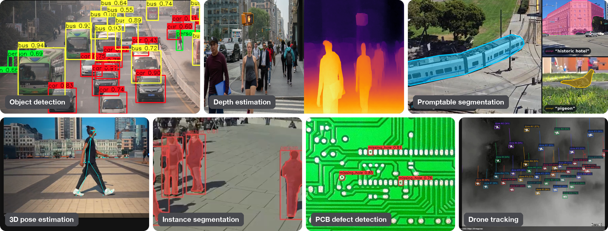
</p>

<h1 align="center">SiMa.ai Neat Apps</h1>

<p align="center">
  Ready-to-run computer vision and GenAI applications for SiMa.ai Modalix,<br>
  written in C++ and Python on the Neat Library.
</p>

<p align="center">
  <a href="https://github.com/sima-neat/apps/actions/workflows/vulcan-ci.yml"></a>
  
  
  
  <a href="LICENSE"></a>
</p>

<p align="center">
  <a href="https://developer.sima.ai/examples">Apps Portal</a> ·
  <a href="https://developer.sima.ai/software/getting-started/">Neat Documentation</a> ·
  <a href="https://developer.sima.ai/software/tools/sima-cli/">sima-cli</a> ·
  <a href="https://developer.sima.ai/software/tools/insight/">Insight</a> ·
  <a href="https://github.com/sima-neat/apps/issues">Issues</a>
</p>

Every application runs on Modalix from one installed bundle: a
pre-built C++ executable, a Python entrypoint, one `config.yaml` with every
customer-facing setting, and a README with the model, the run command, and the
expected result. Install the bundle to run the examples. Clone this repository
only to modify or build their source.

## Quick Start

Run the first example on a Modalix DevKit in four steps. The DevKit needs
internet access. Without it, run steps 1 and 2 under `/workspace` in a Neat SDK
container paired with the DevKit, and the rest on the DevKit. See
[Install Apps](#install-apps).

1. Install Apps and enter the bundle. The installer also installs the Core and
   Insight selected for this Apps package.

   ```bash
   sima-cli neat install apps
   cd prebuilt-apps
   APP_DIR=examples/object-detection/yolo26-object-detector
   ```

2. Download the YOLO26 model. Model Zoo downloads need your SiMa Developer
   Portal login: run `sima-cli login` once, or follow the device-login prompt
   the first download prints.

   ```bash
   export MODELZOO_VERSION="3.0.0"
   mkdir -p models
   cd models
   sima-cli download "https://docs.sima.ai/pkg_downloads/SDK${MODELZOO_VERSION}/models/modalix/yolo26-detection/yolo26m-det-bf16-mla_tess-b1.tar.gz"
   cd ..
   ```

3. Point the example at the model. The packaged `config.yaml` already reads
   the shipped `assets/datasets/coco` folder.

   ```bash
   sed -i 's#<model-path>#models/yolo26m-det-bf16-mla_tess-b1.tar.gz#' ${APP_DIR}/src/common/config.yaml
   ```

4. Run the pre-built executable.

   ```bash
   ./${APP_DIR}/src/cpp/pre-built/yolo26-object-detector \
     --config ${APP_DIR}/src/common/config.yaml
   ```

   The run prints one line per image and writes 21 annotated PNGs to
   `sandbox/yolo26-object-detector/`. The
   [example README](examples/object-detection/yolo26-object-detector/README.md)
   has the Python entrypoint, the other supported models, and troubleshooting.

## Examples

Each example README lists the model, the configuration to set, the run
commands, and the expected result. The
[Apps Portal](https://developer.sima.ai/examples) has the same catalog with
search and filters.

<!-- examples:start -->
30 applications in 13 categories.

| Preview | Applications |
| --- | --- |
| 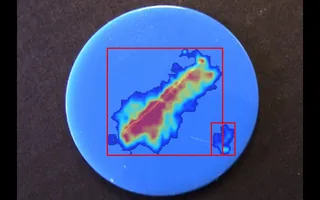 | **Anomaly Detection**<br>[FastFlow Anomaly Detector](examples/anomaly-detection/fastflow-anomaly-detector/README.md) <sub>C++ · Python</sub><br>Flags surface defects on parts in one RTSP stream with an anomaly model trained on good parts only, and sends Insight the video with a defect heatmap drawn on it.<br>[PatchCore Anomaly Detector](examples/anomaly-detection/patchcore-anomaly-detector/README.md) <sub>C++ · Python</sub><br>Detects visual anomalies in industrial images or video using a compiled WideResNet-50 patch-feature extractor and a host-side coreset memory bank calibrated from your own known-good images. |
| 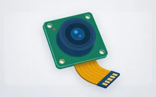 | **Benchmarking**<br>[MIPI Camera Capture](examples/benchmarking/mipi-camera-capture/README.md) <sub>Python</sub><br>Captures NV12 frames from a MIPI camera and saves selected frames with timing and luminance diagnostics. It uses Neat CameraInput with a zero-copy DMA-BUF path.<br>[MIPI Multi-Model](examples/benchmarking/mipi-multi-model/README.md) <sub>Python</sub><br>Runs a selected detection, pose, segmentation, classification, or depth model on a strict zero-copy MIPI camera. Detection and segmentation can also stream video and metadata to Insight.<br>[Model Benchmark](examples/benchmarking/model-benchmark/README.md) <sub>Python</sub><br>Measures latency, throughput, power, and energy for any compiled model package, then saves the results as JSON. |
| 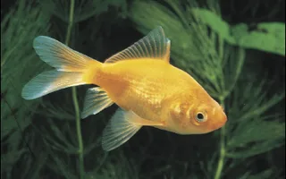 | **Image Classification**<br>[Image Classification Explorer](examples/classification/image-classification-explorer/README.md) <sub>C++ · Python</sub><br>Classifies a single image or a folder of images with one or more models and shows predictions, confidence, and where models agree or disagree in a browsable HTML report with JSON and CSV results. |
| 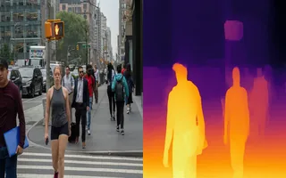 | **Depth Estimation**<br>[Depth Estimator](examples/depth-estimation/depth-estimator/README.md) <sub>C++ · Python</sub><br>Creates visual depth maps for a folder of images with Depth Anything V2. |
| 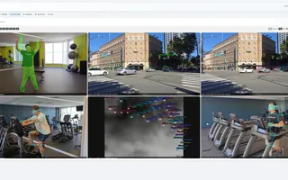 | **Docker**<br>[Parallel Apps in Docker](examples/docker/parallel-apps/README.md) <sub>C++</sub><br>Runs six Neat applications side by side in Docker containers on one Modalix DevKit, each sending live video and results to its own Insight channel. |
| 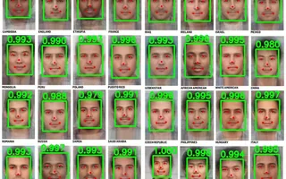 | **Face Detection**<br>[Face Detector](examples/face-detection/face-detector/README.md) <sub>C++ · Python</sub><br>Finds faces in a folder of images with RetinaFace, then saves annotated results with confidence scores and five facial landmarks.<br>[Single-Stream Thermal Face Detector](examples/face-detection/single-stream-thermal-face-detector/README.md) <sub>C++ · Python</sub><br>Detects faces and five facial landmarks in a live thermal RTSP stream with YOLOv5s-Face, then sends the overlay to Insight. |
| 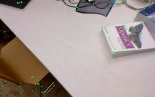 | **Feature Extraction**<br>[SuperPoint Feature Extractor](examples/feature-extraction/superpoint-feature-extractor/README.md) <sub>C++ · Python</sub><br>Finds SuperPoint feature points in an RTSP stream and sends the annotated video to Insight. |
| 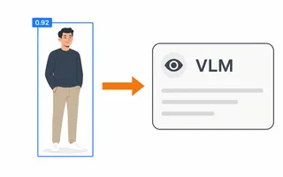 | **GenAI**<br>[Detection-to-VLM Assistant](examples/genai/detection-to-vlm-assistant/README.md) <sub>Python</sub><br>Detects people in a live RTSP stream with YOLO26 and sends video to Insight. It can also crop the highest-confidence person and ask a configured vision-language model about them.<br>[Neat GenAI Studio](examples/genai/neat-genai-studio/README.md) <sub>Python</sub><br>Runs language, vision-language, and speech models on a Modalix device as the board-side backend for the GenAI tab in Neat Insight, with an OpenAI-compatible API. |
| 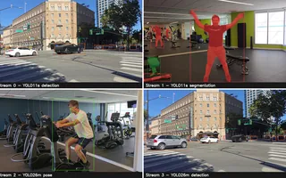 | **Multi Model**<br>[Multi Stream Multi Model](examples/multi-model/multi-stream-multi-model/README.md) <sub>C++ · Python · experimental</sub><br>Runs a different model on each of up to four RTSP cameras in one process, and sends every camera's video and its own detection, segmentation, or pose metadata to Insight. |
| 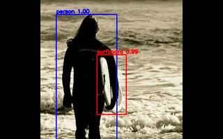 | **Object Detection**<br>[DETR Object Detector](examples/object-detection/detr-object-detector/README.md) <sub>C++ · Python</sub><br>Detects objects in a folder of images with DETR and saves annotated images with class labels and confidence scores.<br>[High-Density Multi-Stream Object Detector](examples/object-detection/high-density-multi-stream-object-detector/README.md) <sub>C++ · Python</sub><br>Runs one YOLO26 detector across 20, 30, or 60 RTSP streams and sends synchronized video and detection metadata to Insight.<br>[Multi-Stream OBB Detector](examples/object-detection/multi-stream-obb-detector/README.md) <sub>C++ · Python</sub><br>Runs YOLO26 oriented-box detection on up to four RTSP streams of top-down aerial video and sends each stream's video and rotated boxes to Insight.<br>[Multi-Stream Object Detector](examples/object-detection/multi-stream-object-detector/README.md) <sub>C++ · Python</sub><br>Runs YOLO26 object detection across multiple RTSP streams and sends each stream's video and detection metadata to Insight.<br>[PCB Defect Detector](examples/object-detection/pcb-defect-detector/README.md) <sub>C++ · Python</sub><br>Batch visual inspection of printed circuit boards with a custom-trained YOLO26n detector. Every image in a folder is run on the MLA and saved back annotated with defect boxes and labels.<br>[PCIe High-Density Multi-Stream Object Detector](examples/object-detection/pcie-high-density-multi-stream-object-detector/README.md) <sub>C++</sub><br>Runs YOLO26 object detection across many RTSP streams using a host and Modalix PCIe card, then sends synchronized results to Insight.<br>[RF-DETR Detection and Segmentation](examples/object-detection/rfdetr-detection-segmentation/README.md) <sub>C++ · Python</sub><br>Run RF-DETR detection or instance segmentation on one H.264, H.265, or MJPEG RTSP stream and view the result in Insight.<br>[Single-Stream Object Detector](examples/object-detection/single-stream-object-detector/README.md) <sub>C++ · Python</sub><br>Detects objects in one RTSP or MJPEG stream with YOLO26 and sends synchronized H.264 video and detection metadata to Insight.<br>[SSD-MobileNet Object Detector](examples/object-detection/ssd-mobilenet-object-detector/README.md) <sub>C++ · Python</sub><br>Detects objects in a folder of images with SSD MobileNet, saves annotated PNGs, and can write the same detections to a JSON report.<br>[YOLO26 Object Detector](examples/object-detection/yolo26-object-detector/README.md) <sub>C++ · Python</sub><br>Detects objects in a folder of images with YOLO26 and saves copies annotated with boxes, labels, and confidence scores. |
| 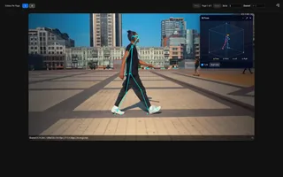 | **Pose Estimation**<br>[Multi-Stream BlazePose 3D](examples/pose-estimation/multi-stream-blazepose3d/README.md) <sub>C++ · Python</sub><br>Tracks people in up to four RTSP streams with YOLO26 and BlazePose Heavy, then sends 2D landmarks and 3D world landmarks for each frame to Insight.<br>[Multi-Stream Pose Estimator](examples/pose-estimation/multi-stream-pose-estimator/README.md) <sub>C++ · Python</sub><br>Estimates 17-point COCO poses in multiple RTSP streams with YOLO26 Pose and sends synchronized video and pose metadata to Insight. |
| 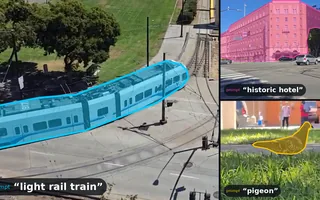 | **Segmentation**<br>[EfficientSAM3 Promptable Segmenter](examples/segmentation/efficientsam3-promptable-segmenter/README.md) <sub>C++ · Python</sub><br>Segments whatever a text prompt names, such as a person or a red car, in one RTSP H.264 or H.265 stream with EfficientSAM3 and sends H.264 video and mask outlines to Insight.<br>[Single Stream Instance Segmenter](examples/segmentation/single-stream-instance-segmenter/README.md) <sub>C++ · Python</sub><br>Segments objects in one RTSP or MJPEG stream with a YOLO26 or YOLOv8 model and sends synchronized H.264 video and mask metadata to Insight. |
| 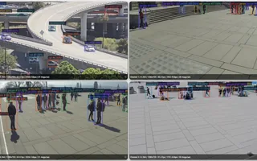 | **Tracking**<br>[Multi-Stream Tracker](examples/tracking/multi-stream-tracker/README.md) <sub>C++ · Python</sub><br>Tracks up to five object classes across multiple RTSP streams with YOLO26, each class with its own ByteTrack tracker settings. Every track gets a stable ID, sent to Insight with its class label.<br>[YOLO26 Tiny-Drone Tracker](examples/tracking/yolo26-tiny-drone-tracker/README.md) <sub>C++ · Python</sub><br>Track tiny drones across up to four RTSP streams with YOLO26 and publish annotated video plus per-stream tracking metadata to Insight. |
<!-- examples:end -->

## Inside an Application

Every example has the same layout, so reading one teaches you all of them:

```text
examples/<category>/<example>/
├── README.md                model, configuration, run commands, expected result
├── src/common/config.yaml   every customer-facing setting: models, paths, hosts, ports, thresholds
├── src/common/              labels and data shared by both implementations
├── src/cpp/                 C++ implementation; the bundle adds pre-built/<binary>
└── src/python/              Python implementation with its requirements.txt
```

Graph construction, model loading, execution, and teardown are visible in each
entrypoint, `src/cpp/main.cpp` and `src/python/main.py`, without wrappers
around the public Neat API. The C++ and Python implementations are kept aligned
in models, thresholds, outputs, and metadata. Applications with live output
publish video and metadata to [Insight](https://developer.sima.ai/software/tools/insight/),
the Neat visualization UI.

## Install Apps

Install on the Modalix DevKit. If the DevKit has no internet access, run the
install under `/workspace` in a Neat SDK container paired with the DevKit.
Pairing shares `/workspace` with the DevKit over NFS, so the bundle appears at
the same path there. The examples always run on the DevKit.

```bash
sima-cli neat install apps
cd prebuilt-apps
```

Use `-d <install-root>` to install `prebuilt-apps/` under another directory.
Run the remaining commands from the installed `prebuilt-apps/` directory.

The installer also installs the Core selected for this Apps package and the
latest Insight through `sima-cli`. From a paired SDK container, Core is
installed on the DevKit as well. After pairing, the DevKit already has the SDK's
Core and Insight runs in the SDK container. If that Core matches the one
selected for this Apps package, run the install as
`NEAT_APPS_SKIP_DEPENDENCIES=1 sima-cli neat install apps` to skip both. The
installer does not check this, so a mismatch appears only when an example runs.
See [Dependency Selection](CONTRIBUTING.md#dependency-selection).

Run the same command with the same installation root to upgrade Apps. Before
replacing an existing installation, the installer asks for confirmation,
carries `models/` into the new bundle, and retains the remaining previous files
under `.prebuilt-apps-backup/`. If that backup already exists, the installer
warns before replacing it.

## Models and Datasets

Models are user-managed and are not included in the Apps package. Store them
under `models/`, or set `model.path` to another readable package. Each example
README lists its default and additional supported models with the
corresponding `sima-cli` or example-specific installation command.

Check the installed platform version to confirm the target is supported:

```bash
cat /etc/buildinfo
```

Model packages are versioned separately from the platform. They come from the
Model Zoo release, which can differ from the installed platform version. Model
Zoo downloads need your SiMa Developer Portal login: run `sima-cli login` once,
or follow the device-login prompt the first download prints. Before
downloading a model, set the Model Zoo version:

```bash
export MODELZOO_VERSION="3.0.0"
```

Runtime sample data is included under `assets/datasets/`.

## Streaming Sources

[Insight](https://developer.sima.ai/software/tools/insight/) can host videos as
streaming sources. Install videos directly from the Insight catalog or through
YouTube support, start the required streams in the Insight Web UI, and copy
their source URLs into the example configuration. Each example README identifies
the required transport, including HTTP MJPEG where supported. Ensure each URL is
reachable from the target.

## Build From Source

Clone and build Apps inside the Neat Development Environment:

```bash
git clone https://github.com/sima-neat/apps.git
cd apps
./build.sh --clean
```

`build.sh` builds the repository; it does not run tests. To fetch one standalone
example without cloning the complete repository:

```bash
curl -fsSL https://raw.githubusercontent.com/sima-neat/apps/main/scripts/get-example.sh | bash -s -- <example>
```

The repository and installed layouts, dependency selection, the example
scaffold, tests, and the review checklist are in
[CONTRIBUTING.md](./CONTRIBUTING.md).

## Support

Use GitHub issues for bug reports and feature requests. Include the example,
command, inputs, environment, and logs required to reproduce the problem.

For direct help, contact `support@sima.ai`.

## License

Neat Apps is released under the [Apache License 2.0](./LICENSE).
