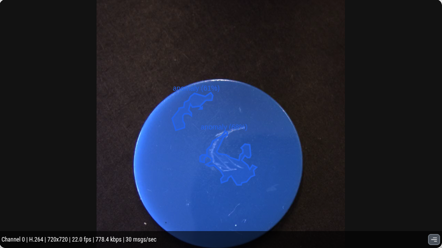

# FastFlow Anomaly Detector

## Metadata

| Field | Value |
| --- | --- |
| Category | anomaly-detection |
| Difficulty | Intermediate |
| Tags | anomaly-detection, fastflow, segmentation, rtsp, insight |
| Languages | C++, Python |
| Status | stable |
| Binary Name | fastflow-anomaly-detector |
| Model | fastflow_demo |

## Concept

Flags surface defects on parts in one H.264, H.265, or MJPEG RTSP stream with an anomaly model trained on good parts only, and outlines each defect in Insight.

```text
How does a frame move through fastflow-anomaly-detector?

╭┄┄┄┄┄┄┄┄┄┄┄┄┄┄┄┄┄┄┄┄┄┄┄┄┄┄┄┄┄┄┄┄┄┄┄┄┄┄┄┄┄┄┄┄┄┄┄┄┄┄┄┄┄┄┄┄┄┄┄┄┄┄┄┄┄╮
┆ RUN                                                             ┆
┆  ┌──────────────────────┐  encoded, as received ┌─────────────┐ ┆
┆  │ RtspEncodedInput     │──────────────────────►│ VideoSender │─────┐
┆  └──────────────────────┘                       └─────────────┘ ┆   │
┆             │ encoded frames                                    ┆   │ video
┆             ▼                                                   ┆   │
┆  ┌──────────────────────┐                                       ┆   │
┆  │ SimaDecode           │                                       ┆   │
┆  └──────────────────────┘                                       ┆   │
┆             │ NV12 frames                                       ┆   │
┆             ▼                                                   ┆   │
┆  ┌──────────────────────┐                                       ┆   │
┆  │ FastFlow Model       │                                       ┆   │
┆  └──────────────────────┘                                       ┆   │
┆             │ anomaly map                                       ┆   │
┆             ▼                                                   ┆   │
┆  ┌──────────────────────┐                                       ┆   │
┆  │ Output "anomaly_map" │                                       ┆   │
┆  └──────────────────────┘                                       ┆   │
╰┄┄┄┄┄┄┄┄┄┄┄┄┄│┄┄┄┄┄┄┄┄┄┄┄┄┄┄┄┄┄┄┄┄┄┄┄┄┄┄┄┄┄┄┄┄┄┄┄┄┄┄┄┄┄┄┄┄┄┄┄┄┄┄┄╯   │
              ▼ pull                                                  │
   ┌────────────────────────────┐                                     │
   │ defect regions (utils/)    │                                     │
   └────────────────────────────┘                                     │
              │ polygons, scores                                      │
              ▼                                                       ▼
   ┌────────────────────────────┐  JSON                        ┌──────────────┐
   │ MetadataSender             │─────────────────────────────►│ Insight      │
   └────────────────────────────┘                              └──────────────┘
```

- `RtspEncodedInput` feeds both `VideoSender`, which passes the video to Insight as received, and `SimaDecode`, whose NV12 frames EV74 converts, stretches to the model input, and normalizes for FastFlow.
- FastFlow returns a square map with, for each pixel, the probability that it does not show a good part. On the host, connected regions at or above `app.anomaly_threshold` that cover at least `app.min_region_px` map pixels are the defects; smaller ones are the speckle a good part produces.
- Each frame's defects go to Insight as `segmentation` metadata, one polygon per region labelled `anomaly` with the region's highest probability, at most `inference.max_detections` per frame. A good part sends no polygon.

A FastFlow package knows one product. The packaged model knows blue discs; for your own product, train with anomalib and plug the compiled package in, see [Use Your Own Model](#use-your-own-model).

## Preview



## Prerequisites

- `sima-cli` ([documentation](https://developer.sima.ai/software/tools/sima-cli/)) on the Modalix DevKit, or in a Neat SDK container paired with it.
- An RTSP source with square frames and an [Insight endpoint](https://developer.sima.ai/software/tools/insight/) reachable from the target.

## Install Apps

Install on the Modalix DevKit, or under `/workspace` in a Neat SDK container paired with it. Only the example itself must run on the DevKit. `sima-cli neat install apps` also offers to install the compatible Neat Library and Insight, and skips them when they are up to date. To keep the Neat Library and Insight you have without being asked, run the install as `NEAT_APPS_SKIP_DEPENDENCIES=1 sima-cli neat install apps`. See [Install Apps](https://github.com/sima-neat/apps/blob/main/README.md#install-apps).

Install the latest Neat Apps runtime and enter the installed bundle:

```bash
sima-cli neat install apps
cd prebuilt-apps
APP_DIR=examples/anomaly-detection/fastflow-anomaly-detector
```

Run the remaining commands from `prebuilt-apps/`.

## Prepare the Model

| `model.id` | Package | Source |
| --- | --- | --- |
| `fastflow_demo` | `fastflow_demo_mpk.tar.gz` | Model Zoo `fastflow_demo`, the default |
| `anomalib` | `<your-model>_mpk.tar.gz` | Compiled from an anomalib FastFlow export, see [Use Your Own Model](#use-your-own-model) |

Model packages come from the Model Zoo release below, which can differ from the installed platform version. Model Zoo downloads need your SiMa Developer Portal login: run `sima-cli login` once, or follow the device-login prompt the first download prints.

```bash
export MODELZOO_VERSION="3.0.0"
mkdir -p models
cd models
sima-cli download "https://docs.sima.ai/pkg_downloads/SDK${MODELZOO_VERSION}/models/modalix/fastflow_demo_mpk.tar.gz"
cd ..
```

The packaged config already points `model.path` at `models/fastflow_demo_mpk.tar.gz`.

## Prepare an RTSP source

1. In Insight, open **Media Sources** and import a clip of your own parts. The packaged `fastflow_demo` model knows only the blue discs it was trained on, so on other parts it flags most frames (300 of 300 on the test streams). A meaningful result on your parts needs a model from [Use Your Own Model](#use-your-own-model).
2. Assign the video under **Streaming Sources** and start the source.
3. Copy its RTSP URL into `input.source` and set `input.codec` to match the video. Use a host and published port reachable from the target, not `localhost`.

## Configure

Edit `$APP_DIR/src/common/config.yaml`:

- Set `input.source`, and `input.codec` to `h264`, `h265`, or `mjpeg`.
- Leave `input.width`, `input.height`, and `input.fps` at 0 to read the frame size and rate from the stream.
- Set `output.insight.host`, `video_port_base`, and `metadata_port_base` to the values reported by Insight.
- Keep `inference.frames: 0` to run until Ctrl-C, or set a frame count.

The frames must be square: the model is trained on square images, and a stretched frame scores worse.

## Run

### C++

```bash
"$APP_DIR/src/cpp/pre-built/fastflow-anomaly-detector" --config "$APP_DIR/src/common/config.yaml"
```

### Python

```bash
source ~/pyneat/bin/activate
pip install -r "$APP_DIR/src/python/requirements.txt"
python3 "$APP_DIR/src/python/main.py" --config "$APP_DIR/src/common/config.yaml"
```

## Expected Result

This application writes nothing to disk; its output is the Insight stream plus a startup line and a closing line, the same from C++ and Python. The lines have this format; the stream size and the counts depend on your clip and model:

```text
source=rtsp://<host>:<port>/<stream> codec=h264 stream=<width>x<height>@<fps> map=256x256 insight=<insight-host-ip> video=9000 metadata=9100
processed=<frames> flagged=<frames-with-a-defect> video_sender=<insight-host-ip>:9000
```

In the Insight viewer, each defect is outlined and labelled `anomaly` with its highest probability, such as `anomaly (81%)` on a scratch. The closing line counts the frames processed and the frames with a defect, and prints after Ctrl-C too. When the nonblocking metadata sender dropped messages because the socket buffer was full, a further line counts them.

## Troubleshooting

- `model.id: unknown value '<id>' (expected anomalib, fastflow_demo)` means `model.id` names no supported package. Use `fastflow_demo` for the Model Zoo package and `anomalib` for your own.
- `input.codec: unknown value '<codec>' (expected h264, h265, mjpeg)` means `input.codec` names a codec this example does not decode.
- `<config> is missing <key>` or `<key> must be <type>` names a key the config lacks or sets to the wrong type. Compare it with the packaged config.
- `failed to probe RTSP frame size: <url>` appears when the source is unreachable from the board or does not report its size. Verify the URL from the board itself, or set `input.width`, `input.height`, and `input.fps`.
- No outline on defective parts: check `model.id` against the package, and that the frames are square.
- Good parts flagged: raise `app.min_region_px`.

## Use Your Own Model

**1. Train and export with anomalib 2.6.** Install anomalib 2.6.2 in a Python environment of its own:

```bash
pip install anomalib==2.6.2
anomalib install
```

From 2.7.0 on, anomalib exports ONNX only through `torch.export`, which writes a different graph at opset 18 that `compile_model.py` does not handle. A model already trained with 2.7.0 needs no retraining: export its checkpoint with 2.6.2.

Train FastFlow on square photos of good parts with [anomalib](https://github.com/open-edge-platform/anomalib), using its `Fastflow` model and `Folder` dataset. Set `flow_steps: 4` and `conv3x3_only: true` in the model config: anomalib's default of 8 steps loses pixel accuracy in bfloat16 on the MLA, 4 steps keep it. Export at 256x256:

```bash
anomalib export --model Fastflow --ckpt_path model.ckpt --export_type onnx --input_size "[256, 256]"
```

**2. Compile.** On the development host, in the Model Compiler environment, from a clone of this repository (the compile helper is not part of the installed bundle):

```bash
activate-model-compiler
python3 examples/anomaly-detection/fastflow-anomaly-detector/scripts/compile_model.py \
  --model model.onnx --calib-images /data/my_product/train/good
```

The script converts the network to bfloat16 and writes `build/model/model_mpk.tar.gz`. It patches two constructs in anomalib's export that the Model Compiler mishandles, the per-image LayerNorm and the 5-D map average; without the patches the package produces noise or does not load. There is no INT8: FastFlow's coupling blocks amplify 8-bit error until the map saturates on every image.

`--calib-images` needs photographs of real good parts even though bfloat16 fits no quantisation scales. Compiled from a synthetic input instead, the same export scores image AUROC 0.50 with the map saturated on every image, against 0.99 with the photographs.

**3. Plug in.** Copy the package to `models/` and change three keys in `config.yaml` together:

```yaml
model:
  id: anomalib               # anomalib packages normalize inside their graph
  path: ../../../../../models/model_mpk.tar.gz
app:
  min_region_px: 1000        # smallest region that counts as a defect; per product
```

For `app.min_region_px`, run the application on good parts and raise the value until the summary reports `flagged=0`, then check that defective parts are still flagged. Measured on MVTec AD bottle on a Modalix, the 4-step model keeps image AUROC 0.99 and pixel AUROC 0.97, and a package runs at about 7 ms per inference.

## Source Files

- C++ reference source: `src/cpp/main.cpp`, with the region extraction in `src/cpp/utils/anomaly_regions.cpp`
- Python implementation: `src/python/main.py`, with the region extraction in `src/python/utils/anomaly_regions.py`
- Shared configuration: `src/common/config.yaml`
- Helpers shared with other examples, with no Neat API calls: `support/python/sima_examples/` in `prebuilt-apps/`, and their C++ reference source in `support/cpp/sima_examples/`

The packaged C++ source is an implementation reference. Run the executable under `src/cpp/pre-built/`; the installed bundle does not include CMake files.

## Development From Source

To modify, compile, or test this example, use the [Apps contributor workflow](https://github.com/sima-neat/apps/blob/main/CONTRIBUTING.md).
