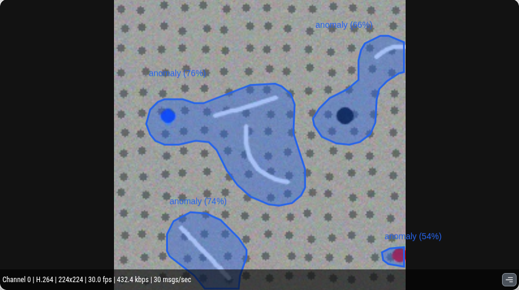

# PatchCore Anomaly Detector

## Metadata

| Field | Value |
| --- | --- |
| Category | anomaly-detection |
| Difficulty | Advanced |
| Tags | anomaly-detection, patchcore, wide-resnet50-2, memory-bank, calibration, rtsp, insight |
| Languages | C++, Python |
| Status | stable |
| Binary Name | patchcore-anomaly-detector |
| Model | patchcore_wide_resnet50_2 |

## Concept

Flags surface defects on parts in one H.264, H.265, or MJPEG RTSP stream, or in a folder of images, by comparing every patch with a memory bank calibrated from your own known-good images, and outlines each defect in Insight.

```text
How does a frame move through patchcore-anomaly-detector?

╭┄┄┄┄┄┄┄┄┄┄┄┄┄┄┄┄┄┄┄┄┄┄┄┄┄┄┄┄┄┄┄┄┄┄┄┄┄┄┄┄┄┄┄┄┄┄┄┄┄┄┄┄┄┄┄┄┄┄┄┄┄┄┄┄┄╮
┆ RUN                                                             ┆
┆  ┌──────────────────────┐  encoded, as received ┌─────────────┐ ┆
┆  │ RtspEncodedInput     │──────────────────────►│ VideoSender │─────┐
┆  └──────────────────────┘                       └─────────────┘ ┆   │
┆             │ encoded frames                                    ┆   │ video
┆             ▼                                                   ┆   │
┆  ┌──────────────────────┐                                       ┆   │
┆  │ SimaDecode           │                                       ┆   │
┆  └──────────────────────┘                                       ┆   │
┆             │ NV12 frames                                       ┆   │
┆             ▼                                                   ┆   │
┆  ┌──────────────────────┐                                       ┆   │
┆  │ PatchCore Model      │                                       ┆   │
┆  └──────────────────────┘                                       ┆   │
┆             │ patch features                                    ┆   │
┆             ▼                                                   ┆   │
┆  ┌──────────────────────┐                                       ┆   │
┆  │ Output "features"    │                                       ┆   │
┆  └──────────────────────┘                                       ┆   │
╰┄┄┄┄┄┄┄┄┄┄┄┄┄│┄┄┄┄┄┄┄┄┄┄┄┄┄┄┄┄┄┄┄┄┄┄┄┄┄┄┄┄┄┄┄┄┄┄┄┄┄┄┄┄┄┄┄┄┄┄┄┄┄┄┄╯   │
              ▼ pull                                                  │
   ┌────────────────────────────┐                                     │
   │ bank scores, regions       │                                     │
   └────────────────────────────┘                                     │
              │ polygons, scores                                      │
              ▼                                                       ▼
   ┌────────────────────────────┐  JSON                        ┌──────────────┐
   │ MetadataSender             │─────────────────────────────►│ Insight      │
   └────────────────────────────┘                              └──────────────┘
```

- `RtspEncodedInput` feeds both `VideoSender`, which passes the video to Insight as received, and `SimaDecode`, whose NV12 frames EV74 converts, stretches to the 224x224 model input, and normalizes as ImageNet.
- The PatchCore model, `wide_resnet50_2` with torchvision `IMAGENET1K_V1` weights, turns each frame into a 28x28 grid of patch features, 1,536 values each.
- On the host, each patch is scored by its distance to the nearest patch of the memory bank, and the worst patch, reweighted as the PatchCore paper does, decides the frame's score. A frame above the calibrated threshold is anomalous: its scores are upsampled to 224x224 and smoothed, and connected regions above the calibrated patch threshold are its defects.
- Each frame's defects go to Insight as `segmentation` metadata, one polygon per region labelled `anomaly` with the region's highest score, at most `inference.max_detections` per frame. A normal frame sends no polygon.
- With `input.type: image_dir`, the host reads each image, stretches it to 224x224, and runs the same model and scoring; it writes each image to `output.dir` with its defects outlined in red.

PatchCore learns only what a good part looks like. `--calibrate` runs the model on your known-good images, keeps a small, diverse set of their patch features as the memory bank, and measures both thresholds on the images it keeps out of the bank. `bank_meta.json` records the model package's hash, so a bank built for another package is rejected at load.

## Preview



## Prerequisites

- `sima-cli` ([documentation](https://developer.sima.ai/software/tools/sima-cli/)) on the Modalix DevKit, or in a Neat SDK container paired with it.
- An RTSP source and an [Insight endpoint](https://developer.sima.ai/software/tools/insight/) reachable from the target, or a folder of images for `input.type: image_dir`.

## Install Apps

Install on the Modalix DevKit, or under `/workspace` in a Neat SDK container paired with it. Only the example itself must run on the DevKit. `sima-cli neat install apps` also offers to install the compatible Neat Library and Insight, and skips them when they are up to date. To keep the Neat Library and Insight you have without being asked, run the install as `NEAT_APPS_SKIP_DEPENDENCIES=1 sima-cli neat install apps`. See [Install Apps](https://github.com/sima-neat/apps/blob/main/README.md#install-apps).

Install the latest Neat Apps runtime and enter the installed bundle:

```bash
sima-cli neat install apps
cd prebuilt-apps
APP_DIR=examples/anomaly-detection/patchcore-anomaly-detector
```

Run the remaining commands from `prebuilt-apps/`.

## Prepare the Model

Model packages come from the Model Zoo release below, which can differ from the installed platform version. Model Zoo downloads need your SiMa Developer Portal login: run `sima-cli login` once, or follow the device-login prompt the first download prints.

```bash
export MODELZOO_VERSION="3.0.0"
mkdir -p models
cd models
sima-cli download "https://docs.sima.ai/pkg_downloads/SDK${MODELZOO_VERSION}/models/modalix/patchcore_wide_resnet50_2_bf16_mla.tar.gz"
cd ..
```

The packaged config already points `model.path` at `models/patchcore_wide_resnet50_2_bf16_mla.tar.gz`.

## Prepare the Memory Bank

The bundled `assets/datasets/patchcore/` set makes the demo reproducible; for your own part, use images of it:

- `nominal/`: 16 known-good images. `app.nominal_images_dir` points here; `--calibrate` builds the bank from 13 of them and measures the thresholds on the other 3.
- `held_out_normal/`: 4 more known-good images that calibration never sees.
- `images/`: one plain image, `plain_0.png`, and four with synthetic scratches, `scratch_0.png` to `scratch_3.png`.

For your own part, point `app.nominal_images_dir` at a folder of its known-good images, a few dozen to start, taken with the camera, framing, and lighting you run with. Then build the bank:

```bash
"$APP_DIR/src/cpp/pre-built/patchcore-anomaly-detector" --calibrate --config "$APP_DIR/src/common/config.yaml"
```

The Python variant builds the same bank, and a bank built by one loads in the other:

```bash
source ~/pyneat/bin/activate
pip install -r "$APP_DIR/src/python/requirements.txt"
python3 "$APP_DIR/src/python/main.py" --calibrate --config "$APP_DIR/src/common/config.yaml"
```

Both print the bank and its thresholds, and write `memory_bank.npy` and `bank_meta.json` to `app.memory_bank_dir`:

```text
bank=4 patches from 13 images threshold=20.5151 patch_threshold=20.3819 (3 held-out images) saved=sandbox/patchcore-anomaly-detector/bank
```

Build the bank again whenever `model.path`, the part, the camera, or an `app.` setting changes.

## Prepare an RTSP source

1. In Insight, open **Media Sources** and import a clip of the part you calibrated on, taken with the same camera, framing, and lighting as the bank's images.
2. Assign the video under **Streaming Sources** and start the source.
3. Copy its RTSP URL into `input.source` and set `input.codec` to match the video. Use a host and published port reachable from the target, not `localhost`.

## Configure

Edit `$APP_DIR/src/common/config.yaml`:

- Set `input.source`, and `input.codec` to `h264`, `h265`, or `mjpeg`.
- Leave `input.width`, `input.height`, and `input.fps` at 0 to read the frame size and rate from the stream.
- Set `output.insight.host`, `video_port_base`, and `metadata_port_base` to the values reported by Insight.
- Keep `inference.frames: 0` to run until Ctrl-C, or set a frame count.
- To score a folder of images instead, set `input.type: image_dir` and `input.source` to the folder, such as `assets/datasets/patchcore/images`, and `output.dir` to the folder for the outlined images.
- Raise `app.coreset_ratio` for a busy or varied scene, where a small bank matches good parts poorly; the PatchCore paper keeps 1 to 10%. Scoring time per frame grows with the bank.

## Run

### C++

```bash
"$APP_DIR/src/cpp/pre-built/patchcore-anomaly-detector" --config "$APP_DIR/src/common/config.yaml"
```

### Python

```bash
source ~/pyneat/bin/activate
python3 "$APP_DIR/src/python/main.py" --config "$APP_DIR/src/common/config.yaml"
```

## Expected Result

With an RTSP source, the output is the Insight stream plus a startup line and a closing line, the same from C++ and Python. The lines have this format; the stream size, the bank size, and the counts depend on your clip and bank:

```text
source=rtsp://<host>:<port>/<stream> codec=h264 stream=<width>x<height>@<fps> bank=<patches> insight=<insight-host-ip> video=9000 metadata=9100
processed=<frames> flagged=<anomalous-frames> video_sender=<insight-host-ip>:9000
```

In the Insight viewer, each defect is outlined and labelled `anomaly` with its highest score. The closing line counts the frames processed and the anomalous frames, and prints after Ctrl-C too. When the nonblocking metadata sender dropped messages because the socket buffer was full, a further line counts them.

With `input.type: image_dir` and the bundled `images/`, each image prints its verdict, and the outlined images go to `output.dir`:

```text
plain_0.png: normal score=16.80 threshold=20.52 regions=0
scratch_0.png: ANOMALOUS score=34.67 threshold=20.52 regions=3
...
processed=5 flagged=4 output=sandbox/patchcore-anomaly-detector
```

## Troubleshooting

- `no memory bank in <dir>; run with --calibrate first` means `app.memory_bank_dir` holds no bank. Run `--calibrate`.
- `memory bank was built against a different model package` means `model.path` changed since the last `--calibrate`. Build the bank again.
- `input.type: unknown value '<type>' (expected image_dir, rtsp)` or `input.codec: unknown value '<codec>' (expected h264, h265, mjpeg)` names a value this example does not support.
- `<config> is missing <key>` or `<key> must be <type>` names a key the config lacks or sets to the wrong type. Compare it with the packaged config.
- `failed to probe RTSP frame size: <url>` appears when the source is unreachable from the board or does not report its size. Verify the URL from the board itself, or set `input.width`, `input.height`, and `input.fps`.
- Every frame of a new camera is anomalous: calibrate on known-good images from that camera, at the framing you run with. PatchCore expects a fixed camera and a steady scene; camera motion and lighting changes raise every score.

## Source Files

- C++ reference source: `src/cpp/main.cpp`, with the memory bank in `src/cpp/utils/memory_bank.h` and `.cpp`, and the region extraction in the shared `support/cpp/sima_examples/anomaly_regions.cpp`
- Python implementation: `src/python/main.py`, with the memory bank in `src/python/utils/memory_bank.py`, and the region extraction in the shared `support/python/sima_examples/anomaly_regions.py`
- Shared configuration: `src/common/config.yaml`

The packaged C++ source is an implementation reference. Run the executable under `src/cpp/pre-built/`; the installed bundle does not include CMake files.

## Development From Source

To modify, compile, or test this example, use the [Apps contributor workflow](https://github.com/sima-neat/apps/blob/main/CONTRIBUTING.md).
