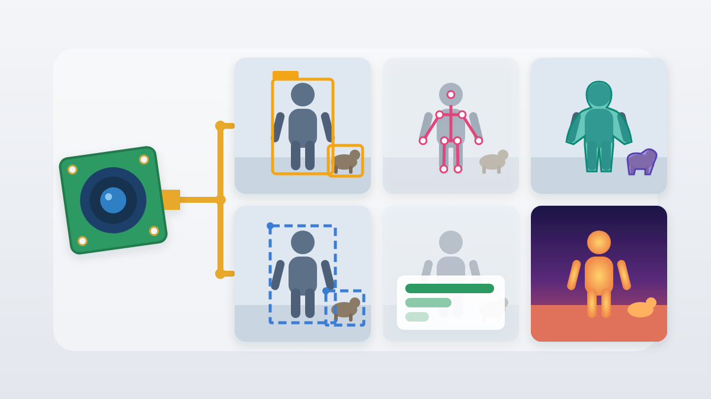

# MIPI Multi-Model

## Metadata

| Field | Value |
| --- | --- |
| Category | benchmarking |
| Difficulty | Intermediate |
| Tags | camera, mipi, zero-copy, yolo26, pose, segmentation, classification, depth |
| Languages | Python |
| Status | stable |
| Binary Name | mipi-multi-model |
| Model | YOLO26, SSD-MobileNet V2, ResNet-50, MiDaS |

## Concept

Runs a selected detection, pose, segmentation, classification, or depth model on a strict zero-copy MIPI camera. Detection and segmentation can also stream video and metadata to Insight.

The application loads one profile per process, keeping MLA memory use predictable while making each task independently testable.

## Preview



## Prerequisites

- `sima-cli` ([documentation](https://developer.sima.ai/software/tools/sima-cli/)) on a supported Modalix or DevKit target.
- A MIPI camera supported by the installed kernel, libcamera pipeline, and IPA configuration.
- A Neat Library and libcamera release that supports downstream-owned camera capture buffers.

Confirm that libcamera sees the camera and that `libcamerasrc` provides the
`external-buffer-mode` property that strict zero-copy capture requires:

```bash
cam -l
gst-inspect-1.0 libcamerasrc | grep external-buffer-mode
```

## Install Apps

Install the latest Neat Apps runtime and enter the installed bundle:

```bash
sima-cli neat install apps
cd prebuilt-apps
APP_DIR=examples/benchmarking/mipi-multi-model
```

Run the remaining commands from `prebuilt-apps/`.

## Prepare the Model

The default profile uses YOLO26n detection. Every profile consumes a compiled `.tar.gz` package directly.

| Profile | Task | Model package |
| --- | --- | --- |
| `detect` | YOLO26n detection | `yolo_26n_mpk.tar.gz` |
| `pose` | YOLO26n pose | `yolo_26n_pose_mpk.tar.gz` |
| `segment` | YOLO26n instance segmentation | `yolo_26n_seg_mpk.tar.gz` |
| `ssd` | SSD-MobileNet V2 detection | `ssd_mobilenet_v2_modalix_int8_tess_mla_mpk.tar.gz` |
| `classify` | ResNet-50 classification | `resnet_50_mpk.tar.gz` |
| `depth` | MiDaS v2.1 Small depth | `midas_v21_small_256_mpk.tar.gz` |

Model packages come from the Model Zoo release below, which can differ from the installed platform version. Download the packages for the profiles you plan to run into `models/`:

```bash
export MODELZOO_VERSION="2.1.3"
mkdir -p models
cd models
sima-cli modelzoo -v "${MODELZOO_VERSION}" --boardtype modalix get yolo_26n
sima-cli modelzoo -v "${MODELZOO_VERSION}" --boardtype modalix get yolo_26n_pose
sima-cli modelzoo -v "${MODELZOO_VERSION}" --boardtype modalix get yolo_26n_seg
sima-cli modelzoo -v "${MODELZOO_VERSION}" --boardtype modalix get resnet_50
sima-cli modelzoo -v "${MODELZOO_VERSION}" --boardtype modalix get midas_v21_small_256
sima-cli download \
  "https://docs.sima.ai/pkg_downloads/SDK${MODELZOO_VERSION}/models/modalix/ssd_mobilenet_v2_modalix_int8_tess_mla_mpk.tar.gz"
cd ..
```

Each profile reads `models/<model package>` by default.

## Configure

Open `${APP_DIR}/src/common/config.yaml`. Change only `model.profile`; set `model.path` only when using a package outside `models/`. `runtime.frames` controls how many results are pulled.

The camera path captures 1920x1080 NV12 at 30 FPS. Neat owns MPK parsing, model compatibility, decoding, and the EV74 preprocessing/postprocessing stages.

The graph ends with a manually added, named output so the composition is explicit:

```python
camera_graph.add(pyneat.nodes.camera_input(camera_options))
model_graph = model.graph(route)
model_graph.add(pyneat.nodes.output("results"))
```

## Run

List the available profiles:

```bash
source ~/pyneat/bin/activate
pip install -r ${APP_DIR}/src/python/requirements.txt
python3 ${APP_DIR}/src/python/main.py --list-profiles
```

Run the configured profile, or select one on the command line:

```bash
python3 ${APP_DIR}/src/python/main.py \
  --config ${APP_DIR}/src/common/config.yaml \
  --describe

python3 ${APP_DIR}/src/python/main.py \
  --config ${APP_DIR}/src/common/config.yaml \
  --profile pose
```

Stream YOLO26 detection or segmentation to Insight:

```bash
python3 ${APP_DIR}/src/python/main.py \
  --profile segment \
  --model models/yolo_26n_seg_mpk.tar.gz \
  --continuous \
  --insight-host 192.168.1.127 \
  --insight-video-port 9000 \
  --insight-metadata-port 9100 \
  --insight-channel 0
```

The Insight graph uses `RealtimeLatestByStream` independently for the model and video branches, preventing either consumer from building a stale camera-frame backlog. Segmentation metadata includes per-instance polygons, class labels, confidence, and bounding boxes.

The application rejects the graph before execution, with or without Insight, unless the camera
captures into downstream-owned DMA-BUFs and Neat's camera bridge refuses CPU copies.

## Expected Result

Each frame prints the selected profile and a task-specific summary, followed by a `PASS` line. For example:

```text
frame=0 profile=detect detections=6
PASS strict-zero-copy MIPI -> YOLO26n object detection -> results
```

## Troubleshooting

- If camera discovery fails, confirm that `cam -l` reports a camera and that the correct overlay is installed.
- If model loading fails, confirm the file is a compiled `.tar.gz` model package compatible with the installed Neat runtime. Neat owns package parsing and compatibility validation.
- If the application reports that strict zero-copy requires `external-buffer-mode`, the installed `libcamerasrc` cannot capture into downstream-owned buffers. Install a platform release whose libcamera provides that property.
- Run with `--validate-model-only` to inspect the package without loading Neat or opening the camera.

## Source Files

- Python source: `src/python/main.py`
- Model profile and package handling: `src/python/model_profiles.py`
- Shared runtime configuration: `src/common/config.yaml`

## Development From Source

To modify or test this example, use the [Apps contributor workflow](https://github.com/sima-neat/apps/blob/main/CONTRIBUTING.md).
