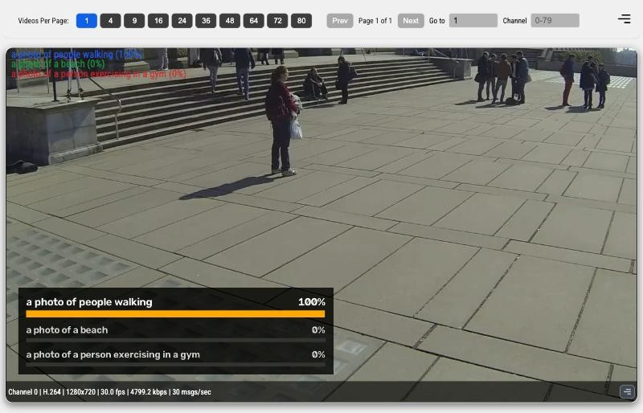

# CLIP Zero-Shot Classifier

## Metadata

| Field | Value |
| --- | --- |
| Category | classification |
| Difficulty | Intermediate |
| Tags | classification, clip, zero-shot, open-vocabulary, text-prompts, rtsp, insight |
| Languages | C++, Python |
| Status | stable |
| Binary Name | clip-zero-shot-classifier |
| Model | clip_vit_b_16 |

## Concept

Classifies every frame of an RTSP stream against text prompts you write, using CLIP ViT-B/16, and sends the video with the three best-matching prompts drawn into it to Insight.

At startup the application reads the prompts from a text file, one per line, and runs the CLIP text encoder once per prompt. It then decodes one RTSP stream (H.264, H.265, or MJPEG) on the DevKit and runs the CLIP image encoder on every frame. For each frame it compares the image with every prompt, draws the top three prompts and their probabilities into the frame, and sends the frame to Insight. It also sends the top three prompts to Insight as metadata.

The probability is a softmax over the prompts in the file. It ranks the prompts against each other, so a frame that matches none of them still shows a winner. Write prompts that contrast with each other and together cover what the camera can see. The metadata also carries each prompt's raw cosine similarity with the frame, which does not depend on the other prompts.

## Preview



## Prerequisites

- `sima-cli` ([documentation](https://developer.sima.ai/software/tools/sima-cli/)) on the Modalix DevKit, or in a Neat SDK container paired with it.
- An RTSP H.264, H.265, or MJPEG source and an [Insight](https://developer.sima.ai/software/tools/insight/) URL reachable from the DevKit.

## Install Apps

Install on the Modalix DevKit, or under `/workspace` in a Neat SDK container paired with it. Only the example itself must run on the DevKit. `sima-cli neat install apps` also offers to install the compatible Neat Library and Insight, and skips them when they are up to date. To keep the Neat Library and Insight you have without being asked, run the install as `NEAT_APPS_SKIP_DEPENDENCIES=1 sima-cli neat install apps`. See [Install Apps](https://github.com/sima-neat/apps/blob/main/README.md#install-apps).

Install the latest Neat Apps runtime and enter the installed bundle:

```bash
sima-cli neat install apps
cd prebuilt-apps
APP_DIR=examples/classification/clip-zero-shot-classifier
```

Run the remaining commands from `prebuilt-apps/`.

## Prepare the Model

The application uses the CLIP ViT-B/16 package `clip_vit_b_16`, variant `w8a16`, from the `develop` branch of the [Model Registry](https://developer.sima.ai/models/?branch=develop). Download and extract it:

```bash
sima-cli models download --id clip_vit_b_16 --variant w8a16 --branch develop -o models
unzip models/clip_vit_b_16/w8a16/clip_vit_b_16_w8a16_default.zip -d models/clip_vit_b_16/w8a16
```

The package lands in `models/clip_vit_b_16/w8a16/` with four files:

| File | Role |
| --- | --- |
| `clip_vit_b_16_w8a16_image_encoder_mpk.tar.gz` | Image encoder, runs on every frame |
| `clip_vit_b_16_w8a16_text_encoder_mpk.tar.gz` | Text encoder, runs once per prompt at startup |
| `text_encoder/tokenizer.json` | CLIP tokenizer, splits each prompt into token IDs on the CPU |
| `text_encoder/token_embeddings.npy` | Token-embedding table, turns the token IDs into the text encoder's input on the CPU |

CLIP ViT-B/16 is OpenAI's image-text model ([openai/clip-vit-base-patch16](https://huggingface.co/openai/clip-vit-base-patch16)), released under the MIT License.

## Configure

For a sample stream, open the Insight Web UI, import a video under Media Sources from the catalog or your own file, start it, and copy its RTSP URL. Use a host the DevKit can reach, not `localhost`.

Open `${APP_DIR}/src/common/config.yaml`. Set:

- `model.image_encoder`, `model.text_encoder`, `model.tokenizer`, and `model.token_embeddings` to the four files under `models/clip_vit_b_16/w8a16/`.
- `source.rtsp_url` to the stream, and `source.codec` to `h264`, `h265`, or `mjpeg` to match it.
- `output.insight.host` to the Insight host, and the video and metadata ports if Insight uses other ports.

The prompts are in `${APP_DIR}/src/common/prompts.txt`, one per line. Replace them with prompts that describe what your camera sees.

## Run

### C++

```bash
./${APP_DIR}/src/cpp/pre-built/clip-zero-shot-classifier \
  --config ${APP_DIR}/src/common/config.yaml
```

### Python

```bash
source ~/pyneat/bin/activate
pip install -r ${APP_DIR}/src/python/requirements.txt
python3 ${APP_DIR}/src/python/main.py \
  --config ${APP_DIR}/src/common/config.yaml
```

## Expected Result

On startup both applications print the stream, the number of prompts, and the Insight target. `text_encoding_s` is the time to encode every prompt and `graph_build_s` the time to load the image encoder and start the graph, in seconds:

```text
rtsp=rtsp://<insight-host-ip>:8554/src1 stream=1280x720@30 codec=h264 prompts=10 text_encoding_s=<s> graph_build_s=<s> insight=<insight-host-ip> video=9000 metadata=9100 channel=0
```

Open the Insight video viewer for channel 0. A dark panel at the bottom left of the video lists the top three prompts for that frame, best first. Each row shows the prompt, a bar as long as its probability, and the percentage. The best prompt has larger, brighter text and an amber bar. A prompt too long for the panel ends in `...`.

Insight also prints the three prompts as small text at the top left of the video, from the metadata. To hide that text, turn off **Show Overlay** for Classification in the viewer settings. Each classified frame sends one `classification` message, for example:

```json
{
  "type": "classification",
  "timestamp": 3752,
  "frame_id": "51",
  "data": {
    "top_classes": [
      {
        "label": "a photo of a city street intersection",
        "confidence": 0.9918,
        "similarity": 0.3224
      },
      {
        "label": "a photo of cars in a parking garage",
        "confidence": 0.0033,
        "similarity": 0.2652
      },
      {
        "label": "a photo of people walking",
        "confidence": 0.0025,
        "similarity": 0.2627
      }
    ]
  }
}
```

`confidence` is the softmax probability over all prompts, and `similarity` is the cosine similarity between the frame and the prompt.

The application runs until Ctrl-C, or until it has classified `inference.frames` frames when that is positive, and then prints a summary. `skipped_frames` counts decoded frames that the image encoder did not classify:

```text
processed=<n> skipped_frames=<n> video_sender=<insight-host-ip>:9000
```

With `runtime.profile` set, it also prints one line every `runtime.profile_interval` classified frames: the classification rate in frames per second, the wall time per frame to read the image encoder's output and rank the prompts, the wall time per frame to copy the frame, draw the panel, and send the frame to the video sender, both in milliseconds, the frames skipped in that window, and the top prompt with its probability:

```text
[profile] frames=100 classified_fps=<fps> ranking_ms=<ms> panel_ms=<ms> skipped_frames=<n> top='<prompt>' confidence=<probability>
```

On a Modalix DevKit with Platform 3.0 and the MLA clock at 1 GHz, both applications drew the panel into every frame of 1280x720 streams: 30 frames per second of 30 FPS H.264, H.265, and MJPEG, and 60 frames per second of 60 FPS H.264. After the first 100 frames they skipped no frame. The panel took about 2 ms per frame in Python and 1.2 ms in C++.

## Limitations

- One stream per run.
- At least two prompts, each at most 75 tokens. Startup stops with an error that names a longer prompt.
- Prompts are plain text. Letters such as é, ß, Cyrillic, and CJK tokenize as CLIP does. Write digits as ASCII 0-9. Superscripts, scripts with combining marks such as Hindi, and the capitals İ and word-final Σ can tokenize differently from CLIP.
- The application reads the prompts at startup. Restart it to use new ones.
- The panel in the video draws ASCII text only. Other letters in a prompt appear as `?` there. The metadata keeps the prompt as written.
- The frame is stretched to the model's 224x224 input, so a wide frame looks narrower to the model.

## Troubleshooting

- If startup reports that it could not read the frame size or that the stream is in another codec, check the stream URL and set `source.codec` to match.
- If nothing appears in Insight, check `output.insight.host` and the UDP ports.

## Source Files

- C++ reference source: `src/cpp/main.cpp` and the tokenizer `src/cpp/clip_tokenizer.h`
- Python source: `src/python/main.py` and the tokenizer `src/python/clip_tokenizer.py`
- Shared config and prompts: `src/common/config.yaml` and `src/common/prompts.txt`
- The tokenizer follows OpenAI CLIP, under the MIT license in `src/common/LICENSE-CLIP.txt`

The packaged C++ source is an implementation reference. Run the executable under `src/cpp/pre-built/`. The installed bundle does not include CMake files.

## Development From Source

To modify, compile, or test this example, use the [Apps contributor workflow](https://github.com/sima-neat/apps/blob/main/CONTRIBUTING.md).
