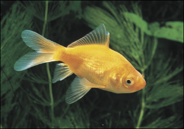
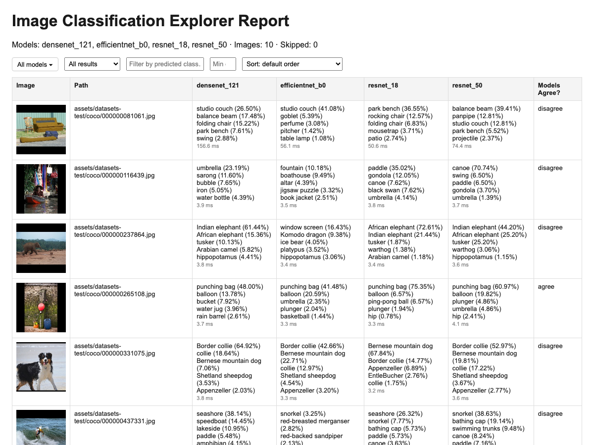

# Image Classification Explorer

## Metadata

| Field | Value |
| --- | --- |
| Category | classification |
| Difficulty | Beginner |
| Tags | classification, model, mpk, report |
| Languages | C++, Python |
| Status | stable |
| Binary Name | image-classification-explorer |
| Model | resnet_50, resnet_18, efficientnet_b0, densenet_121 |

## Concept

Classifies a single image or a folder of images with one or more models and shows predictions,
confidence, and where models agree or disagree in a browsable HTML report with JSON and CSV
results.

## Preview

The pipeline classifies this goldfish image by default:



## Prerequisites

- `sima-cli` ([documentation](https://developer.sima.ai/software/tools/sima-cli/)) on the Modalix DevKit, or in a Neat SDK container paired with it.

## Install Apps

Install on the Modalix DevKit, or under `/workspace` in a Neat SDK container paired with it. Only the example itself must run on the DevKit. If the Core and Insight selected by Apps are already installed, run the install as `NEAT_APPS_SKIP_DEPENDENCIES=1 sima-cli neat install apps` to skip reinstalling them. See [Install Apps](https://github.com/sima-neat/apps/blob/main/README.md#install-apps).

Install the latest Neat Apps runtime and enter the installed bundle:

```bash
sima-cli neat install apps
cd prebuilt-apps
APP_DIR=examples/classification/image-classification-explorer
```

Run the remaining commands from `prebuilt-apps/`.

## Prepare the Model

| Model package | Model Zoo name |
| --- | --- |
| `resnet_50_mpk.tar.gz` | `resnet_50` |
| `resnet_18_mpk.tar.gz` | `resnet_18` |
| `efficientnet_b0_mpk.tar.gz` | `efficientnet_b0` |
| `densenet_121_mpk.tar.gz` | `densenet_121` |

Model packages come from the Model Zoo release below, which can differ from the installed platform version.

```bash
export MODELZOO_VERSION="2.1.3"
mkdir -p models
cd models
sima-cli modelzoo -v "${MODELZOO_VERSION}" get resnet_50
sima-cli modelzoo -v "${MODELZOO_VERSION}" get resnet_18
sima-cli modelzoo -v "${MODELZOO_VERSION}" get efficientnet_b0
sima-cli modelzoo -v "${MODELZOO_VERSION}" get densenet_121
cd ..
```

Each model is its own profile in the config; add more supported classification models the same
way by adding another entry under `models`.

## Configure

Open `${APP_DIR}/src/common/config.yaml`:

- `models.<name>.path` — path to each downloaded model package.
- `io.input` — a single image path or a directory of images. The directory is read one level
  deep: files directly inside it are classified and subdirectories are ignored. Leave empty to
  classify the bundled sample goldfish image (downloads it on first run; needs network access).
- `io.output_dir` — dedicated directory where the selected reports and
  `thumbnails/` are written; each run replaces its previous contents.
- `io.output_format` — which reports to write: any of `html`, `json`, `csv`.
  Ships as `[html]`; `thumbnails/` is written only when `html` is selected.

Remove a `models` entry to run with fewer models, or add one to compare an additional model.
Profile names may contain letters, digits, `_` and `-` (they become config keys, report columns
and CSV/JSON fields). Each profile is fully self-contained:

| Field | Meaning |
| --- | --- |
| `path` | Compiled model package. |
| `input_width` / `input_height` | Model input dimensions. |
| `preprocess` | Preprocessing preset. Only `imagenet` (standard ImageNet normalization) is implemented. |
| `output` | Output interpretation. Only `softmax` is implemented: the model produces raw per-class scores, softmax is applied, and index `i` maps to `label_map[i]`. |
| `num_classes` | Number of classes the model outputs. |
| `label_map` | Path to a text file with one label per line (line index = class id; blank lines within the first `num_classes` lines are rejected). Omit for numeric labels. |
| `top_k` | How many predictions to keep per image. |

`preprocess` and `output` exist so a future model that needs different normalization or output
handling can declare it explicitly instead of being silently misinterpreted; adding support for a
new value is a small, explicit code change in both `main.py` and `main.cpp`.

## Run

### C++

```bash
./${APP_DIR}/src/cpp/pre-built/image-classification-explorer \
  --config ${APP_DIR}/src/common/config.yaml
```

### Python

```bash
source ~/pyneat/bin/activate
pip install -r ${APP_DIR}/src/python/requirements.txt
python3 ${APP_DIR}/src/python/main.py \
  --config ${APP_DIR}/src/common/config.yaml
```

## Understanding the Report

Each run writes to `io.output_dir` (default `sandbox/report/`). `io.output_format`
selects which of these are written; it ships as `[html]`, and the formats are
`html`, `json` and `csv`:

| File | Written when | Contents |
| --- | --- | --- |
| `report.html` | `html` | Browsable report: thumbnails, per-model predictions and confidence, agreement/disagreement, filtering, sorting. |
| `thumbnails/` | `html` | Small JPEG copies of each classified image, referenced by `report.html`. |
| `report.json` | `json` | Same results in machine-readable form: predictions, timing, per-class summary, skipped files. |
| `report.csv` | `csv` | Flat per-image, per-model rows: top-1 class, confidence, inference time, full top-k. |

The thumbnails follow `html` because nothing else references them; for 21 images
they were 288 KB of roughly 420 KB written, so a run that only needs `json`
writes considerably less. Request several formats with
`output_format: [html, json, csv]`.

Open `report.html` in a browser. It lists every classified image with a thumbnail and each
selected model's top predictions and confidence. Use the controls above the table to:

- Check or uncheck models to show or hide their columns and recompute agreement for just the
  models you pick.
- Filter by result (all / agreement / disagreement / errors), by predicted class (text search), or
  by a minimum confidence threshold.
- Sort by confidence, predicted class, or result.

Example report (4 models against a directory of images):



Files with an unsupported extension are listed under **Skipped files** and are not classified;
subdirectories of the input directory are not listed, since the scan is one level deep.
Files with a supported extension that cannot be decoded stay in the main table with a per-model
`error` cell (and, when `json` is selected, an `errors` entry in `report.json`);
neither case stops the run.

One run writes one report. Two runs publishing into the same `io.output_dir` at
the same time is not supported and is not detected: give each concurrent run its
own output directory. A run interrupted part-way through replacing the directory
costs the previous report; the next run writes a fresh one.

**How large a collection is practical.** The input directory is not capped, but
the report is one HTML page and every result is held in memory until it is
written, so the collection size that is useful is smaller than the one that
fits. Measured on a Modalix DevKit with the four models above, at about 288 ms
and 6 KB of report per image:

| Images | Run time | `report.json` | `report.html` |
| ---: | ---: | ---: | ---: |
| 1,000 | ~5 min | 3 MB | 3 MB |
| 10,000 | ~48 min | 34 MB | 26 MB |
| 50,000 | ~4 h | 170 MB | 130 MB |
| 100,000 | ~8 h | 340 MB | 259 MB |

Past roughly 10,000 images `report.html` stops being practical to open and
browse, which is what the report is for, and a large enough collection can
exhaust memory and end the run with no report at all. Split bigger collections
across several runs, each with its own `io.output_dir`.

Each run replaces the previous contents of `io.output_dir` as a unit, so the directory is either
the complete previous report or the complete new one. Use an empty or dedicated directory: a run
only replaces a directory that carries the hidden `.image-classification-explorer-report` marker
from a previous run and holds nothing else; any other non-empty directory is refused.

## Expected Result

Both implementations write the same report, so the check is the same whichever
you ran: the run ends with a summary naming the report directory, and every
model agrees on the sample image.

```text
Done in 3292.5 ms. Report written to sandbox/report
  report.html, thumbnails/
```

The summary names the files that run actually wrote, so it follows
`io.output_format`: with the shipped `[html]` it lists `report.html` and
`thumbnails/`, and adding `json` or `csv` adds those.

With `io.input` left `null`, the bundled goldfish sample is classified by every
profile in `config.yaml`. Opening `report.html` should show class `1` winning
for each model. The same results read more compactly from `report.csv`, which
needs `csv` in `io.output_format`:

```text
image                     model            status  top1_class_id  top1_label  top1_probability
/tmp/sima_imagenet_...    resnet_50        ok      1              goldfish    0.9462
/tmp/sima_imagenet_...    resnet_18        ok      1              goldfish    0.9995
/tmp/sima_imagenet_...    efficientnet_b0  ok      1              goldfish    0.7786
/tmp/sima_imagenet_...    densenet_121     ok      1              goldfish    0.9586
```

Exact probabilities vary with the model package; what matters is that class `1`
wins for every profile and that `status` is `ok` rather than `error`. The two
implementations produce identical `report.csv`, `report.html` and thumbnail
names for the same input, once the separately measured per-image `inference_ms`
and total time are excluded. Those timings differ between any two runs by
design; anything else differing between the two implementations is a defect.

A per-image failure does not stop the run: the image keeps its row and the
failing model gets an `error` cell in the report and a line on stderr, so a
partial result is always visible rather than silently missing.

```text
  images/broken.jpg: resnet_50 failed: Failed to read image: images/broken.jpg
```

If `validation.expected_class_id` is set and the sample does not match it, the
run still writes its report and notes the mismatch on stderr rather than
failing:

```text
Note: resnet_50 top1=393 (0.4871) did not match expected_class_id=1
  (min_probability=0.2); see report for details.
```

## Troubleshooting

- Verify each `models.<name>.path` if a model fails to load.
- Set `io.input` to a readable local image or directory if downloading or decoding the fallback
  image fails.
Both entrypoints report failures the same way, so a script can branch on the
exit code regardless of the language it ran:

| Exit code | Meaning |
| ---: | --- |
| `0` | The run completed and the report was written. |
| `2` | The command line or `config.yaml` is wrong (`Invalid configuration: ...`). |
| `3` | The input could not be read: a missing path, an empty directory, or a failed fallback download. |
| `6` | A model or the report itself failed at runtime. |

A per-image, per-model inference failure does not fail the run: it is recorded
in the report and the exit code stays `0`.

- Check `report.json`'s `skipped` list and each image's `errors` object for files that failed to
  process (add `json` to `io.output_format`; `report.html` shows the same failures in its
  per-model cells). `errors` is keyed by model name, so one image can record a failure for one
  model while retaining predictions from the others.

## Source Files

- C++ reference source: `src/cpp/main.cpp`
- Python source: `src/python/main.py`
- Shared config: `src/common/config.yaml`
- Bundled ImageNet label map: `src/common/imagenet_labels.txt`
- Shared report assets used by both implementations: `src/common/report.css`, `src/common/report.js`

The packaged C++ source is an implementation reference. Run the executable under `src/cpp/pre-built/`; the installed bundle does not include CMake files.

## Development From Source

To modify, compile, or test this example, use the [Apps contributor workflow](https://github.com/sima-neat/apps/blob/main/CONTRIBUTING.md).
