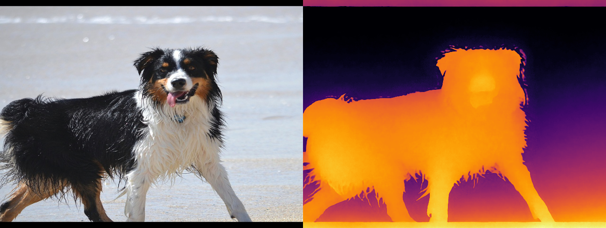

# Depth Estimator

## Metadata

| Field | Value |
| --- | --- |
| Category | depth-estimation |
| Difficulty | Intermediate |
| Tags | depth-estimation, depth-anything, folder-inference |
| Languages | C++, Python |
| Status | stable |
| Binary Name | depth-estimator |
| Model | depth_anything_v2_small |

## Concept

Creates visual depth maps for a folder of images with Depth Anything V2.

## Preview



## Prerequisites

- `sima-cli` ([documentation](https://developer.sima.ai/software/tools/sima-cli/)) on the Modalix DevKit, or in a Neat SDK container paired with it.

## Install Apps

Install on the Modalix DevKit, or under `/workspace` in a Neat SDK container paired with it. Only the example itself must run on the DevKit. `sima-cli neat install apps` also offers to install the compatible Neat Library and Insight, and skips them when they are up to date. To keep the Neat Library and Insight you have without being asked, run the install as `NEAT_APPS_SKIP_DEPENDENCIES=1 sima-cli neat install apps`. See [Install Apps](https://github.com/sima-neat/apps/blob/main/README.md#install-apps).

Install the latest Neat Apps runtime and enter the installed bundle:

```bash
sima-cli neat install apps
cd prebuilt-apps
APP_DIR=examples/depth-estimation/depth-estimator
```

Run the remaining commands from `prebuilt-apps/`.

## Prepare the Model

| Model | Variants | Role | Source |
| --- | --- | --- | --- |
| `depth_anything_v2_small` | `w8a8_mixed` | Default | Model browser |
| `depth_anything_v2_small` | `w16a16`, `w8a16` | Alternatives | Model browser |

Download the default package from the [model browser](https://developer.sima.ai/models/) with `sima-cli` 2.1.20 or
newer and extract the model archive from the downloaded ZIP:

```bash
sima-cli models download --id depth_anything_v2_small --variant w8a8_mixed --output models
unzip -o models/depth_anything_v2_small/w8a8_mixed/depth_anything_v2_small_w8a8_mixed_default.zip \
  -d models/depth_anything_v2_small/w8a8_mixed
```

The model archive is then at
`models/depth_anything_v2_small/w8a8_mixed/depth_anything_v2_small_w8a8_mixed_mpk.tar.gz`; Neat cannot load the
ZIP itself. To use another variant, replace `w8a8_mixed` with `w16a16` or `w8a16` in both commands and in
`model.path`. Every variant takes a 518x686 (height x width) input, and Neat reads that size from the package.

## Configure

Open `${APP_DIR}/src/common/config.yaml` and set `model.path` to the downloaded package, then set `io.input_dir` and `io.output_dir`.

## Run

### C++

```bash
./${APP_DIR}/src/cpp/pre-built/depth-estimator \
  --config ${APP_DIR}/src/common/config.yaml
```

### Python

```bash
source ~/pyneat/bin/activate
pip install -r ${APP_DIR}/src/python/requirements.txt
python3 ${APP_DIR}/src/python/main.py \
  --config ${APP_DIR}/src/common/config.yaml
```

## Expected Result

The application prints one line per image and a final count. The C++ binary also
prints `[INFER]` and `[DEPTH]` diagnostic lines between them and quotes the
filenames; both are normal.

```text
[1/21] 000000081061.jpg -> 000000081061.png
...
Done: 21 images processed
```

`io.output_dir` (default `sandbox/depth-estimator`) then holds one PNG depth
visualization per input image. With the packaged `assets/datasets/coco` folder
that is 21 files. Each is a 1372x518 side-by-side image: the input resized to the
model's 686x518 on the left, its depth colormap on the right. Brighter is closer.
The colormap is normalized per image, so brightness is relative within one image
and not comparable between images.

## Troubleshooting

- Verify `model.path` if startup fails.
- Confirm `io.input_dir` contains supported images.
- Confirm `io.output_dir` is writable.

## Source Files

- C++ reference source: `src/cpp/main.cpp`
- Python source: `src/python/main.py`
- Shared config: `src/common/config.yaml`

The packaged C++ source is an implementation reference. Run the executable under `src/cpp/pre-built/`; the installed bundle does not include CMake files.

## Development From Source

To modify, compile, or test this example, use the [Apps contributor workflow](https://github.com/sima-neat/apps/blob/main/CONTRIBUTING.md).
