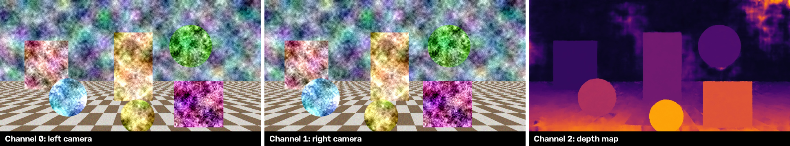

# Stereo Depth Estimator

## Metadata

| Field | Value |
| --- | --- |
| Category | depth-estimation |
| Difficulty | Intermediate |
| Tags | depth-estimation, stereo, disparity, lightstereo, rtsp, usb-camera, mipi-camera |
| Languages | C++, Python |
| Status | experimental |
| Binary Name | stereo-depth-estimator |
| Model | lightstereo_s |

## Concept

Shows how near each point of a scene is from two cameras: LightStereo-S compares the left and right view, and Insight shows both cameras and a colored depth map on three channels.

The model returns disparity: how many pixels a point shifts between the left and the right view. A near point shifts more than a far one, so the disparity map is a relative depth map. The application colors it from black (far) to bright yellow (near).

The application runs two Neat graphs and one model:

1. The source graph reads a left and a right camera over RTSP, USB, or MIPI. It forwards each camera's video to its own Insight channel and decodes it.
2. Each loop takes the newest decoded frame of both cameras and joins them side by side, the frame LightStereo-S takes.
3. LightStereo-S returns one disparity per pixel of the left view. The application keeps three frames in the model at once, so the model's stages work on different frames at the same time.
4. The CPU colors the disparity map.
5. The depth graph encodes the colored map to H.264 and sends it to a third Insight channel.

```text
left camera  ─┬─> Insight channel 0
              └─> decode ─┐
right camera ─┬─> Insight channel 1
              └─> decode ─┴─> join ─> LightStereo-S ─> color ─> encode ─> Insight channel 2
```

RTSP and USB cameras send encoded video, which reaches Insight as it is. A MIPI camera sends raw frames, which are encoded to H.264 first.

The cameras must be rectified: a scene point lies on the same row in both views. A stereo camera that rectifies its images, or a calibrated pair remapped before streaming, provides that. The application does not rectify.

Depth in meters needs the cameras' calibration: depth equals the focal length in pixels times the distance between the cameras, divided by the disparity. This example shows relative depth only.

## Preview



## Prerequisites

- `sima-cli` ([documentation](https://developer.sima.ai/software/tools/sima-cli/)) on the Modalix
  DevKit, or in a Neat SDK container paired with it.
- Two rectified cameras of the same model and mode: two RTSP streams, two USB cameras, or two MIPI
  cameras on the DevKit.
- Insight receiving the three output channels.
- The LightStereo-S model package prepared below.

## Install Apps

Install on the Modalix DevKit, or under `/workspace` in a Neat SDK container paired with it. Only the example itself must run on the DevKit. `sima-cli neat install apps` also offers to install the compatible Neat Library and Insight, and skips them when they are up to date. To keep the Neat Library and Insight you have without being asked, run the install as `NEAT_APPS_SKIP_DEPENDENCIES=1 sima-cli neat install apps`. See [Install Apps](https://github.com/sima-neat/apps/blob/main/README.md#install-apps).

Install the latest Neat Apps runtime and enter the installed bundle:

```bash
sima-cli neat install apps
cd prebuilt-apps
APP_DIR=examples/depth-estimation/stereo-depth-estimator
```

Run the remaining commands from `prebuilt-apps/`.

## Prepare the Model

| Model | Role | Source |
| --- | --- | --- |
| `lightstereo_s_w16a16_mpk.tar.gz` | Default, closest to the original model | Compile it yourself, see below |
| `lightstereo_s_w8a8_mpk.tar.gz` | Faster, with coarser depth steps | Compile it yourself, see below |

LightStereo-S comes from [OpenStereo](https://github.com/XiandaGuo/OpenStereo), which releases it for academic, noncommercial use only. SiMa.ai therefore does not offer the compiled package for download. Check that your use fits OpenStereo's terms, then compile the `LightStereo-S-SceneFlow` checkpoint for Modalix with the Model Compiler.

The application expects a package with this interface:

- Input: one RGB frame of 540×1920 pixels, the left view in its left half and the right view in its right half, prepared by Neat with stretch resizing and the ImageNet normalization.
- Output: the left view's disparity, one 32-bit float per pixel of a 540×960 map, in pixels.

Place the package where `config.yaml` names it:

```bash
mkdir -p models/lightstereo_s/w16a16
cp <your-build>/lightstereo_s_w16a16_mpk.tar.gz models/lightstereo_s/w16a16/
```

## Configure

Open `${APP_DIR}/src/common/config.yaml`. Set `source.type` and the matching `source.rtsp`, `source.usb`, or `source.mipi` section, then `output.insight.host`. Only the selected source section is read.

- `output.insight.video_port` is the left camera's port. The right camera uses the next port and the depth map the one after: 9000, 9001 and 9002 by default, which are Insight channels 0, 1 and 2.

- Every source names a left and a right camera. Swapping them gives a wrong depth map, not an error.
- An RTSP source takes H.264, H.265, or MJPEG, the same for both streams. Set `source.rtsp.fps` for MJPEG streams that do not report a frame rate.
- A USB source needs both cameras' stable IDs and one MJPEG mode both have. List them on the DevKit with `python3 -c "import pyneat; print(pyneat.usb_camera_ids())"` and `v4l2-ctl -d /dev/video<N> --list-formats-ext`.
- A MIPI source needs both cameras' libcamera names from `cam -l` and a mode both sensors support.
- `output.max_disparity` is the disparity drawn as the brightest color. Lower it when the whole scene is far away and the map looks dark.
- `inference.frames: 0` runs until Ctrl-C. Set `output.save_dir` and `output.save_every` to also save every Nth depth map as a JPEG.

The two cameras share no clock. The application pairs the newest frame of each, so the two frames can be about one frame interval apart, and more when the streams arrive with different delays. Channels 0 and 1 show such a delay as two views that move out of step. A still scene is unaffected. For fast motion, use cameras that capture in sync.

## Run

### C++

```bash
./${APP_DIR}/src/cpp/pre-built/stereo-depth-estimator \
  --config ${APP_DIR}/src/common/config.yaml
```

### Python

```bash
source ~/pyneat/bin/activate
pip install -r ${APP_DIR}/src/python/requirements.txt
python3 ${APP_DIR}/src/python/main.py \
  --config ${APP_DIR}/src/common/config.yaml
```

Both implementations print the source and the camera frame size at start, then stream to Insight.

## Expected Result

Open channels 0, 1 and 2 in the Insight viewer, with four videos per page. Channel 0 shows the left camera, channel 1 the right camera, and channel 2 the depth map of the left view, 960×540 pixels. Near objects are bright and far ones dark. When the run ends, the application prints one summary line:

```text
frames=300 depth_fps=16.0 insight=<insight-host>:9000-9002
```

`depth_fps` is the rate of depth maps sent to Insight. The camera channels keep the cameras' own rate, and the depth map follows them by about a tenth of a second.

On a DevKit with 960×540 streams at 30 FPS, the application sends a depth map for every camera frame with both packages. With 1280×720 streams at 60 FPS it sends about 32 depth maps per second with the `w16a16` package and about 42 with `w8a8`.

## Troubleshooting

- A depth map that looks plausible but wrong usually means swapped cameras, cameras that are not rectified, or two frames captured at different moments.
- `the cameras must send the same frame size` means the two streams or camera modes differ. Give both the same mode.
- `could not read the frame rate` means the left stream does not report one. Set `source.rtsp.fps`.
- Confirm the model package exists at `model.path`.
- Confirm Insight is reachable at the configured host and its three UDP video ports.
- Set `inference.frames: 30` for a short smoke run.

## Source Files

- C++ reference source: `src/cpp/main.cpp`
- Python source: `src/python/main.py`
- Shared config: `src/common/config.yaml`

The packaged C++ source is an implementation reference. Run the executable under
`src/cpp/pre-built/`; the installed bundle does not include CMake files.

## Development From Source

To modify, compile, or test this example, use the
[Apps contributor workflow](https://github.com/sima-neat/apps/blob/main/CONTRIBUTING.md).
