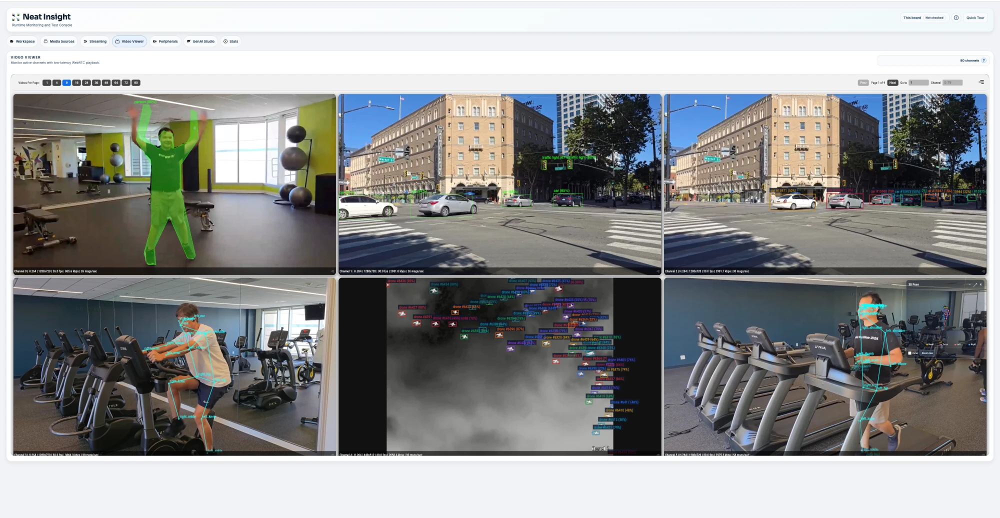

# Parallel Apps in Docker

## Metadata

| Field | Value |
| --- | --- |
| Category | docker |
| Difficulty | Intermediate |
| Tags | docker, containers, multistream, rtsp, insight |
| Languages | C++ |
| Status | stable |
| Binary Name | parallel-apps.sh |
| Model | Each example's default model |

## Concept

Runs six Neat applications side by side in Docker containers on one Modalix DevKit, each sending live video and results to its own Insight channel.

Each container runs one Apps example with its own config: instance segmentation, RF-DETR object detection, multi-class tracking, pose estimation, tiny-drone tracking, and BlazePose 3D pose estimation. You install the Apps bundle in the Neat SDK, pack each example into an ARM64 image, and push the images to the SDK's container registry. The DevKit pulls them from there. Each image holds only the example's binary, its `src/common` files, its config, and its model. Each container mounts the DevKit's installed Neat and system libraries read-only and gets the accelerator and video codec devices, so it behaves like a normal run of the same example. All six share the DevKit's machine learning accelerator (MLA).

## Preview



## Prerequisites

- The Neat SDK set up with your Modalix DevKit (`sima-cli sdk setup --devkit`). This starts the SDK's container registry and the `dk` DevKit commands. Run every command below in the Neat SDK shell.
- The same Neat Core on the DevKit as in the installed Apps bundle. The containers run the DevKit's Neat with binaries built against the bundle's Core; the Install Apps step installs that Core on the DevKit.
- A Neat Core that admits Modalix in containers (Core develop `e1eddd4` or newer). Older Cores identify the board from `/proc/device-tree`, which Docker hides, and every application exits with `closed owned platform capability unavailable`.
- Docker on the DevKit. If it is missing, `dk container setup` installs it.
- Six H.264 RTSP sources: people for segmentation and both pose examples, traffic for detection and tracking, and drones for the drone tracker. [Insight](https://developer.sima.ai/software/tools/insight/) can host them under RTSP Source from its video catalog, and the Apps bundle ships a drone clip at `assets/datasets/yolo26-tiny-drone-tracker/anti_uav_multi_uav_source_demo.mp4`.
- Insight with at least six channels, reachable from the DevKit. Running Insight on the DevKit itself is the most reliable choice: the applications then send to `127.0.0.1`. Insight inside the SDK publishes four channels by default (set up the SDK with `--insight-video-channels 8` for six), and on macOS Docker Desktop can fail to forward some of its UDP ports.

## Install Apps

Install under `/workspace` in the Neat SDK container paired with your DevKit; the images are built there and the containers run on the DevKit. If the Core and Insight selected by Apps are already installed, run the install as `NEAT_APPS_SKIP_DEPENDENCIES=1 sima-cli neat install apps` to skip reinstalling them. See [Install Apps](https://github.com/sima-neat/apps/blob/main/README.md#install-apps).

```bash
cd /workspace
sima-cli neat install apps
cd prebuilt-apps
APP_DIR=examples/docker/parallel-apps
```

Run the remaining commands in the Neat SDK container, from `prebuilt-apps/`.

## Prepare the Model

Each container gets its own folder under `models/`, named after the container, and its image holds only that folder. Model packages come from the Model Zoo release below, which can differ from the installed platform version.

```bash
export MODELZOO_VERSION="3.0.0"
MODELS="https://docs.sima.ai/pkg_downloads/SDK${MODELZOO_VERSION}/models/modalix"
mkdir -p models/neat-segmentation models/neat-detection models/neat-tracking models/neat-pose models/neat-drone models/neat-blazepose
(cd models/neat-segmentation && sima-cli download "${MODELS}/yolo26-segmentation/yolo26m-seg-int8-b1.tar.gz")
(cd models/neat-detection && sima-cli download "${MODELS}/rf_detr_small_w8a8_w16a16_backbone_mpk.tar.gz" && sima-cli download "${MODELS}/rf_detr_small_w8a8_w16a16_decoder_mpk.tar.gz")
(cd models/neat-tracking && sima-cli download "${MODELS}/yolo26-detection/yolo26m-det-int8-b1.tar.gz")
(cd models/neat-pose && sima-cli download "${MODELS}/yolo26-pose/yolo26m-pose-int8-b1.tar.gz")
(cd models/neat-drone && sima-cli download "${MODELS}/yolo26n_p2_tiny_drone_int8_qat_b1_mpk.tar.gz")
(cd models/neat-blazepose && sima-cli download "${MODELS}/blazepose_ghum_heavy_w16a16_mpk.tar.gz")
cp models/neat-tracking/yolo26m-det-int8-b1.tar.gz models/neat-blazepose/
```

Six applications share one MLA, so this example uses the INT8 segmentation package instead of the BF16 one its own README defaults to.

Inside an image, the container's folder appears as `models/`, so a config names a model as `models/<file>`. To use another model, follow that example's README and place the file in the container's folder.

## Configure

Each image holds its example's own `src/common/config.yaml`. Edit the six configs as their READMEs describe, with one difference: give each example its own Insight channel. Insight maps video port `9000 + N` and metadata port `9100 + N` to channel `N`, and all six configs start on channel 0.

| Container | Example config | Model | RTSP source | Insight ports |
| --- | --- | --- | --- | --- |
| `neat-segmentation` | `examples/segmentation/single-stream-instance-segmenter` | `model.path: models/yolo26m-seg-int8-b1.tar.gz` | `source.url` | `output.insight.video_port: 9000`, `metadata_port: 9100` |
| `neat-detection` | `examples/object-detection/rfdetr-detection-segmentation` | Ready for RF-DETR small | `source.rtsp_url` | `output.insight.video_port: 9001`, `metadata_port: 9101` |
| `neat-tracking` | `examples/tracking/multi-stream-tracker` | `model.path: models/yolo26m-det-int8-b1.tar.gz`; set `inference.fps: 15` to leave MLA time for the others | one URL under `streams` | `output.insight.video_port_base: 9002`, `metadata_port_base: 9102` |
| `neat-pose` | `examples/pose-estimation/multi-stream-pose-estimator` | `model.path: models/yolo26m-pose-int8-b1.tar.gz` | one URL under `streams` | `output.insight.video_port_base: 9003`, `metadata_port_base: 9103` |
| `neat-drone` | `examples/tracking/yolo26-tiny-drone-tracker` | `model.path: models/yolo26n_p2_tiny_drone_int8_qat_b1_mpk.tar.gz` | one URL under `streams` | `output.insight.video_port_base: 9004`, `metadata_port_base: 9104` |
| `neat-blazepose` | `examples/pose-estimation/multi-stream-blazepose3d` | `models.detector_path: models/yolo26m-det-int8-b1.tar.gz`, `models.pose_path: models/blazepose_ghum_heavy_w16a16_mpk.tar.gz` | one entry under `streams` with `url`, `width`, `height`, and `insight_channel: 5` | `output.insight.video_port_base: 9000`, `metadata_port_base: 9100` |

Set `output.insight.host` in all six: `127.0.0.1` when Insight runs on the DevKit, otherwise the Insight host's address. The config is copied into the image, so after a config change run `build` and `deploy` again.

## Run

Run these commands in the Neat SDK container, from `prebuilt-apps/`, not on the DevKit. `build` uses the SDK's Docker and container registry, and `deploy`, `dk container logs`, and `stop` reach the DevKit through `dk`.

Build the six ARM64 images and push them to the SDK's container registry:

```bash
${APP_DIR}/src/common/parallel-apps.sh build
```

Start the six containers on the DevKit, one after another:

```bash
${APP_DIR}/src/common/parallel-apps.sh deploy
```

To start only some of them, name them, for example `${APP_DIR}/src/common/parallel-apps.sh deploy neat-tracking neat-pose`.

Follow one application's log:

```bash
dk container logs neat-tracking --follow
```

Stop and remove the containers:

```bash
${APP_DIR}/src/common/parallel-apps.sh stop
```

`stop` sends SIGINT, which the applications handle as a clean shutdown.

## Expected Result

`dk container list` shows six running containers: `neat-segmentation`, `neat-detection`, `neat-tracking`, `neat-pose`, `neat-drone`, and `neat-blazepose`. Insight shows channels 0 to 5, each with video and overlays from a different application. Channel 5 also carries BlazePose's 3D skeleton for Insight's 3D Pose view.

The MLA runs one model at a time, so each application's frame rate depends on the combined model time of all six. RF-DETR is the heaviest and is the first to fall below its source rate. When the six sources together need more model time than the MLA has, the applications drop frames. Lower a source's frame rate or choose a smaller model in its config.

## Container Settings

`deploy` starts every container with the same settings:

- `--network host`: the applications use the DevKit's own network, so RTSP sources and Insight need no port mapping. Older DevKit kernels also lack NAT for Docker's default bridge network.
- `--user`: the DevKit user's user and group IDs. The accelerator and codec devices belong to its group, so the containers run without root.
- `--stop-signal SIGINT`: the applications shut down cleanly on SIGINT. As the container's main process, they ignore Docker's default SIGTERM.
- `--tmpfs /tmp`: Neat unpacks model packages here at startup.
- `--device`: the MLA, the computer vision unit, their memory heaps, and the video decoder and encoder.
- `--mount`: the DevKit's `/usr`, `/bin`, `/lib`, `/etc/alternatives`, and dynamic linker cache, read-only.

`src/common/Dockerfile` builds one image per container. It starts `FROM scratch` and copies only the example's binary (`src/cpp/pre-built` in the installed bundle, the build tree in a checkout), its `src/common` files, and the container's model folder. Because it runs no commands, it builds for ARM64 on any SDK host without emulation.

## Troubleshooting

- If `build` reports a missing binary, run it from `prebuilt-apps/` after `sima-cli neat install apps`, or build the checkout as described in Development From Source. If it reports an empty model folder, download the model into `models/<container>/`.
- If a container exits at startup, read its log with `dk container logs <container>`. The application reports configuration and model errors the same way as a normal run.
- If every application exits with `closed owned platform capability unavailable`, the installed Core predates container support; update Core on the DevKit and in the SDK.
- If an application runs on the DevKit but fails to open the MLA in a container, update the DevKit with `sima-cli update`.
- If Insight runs inside the SDK on macOS and some channels stay blank, Docker Desktop is not forwarding all of Insight's UDP ports. Run Insight on the DevKit and set `output.insight.host: 127.0.0.1`.
- If an application fails to load a Neat library or reports a version mismatch, the DevKit's Core differs from the one the bundle was built against. Run `sima-cli neat install apps` again without `NEAT_APPS_SKIP_DEPENDENCIES`.
- If two applications appear on one Insight channel, check that their configs use different Insight ports.

## Source Files

- Build, deploy, and stop, with the list of containers and examples: `src/common/parallel-apps.sh`
- Container image: `src/common/Dockerfile`

## Development From Source

To modify, compile, or test this example, use the [Apps contributor workflow](https://github.com/sima-neat/apps/blob/main/CONTRIBUTING.md).

`parallel-apps.sh` also runs from the root of an Apps checkout in the Neat SDK shell, using the binaries under `build/`. On a new SDK container, install Core before the first build:

```bash
./build.sh --only-install-neat-core
./build.sh
```
