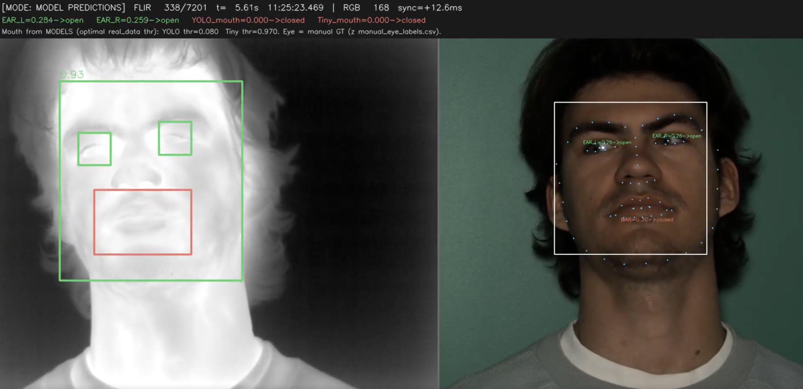

# Single-Stream Thermal Face Detector

## Metadata
| Field | Value |
| --- | --- |
| Category | face-detection |
| Difficulty | Intermediate |
| Tags | face-detection, keypoints, yolov5s-face, thermal, rtsp, insight |
| Languages | C++, Python |
| Status | stable |
| Binary Name | single-stream-thermal-face-detector |
| Model | yolov5s_face_raw_split |

## Concept
Detects faces and five facial landmarks in a live thermal RTSP stream with YOLOv5s-Face, then sends the overlay to Insight.

```text
How does a frame move through single-stream-thermal-face-detector?

╭┄┄┄┄┄┄┄┄┄┄┄┄┄┄┄┄┄┄┄┄┄┄┄┄┄┄┄┄┄┄┄┄┄┄┄┄┄┄┄┄┄┄┄┄┄┄┄┄┄┄┄┄┄┄┄┄┄┄┄┄┄┄┄┄┄┄┄┄┄┄┄┄┄┄┄┄┄┄┄┄┄┄┄╮
┆ RUN                                                                               ┆
┆  ┌────────────────────────────────┐  H.264 frames       ┌──────────────────────┐  ┆
┆  │ RtspEncodedInput               │────────────────────►│ VideoSender          │──┼─────┐
┆  └────────────────────────────────┘  as received        └──────────────────────┘  ┆     │
┆            │ encoded frames                                                       ┆     │ video
┆            ▼                                                                      ┆     │
┆  ┌────────────────────────────────┐                                               ┆     │
┆  │ SimaDecode                     │                                               ┆     │
┆  └────────────────────────────────┘                                               ┆     │
┆            │ NV12 frames                                                          ┆     │
┆            ▼                                                                      ┆     │
┆  ┌────────────────────────────────┐                                               ┆     │
┆  │ yolov5s-face Model             │                                               ┆     │
┆  └────────────────────────────────┘                                               ┆     │
┆            │ six raw heads                                                        ┆     │
┆            ▼                                                                      ┆     │
┆  ┌────────────────────────────────┐                                               ┆     │
┆  │ Output "detections"            │                                               ┆     │
┆  └────────────────────────────────┘                                               ┆     │
╰┄┄┄┄┄┄┄┄┄┄┄┄│┄┄┄┄┄┄┄┄┄┄┄┄┄┄┄┄┄┄┄┄┄┄┄┄┄┄┄┄┄┄┄┄┄┄┄┄┄┄┄┄┄┄┄┄┄┄┄┄┄┄┄┄┄┄┄┄┄┄┄┄┄┄┄┄┄┄┄┄┄┄╯     │
             ▼ pull                                                                       │
   ┌────────────────────────────────┐                                                     │
   │ yolov5_face decode             │                                                     │
   └────────────────────────────────┘                                                     │
             │ faces, five landmarks                                                      │
             ▼                                                                            ▼
   ┌────────────────────────────────┐                                                ┌─────────┐
   │ MetadataSender                 │───────────────────────────────────────────────►│ Insight │
   └────────────────────────────────┘   poses as JSON                                └─────────┘
```

The H.264 stream goes to Insight as received, while the decoder feeds the model. Plain links
pass every received frame to both, so each face message carries the timestamp of a frame sent to
Insight, and Insight draws the landmarks on the frame they came from.

Each frame sends one `pose-estimation` message with the left eye, right eye, nose tip, and both mouth corners. Insight draws them as labeled dots. The application sends one metadata type because Insight shows only one type per channel at a time.

YOLOv5s-Face returns raw box and landmark outputs. The C++ and Python applications decode
those outputs with the same math, in `src/cpp/utils/yolov5_face.h` and
`src/python/utils/yolov5_face.py`, before sending the five points to Insight.

## Preview


## Prerequisites

- `sima-cli` ([documentation](https://developer.sima.ai/software/tools/sima-cli/))
  on the Modalix DevKit, or in a Neat SDK container paired with it.
- A running [Neat Insight](https://developer.sima.ai/software/tools/insight/)
  instance reachable from the target, with an RTSP source containing faces.

## Install Apps

Install on the Modalix DevKit, or under `/workspace` in a Neat SDK container paired with it. Only the example itself must run on the DevKit. `sima-cli neat install apps` also offers to install the compatible Neat Library and Insight, and skips them when they are up to date. To keep the Neat Library and Insight you have without being asked, run the install as `NEAT_APPS_SKIP_DEPENDENCIES=1 sima-cli neat install apps`. See [Install Apps](https://github.com/sima-neat/apps/blob/main/README.md#install-apps).

Install the latest Neat Apps runtime and enter the installed bundle:

```bash
sima-cli neat install apps
cd prebuilt-apps
APP_DIR=examples/face-detection/single-stream-thermal-face-detector
```

Run the remaining commands from `prebuilt-apps/`.

## Prepare the Model

Primary model: `yolov5s_face_raw_split`

Model packages come from the Model Zoo release below, which can differ from the
installed platform version.

```bash
export MODELZOO_VERSION="3.0.0"
mkdir -p models
cd models
sima-cli download \
  "https://docs.sima.ai/pkg_downloads/SDK${MODELZOO_VERSION}/models/modalix/yolov5s_face_raw_split_mpk.tar.gz"
cd ..
```

The command stores the package under `models/`, where the shipped `model.path` points. A
relative `model.path` starts at the config file.

## Prepare Insight
[Neat Insight](https://developer.sima.ai/software/tools/insight/) can host an RTSP source, receive video from `VideoSender`, receive landmark metadata from `MetadataSender`, and show rendered overlays plus runtime metrics in the browser.

Install videos directly from the Insight catalog or through Insight's YouTube support. This
example expects faces in frame, so upload a thermal or visible-light face clip of your own when
the catalog videos do not contain any.

To create a reproducible RTSP input:
1. Run `neat` in the Palette SDK and open the reported `Insight Web UI`.
2. In Insight, open `RTSP Source`.
3. Pick a catalog video with faces, or upload your own.
4. Start the stream and copy the RTSP URL.
5. Put that RTSP URL into `input.source`.

Use the same `neat` output to set `output.insight.host`, `video_port_base`, and
`metadata_port_base` from the reported `videoUDP` and `metadataUDP` ranges.

**Ports when the app runs on a board.** Insight runs inside the SDK container and
builds its URLs from the container's own view, so the RTSP link copied from the UI
carries the container-internal port (`8554`). An app running on a DevKit is
outside that container and must use the SDK host IP plus the **published** host
port instead. Read the mapping from `exposedPorts` in `neat --json` and never
assume the defaults:

| Endpoint | Container port (shown in the UI) | Host port (use this from a board) |
| --- | --- | --- |
| RTSP | 8554 | `rtsp.tcp` → `hostPortStart` |
| Video UDP | 9000 | `videoUDP` → `hostPortStart` |
| Metadata UDP | 9100 | `metadataUDP` → `hostPortStart` |

## Configure

Open `${APP_DIR}/src/common/config.yaml`. Set `input.source` to the H.264 RTSP URL and
`output.insight.host` to the machine running Insight. If Insight uses nondefault ports, also set
`output.insight.video_port_base` and `output.insight.metadata_port_base` to the ports reported
by `neat --json`.

`input.width`, `input.height`, and `input.fps` stay at 0 to read the stream's frame size and
rate with a probe; set them only for a stream that does not report them. The shipped thresholds
are ready for a first run.

## Run
### C++
```bash
./${APP_DIR}/src/cpp/pre-built/single-stream-thermal-face-detector \
  --config ${APP_DIR}/src/common/config.yaml
```

### Python
```bash
source ~/pyneat/bin/activate
pip install -r ${APP_DIR}/src/python/requirements.txt
python3 ${APP_DIR}/src/python/main.py \
  --config ${APP_DIR}/src/common/config.yaml
```

Open the Insight video viewer for the channel (e.g. `/api/viewer-url?src=0`) to
watch the annotated stream.

## Expected Result

This application writes nothing to disk; its output is the Insight video channel
plus the landmark metadata channel. It prints the source on startup and a count when it
stops:

```text
source=rtsp://<host>:<port>/<stream> stream=1280x720@30 insight=<insight-host> video=9000 metadata=9100
processed=200 video_sender=<insight-host>:9000
```

The packaged config ships `inference.frames: 0`, which runs until Ctrl-C, SIGTERM, or a closed
ssh session stops it; the count prints then too. For a bounded check that ends by itself, set
a positive limit:

```yaml
inference:
  frames: 200
```

When the metadata socket is full, a message is dropped rather than delaying the stream, and the
count of dropped messages prints after `processed=`.

Either way, `processed` reports frames pushed through the pipeline, not faces
found, so a healthy count does not by itself confirm detections. Confirm those
in Insight, which draws the five landmarks as labeled dots on the stream.

The preview image is a reference visualization: it pairs the thermal stream
with its visible-light source and draws face, eye, and mouth boxes. The
application publishes only the five landmarks, not those boxes.

## Troubleshooting

- A missing or mistyped config key stops the application with the key's name, such as
  `input.source`. An unedited placeholder, such as `<insight-host-ip>`, fails when the
  application probes the stream or opens the sender.
- `failed to probe RTSP frame size` means the stream did not report its size from the target;
  verify the RTSP URL from the board itself, or set `input.width`, `input.height`, and
  `input.fps`.
- If the run reports no frames at all, verify the RTSP URL from the board itself
  rather than from the machine running Insight. The URL Insight displays is not
  always reachable from the target, and the ports table above explains why.
- If the viewer shows video but no overlays, confirm `output.insight.host` and the
  metadata port are reachable and match the viewer's channel. Use Insight's
  `/api/ingest/stats` to check `metadata.messages_received`.
- If the viewer shows no video, verify the video UDP port and that RTP is arriving
  (`/api/ingest/stats` -> `rtp.packets_received`, `media.seen_sps`).
- Use `inference.min_score` and `inference.nms_iou` to tune detection sensitivity.

## Source Files
- C++ reference source: `src/cpp/main.cpp`, `src/cpp/utils/yolov5_face.h`
- Python source: `src/python/main.py`, `src/python/utils/yolov5_face.py`
- Shared config: `src/common/config.yaml`
- Class label: `src/common/face_label.txt`
- Helpers the examples share: `support/python/sima_examples/` at the root of the installed bundle, which `main.py` finds in a folder above itself, and their C++ reference source in `support/cpp/sima_examples/`

The packaged C++ source is an implementation reference. Run the executable
under `src/cpp/pre-built/`; the installed bundle does not include CMake files.

## Development From Source

To modify, compile, or test this example, use the
[Apps contributor workflow](https://github.com/sima-neat/apps/blob/main/CONTRIBUTING.md).
