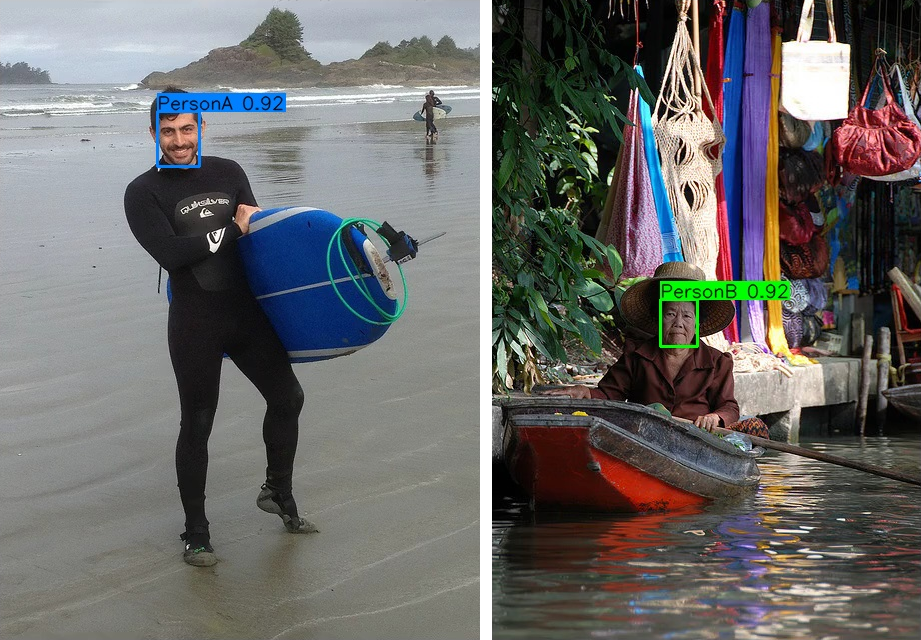

# Face Recognizer

## Metadata

| Field | Value |
| --- | --- |
| Category | face-recognition |
| Difficulty | Advanced |
| Tags | face-recognition, face-detection, scrfd, arcface, rtsp, usb-camera, insight |
| Languages | C++, Python |
| Status | stable |
| Binary Name | face-recognizer |
| Model | scrfd_2.5g_bnkps.mla, w600k_r50.surgery |

## Concept

Names the people in an RTSP stream, a USB camera or a video file with SCRFD face detection and ArcFace recognition, and sends the video with each face's box and name to Insight.

SCRFD finds each face and its five landmarks, ArcFace turns the aligned face into a 512-value embedding, and the embedding is matched against a gallery of enrolled people.

A live source is sent to Insight as it arrives, with no re-encoding, and decoded once for the model. Each decoded frame goes to SCRFD and is also returned to the application, joined by frame, so every face is cropped from the frame it was found in. The application then aligns, embeds and matches every face of every frame; each face adds one ArcFace run of about 10 ms. `--enroll` builds the gallery with the same detection, alignment and embedding steps.

## Preview



## Prerequisites

- `sima-cli` ([documentation](https://developer.sima.ai/software/tools/sima-cli/)) on the Modalix DevKit, or in a Neat SDK container paired with it.
- An RTSP H.264 source or a USB (UVC) MJPEG camera plugged into the DevKit, and an [Insight](https://developer.sima.ai/software/tools/insight/) URL reachable from the target. An H.264 video file runs without Insight.
- One or more images of each person to recognize.

## Install Apps

Install on the Modalix DevKit, or under `/workspace` in a Neat SDK container paired with it. Only the example itself must run on the DevKit. `sima-cli neat install apps` also offers to install the compatible Neat Library and Insight, and skips them when they are up to date. To keep the Neat Library and Insight you have without being asked, run the install as `NEAT_APPS_SKIP_DEPENDENCIES=1 sima-cli neat install apps`. See [Install Apps](https://github.com/sima-neat/apps/blob/main/README.md#install-apps).

Install the latest Neat Apps runtime and enter the installed bundle:

```bash
sima-cli neat install apps
cd prebuilt-apps
APP_DIR=examples/face-recognition/face-recognizer
```

Run the remaining commands from `prebuilt-apps/`.

## Prepare the Model

| Model file | Role |
| --- | --- |
| `scrfd_2.5g_bnkps.mla_mpk.tar.gz` | Face detector |
| `w600k_r50.surgery_mpk.tar.gz` | Face embedding (ArcFace) |

Model packages come from the Model Zoo release below, which can differ from the installed platform version. The example needs both.

```bash
export MODELZOO_VERSION="3.0.0"
mkdir -p models
cd models
sima-cli download "https://docs.sima.ai/pkg_downloads/SDK${MODELZOO_VERSION}/models/modalix/scrfd_2.5g_bnkps.mla_mpk.tar.gz"
sima-cli download "https://docs.sima.ai/pkg_downloads/SDK${MODELZOO_VERSION}/models/modalix/w600k_r50.surgery_mpk.tar.gz"
cd ..
```

`model.scrfd` and `model.arcface` in the config already point at these files.

## Enroll People

The example names only the people you enroll. Enrollment reads pictures of a person and stores what their face looks like, under the name you give, in a gallery file. Recognition then labels a matching face with that name and every other face `Unknown`. You choose the names; the application does not know who is in a picture.

### From images

1. Make one folder per person, named after them, and put their images in it. The folder name is the label Insight draws on that person's face.

   ```text
   people/
     Alice/front.jpg
     Alice/side.jpg
     Bob/front.jpg
   ```

   Each image should show only that person: from an image with several faces, only the most confident one is enrolled. All of a person's images are averaged into one entry.

2. Point `enrollment.images_dir` in `${APP_DIR}/src/common/config.yaml` at the folder. A relative path is read from `prebuilt-apps/`.

   ```yaml
   enrollment:
     images_dir: people
   ```

3. Run the example with `--enroll`:

   ```bash
   ./${APP_DIR}/src/cpp/pre-built/face-recognizer \
     --config ${APP_DIR}/src/common/config.yaml --enroll
   ```

   The Python application takes the same flag: add `--enroll` to the command in [Run](#run).

Each `[enroll]` line is one image stored under that name, and the last line counts the people now in the gallery:

```text
[enroll] Alice: front.jpg score=0.812
[enroll] Alice: side.jpg score=0.790
[enroll] Bob: front.jpg score=0.845
enrolled=3 skipped=0 people=2 gallery=sandbox/face-recognizer/gallery.bin
```

An image that cannot be read, or whose best face scores below `enrollment.min_score`, is reported on a `[skip]` line and not enrolled.

### From a video

To enroll one person from a video of them alone, set the video and the name instead of `images_dir`, then run with `--enroll` as above. Every fifth frame is enrolled under that name; `enrollment.sample_every` changes the interval.

```yaml
enrollment:
  video_path: alice.mp4
  name: Alice
```

### Add or remove people

`--enroll` adds to the gallery at `gallery.path`. Run it again to add a person, or more images of someone already enrolled; enrolling the same images twice counts them twice. To remove someone or start over, delete the gallery file and enroll again. The C++ and Python applications read and write the same file.

## Prepare Insight

[Insight](https://developer.sima.ai/software/tools/insight/) can host the input stream and render the video with a box and name on each face. Install videos directly from the Insight catalog or through Insight's YouTube support.

In the Insight Web UI, start the required stream and copy its RTSP source URL. The stream must be H.264. Use a host and published port that the target can reach, not `localhost` and not an address only Insight's own machine can resolve.

## Configure

Open `${APP_DIR}/src/common/config.yaml`. Set `source.type` and the matching `source.rtsp`, `source.usb` or `source.video_file` section (only that section is read), and the Insight host and video and metadata ports. Keep `inference.frames` at `0` to run until you stop the application.

To use a USB camera, set `source.type: usb`, `source.usb.camera` to its stable ID, and `source.usb.width`, `source.usb.height`, and `source.usb.fps` to an MJPEG mode the camera lists. List the connected camera IDs and modes on the DevKit:

```bash
source ~/pyneat/bin/activate
python3 -c "import pyneat; print(pyneat.usb_camera_ids())"
v4l2-ctl --list-devices && v4l2-ctl -d /dev/video<N> --list-formats-ext
```

The camera's own JPEG goes to Insight unchanged as RTP/JPEG, so view it with an Insight version that shows JPEG channels. RTP/JPEG carries sizes up to 2040 pixels per side in multiples of 8.

With `source.type: video_file` the example prints each frame's result instead of sending it to Insight, and stops at the end of the file.

| Setting | Default | Effect |
| --- | --- | --- |
| `match.threshold` | `0.55` | Lowest similarity that names a person. Raise it for fewer wrong names. |
| `match.margin` | `0.12` | Lead the best match needs over the second best. Raise it when enrolled people look alike. |
| `inference.min_score` | `0.65` | Face detection score threshold. Lower it for small or partly hidden faces. |
| `inference.max_faces` | `100` | Most faces recognized per frame. Lower it to bound the frame time in crowded scenes. |

## Run

### C++

```bash
./${APP_DIR}/src/cpp/pre-built/face-recognizer \
  --config ${APP_DIR}/src/common/config.yaml
```

### Python

```bash
source ~/pyneat/bin/activate
pip install -r ${APP_DIR}/src/python/requirements.txt
python3 ${APP_DIR}/src/python/main.py \
  --config ${APP_DIR}/src/common/config.yaml
```

## Expected Result

The application prints the source and the number of enrolled people on startup:

```text
source=1280x720@30 people=2 insight=<insight-host> video=9000 metadata=9100
```

Insight then shows the video on channel 0 with a box on each face, labelled with the person's name, or `Unknown` for a face that matches nobody.

The packaged config ships `inference.frames: 0`, which runs continuously; stop it with Ctrl-C. With a positive limit, or at the end of a video file, the run ends by itself with a count:

```text
processed=200 fps=30.0
```

A video file prints one line per frame with each face's name and similarity:

```text
frame 1: Alice 0.871, Unknown 0.214
frame 2: Alice 0.868, Unknown 0.209
```

## Troubleshooting

- `no gallery at ...; every face is labelled Unknown`: run [Enroll People](#enroll-people) first, with the same `gallery.path`.
- An enrolled person shows as `Unknown`: enroll more images of them in the lighting and angle of the camera, or lower `match.threshold`.
- Verify stream reachability if no frame arrives.
- For a USB camera, an unknown ID or an unsupported mode fails at startup with the connected IDs or the camera's MJPEG modes; close other programs that hold the camera.
- Verify the Insight host and UDP ports if video and names are absent.

## Source Files

- C++ reference source: `src/cpp/main.cpp`, with SCRFD decoding, face alignment, the gallery and matching in the files beside it
- Python source: `src/python/main.py`
- Shared config: `src/common/config.yaml`

The packaged C++ source is an implementation reference. Run the executable under `src/cpp/pre-built/`; the installed bundle does not include CMake files.

## Development From Source

To modify, compile, or test this example, use the [Apps contributor workflow](https://github.com/sima-neat/apps/blob/main/CONTRIBUTING.md).
