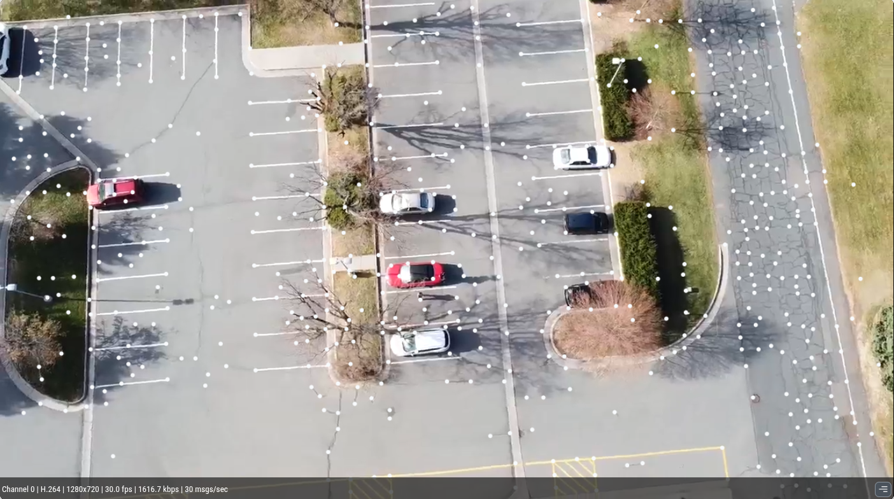

# SuperPoint Feature Extractor

## Metadata

| Field | Value |
| --- | --- |
| Category | feature-extraction |
| Difficulty | Intermediate |
| Tags | superpoint, feature-extraction, rtsp, boxdecode |
| Languages | C++, Python |
| Status | stable |
| Binary Name | superpoint-feature-extractor |
| Model | superpoint (w8a8) |

## Concept

Finds SuperPoint feature points in an RTSP stream and sends the annotated video to Insight.

## Preview



## Prerequisites

- `sima-cli` ([documentation](https://developer.sima.ai/software/tools/sima-cli/)) on the Modalix
  DevKit, or in a Neat SDK container paired with it.
- Neat Library with SuperPoint BoxDecode support.
- Insight serving an H.264 RTSP source and receiving the annotated output stream.
- A SuperPoint model package you compiled, as Prepare the Model describes.

## Install Apps

Install on the Modalix DevKit, or under `/workspace` in a Neat SDK container paired with it. Only the example itself must run on the DevKit. `sima-cli neat install apps` also offers to install the compatible Neat Library and Insight, and skips them when they are up to date. To keep the Neat Library and Insight you have without being asked, run the install as `NEAT_APPS_SKIP_DEPENDENCIES=1 sima-cli neat install apps`. See [Install Apps](https://github.com/sima-neat/apps/blob/main/README.md#install-apps).

Install the latest Neat Apps runtime and enter the installed bundle:

```bash
sima-cli neat install apps
cd prebuilt-apps
APP_DIR=examples/feature-extraction/superpoint-feature-extractor
```

Run the remaining commands from `prebuilt-apps/`.

## Prepare the Model

SuperPoint is licensed by Magic Leap under the [SuperPoint Software License Agreement](https://github.com/magicleap/SuperPointPretrainedNetwork/blob/master/LICENSE), which restricts the software to noncommercial research use and prohibits its distribution to third parties. Redistribution of a compiled SuperPoint model package is therefore prohibited, and the model browser does not offer one for download. To run this example, compile the model from its recipe in the [models repository](https://github.com/sima-neat/models/tree/d0b3f921b29be11a8ca80859f0805ba143a2e975/models/superpoint) on a machine with the Model Compiler, such as the Neat SDK. Review the license terms to confirm that they permit your intended use.

Follow steps 1 to 5 of [Getting started](https://github.com/sima-neat/models/blob/d0b3f921b29be11a8ca80859f0805ba143a2e975/docs/getting-started.md) in the models repository, replacing `yolo26n` with `superpoint`. Steps 4 and 5 convert the checkpoint to ONNX and compile it into a model package; the later performance and accuracy steps are optional. Choose one build profile:

- **`w16a16`, the simplest.** It needs no calibration images, so skip step 3, replace `w8a8` with `w16a16` in the step 5 commands, and drop `--dataset` from the compile command. The compile writes `build/superpoint/w16a16/model/superpoint_w16a16_mpk.tar.gz`. Copy that file to the DevKit, into `models/superpoint/w16a16/` under `prebuilt-apps/`, and point the config at it, because the packaged config names the `w8a8` package:

  ```bash
  sed -i 's#models/superpoint/w8a8/superpoint_w8a8_mpk.tar.gz#models/superpoint/w16a16/superpoint_w16a16_mpk.tar.gz#' ${APP_DIR}/src/common/config.yaml
  ```

- **`w8a8`, the packaged default.** It calibrates on 50 HPatches images (`hpatches-cal` in [`model.yaml`](https://github.com/sima-neat/models/blob/d0b3f921b29be11a8ca80859f0805ba143a2e975/models/superpoint/model.yaml)). Step 3's `model-registry fetch-calibration models/superpoint --build-profile w8a8 --component model` downloads them, but only with SiMa.ai Dataset Registry (Artifactory) access, and `model-registry` installs only where the Model Compiler is installed. Without that access, pass `--dataset` a `.tar` or `.tar.gz` archive of at least 50 HPatches images stored as `hpatches/cal/<sequence>/<n>.ppm`, which is the layout the recipe's `calibration.py` reads. Other images give a different INT8 model from the published one. The compile writes `build/superpoint/w8a8/model/superpoint_w8a8_mpk.tar.gz`; copy it to `models/superpoint/w8a8/` under `prebuilt-apps/`, where the packaged config already points.

## Configure

Upload `assets/datasets/tum-rgbd/freiburg1-desk.mp4` to Insight and start it under Media Sources. The clip loops at its native 30 FPS.

Open `${APP_DIR}/src/common/config.yaml`. Set `source.rtsp_url` (for example, `rtsp://<insight-host-ip>:8554/src1`) and `output.insight.host`. `model.path` already points at the package you compiled; change it only if you saved it elsewhere or built another build profile.

Set `runtime.frames` to `0` to run until Ctrl-C. The RTSP source must keep the same resolution for the whole run.

The TUM RGB-D clip's attribution and CC BY 4.0 license are in
`assets/datasets/tum-rgbd/LICENSE.md`.

## Run

### C++

```bash
./${APP_DIR}/src/cpp/pre-built/superpoint-feature-extractor \
  --config ${APP_DIR}/src/common/config.yaml
```

### Python

```bash
source ~/pyneat/bin/activate
pip install -r ${APP_DIR}/src/python/requirements.txt
python3 ${APP_DIR}/src/python/main.py \
  --config ${APP_DIR}/src/common/config.yaml
```

Both implementations stream the overlay to Insight and print the number of processed frames,
average feature count, descriptor dimension, and selected video endpoint.

## Expected Result

This application writes nothing to disk; its output is the Insight stream plus a
single summary line printed when the run ends:

```text
frames=200 average_points=331.6 descriptor_dim=256 video_sender=<insight-host>:9000
```

`frames` should match `runtime.frames`, or the number processed before Ctrl-C when it is `0`.
`descriptor_dim` should be `256`. For the packaged TUM RGB-D sequence
`average_points` runs in the low hundreds. An `average_points` near zero means
the pipeline ran but the model returned almost no features, which is worth
investigating even though the run exits successfully.

## Troubleshooting

- Confirm `model.path` points to the compiled `superpoint_w8a8_mpk.tar.gz`.
- A missing or incompatible typed SuperPoint contract fails during model construction.
- Confirm the H.264 RTSP source is running and keeps a stable resolution.
- Confirm Insight is reachable at the configured host and UDP video port.
- Set `runtime.frames: 30` for a short smoke run.

## Source Files

- C++ reference source: `src/cpp/main.cpp`
- Python source: `src/python/main.py`
- Shared config: `src/common/config.yaml`

The packaged C++ source is an implementation reference. Run the executable under
`src/cpp/pre-built/`; the installed bundle does not include CMake files.

## Development From Source

To modify, compile, or test this example, use the
[Apps contributor workflow](https://github.com/sima-neat/apps/blob/main/CONTRIBUTING.md).
