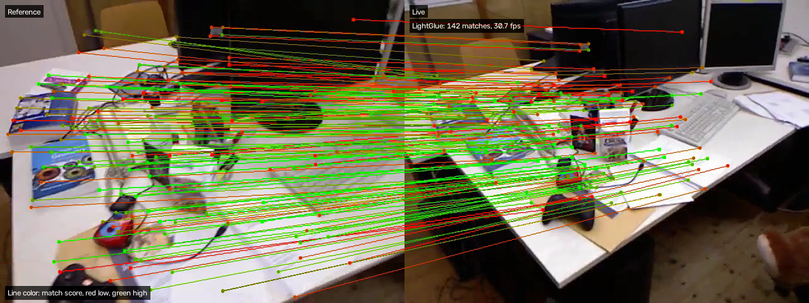

# SuperPoint Feature Matcher

## Metadata

| Field | Value |
| --- | --- |
| Category | feature-extraction |
| Difficulty | Advanced |
| Tags | superpoint, lightglue, superglue, feature-matching, rtsp, usb-camera, mipi-camera |
| Languages | C++, Python |
| Status | experimental |
| Binary Name | superpoint-feature-matcher |
| Model | superpoint, lightglue_superpoint, superglue_outdoor |

## Concept

Matches each live frame's SuperPoint keypoints to a reference frame with LightGlue or SuperGlue and sends both frames, joined by colored match lines, to Insight.

The first frame with 512 keypoints becomes the reference, on the left. Every later frame runs SuperPoint, then the selected matcher compares its keypoints with the reference's. Insight receives the reference beside the live frame, with one line per match, a dot at each end, colored from red (weak) to green (strong). Frames where SuperPoint finds fewer than 512 keypoints are shown without lines, because both matchers take exactly 512.

The application runs two Neat graphs and two models:

1. The source graph decodes RTSP, HTTP MJPEG, USB, or MIPI video into frames.
2. SuperPoint reads each frame's luma plane and returns 512 keypoints with descriptors. It keeps keypoints that score above 0.005, not the 0.0005 LightGlue's extractor uses, so the CPU decode takes about 14 ms per frame instead of about 70 ms. The best 512 keypoints are the same; a frame with too little texture to reach 512 above 0.005 is skipped.
3. LightGlue or SuperGlue scores every pair of reference and live keypoints.
4. The CPU keeps mutual best pairs above the match threshold. SuperGlue first runs its Sinkhorn iterations on the CPU.
5. The CPU joins the two frames and draws the matches in NV12, the encoder's own format, so the output graph only encodes it to H.264 for Insight.

## Preview



## Prerequisites

- `sima-cli` ([documentation](https://developer.sima.ai/software/tools/sima-cli/)) on the Modalix
  DevKit, or in a Neat SDK container paired with it.
- Neat Library with SuperPoint BoxDecode support.
- Insight serving an RTSP or HTTP MJPEG source, or a USB or MIPI camera on the DevKit, and Insight
  receiving the output stream.
- The three model packages installed below.

## Install Apps

Install on the Modalix DevKit, or under `/workspace` in a Neat SDK container paired with it. Only the example itself must run on the DevKit. `sima-cli neat install apps` also offers to install the compatible Neat Library and Insight, and skips them when they are up to date. To keep the Neat Library and Insight you have without being asked, run the install as `NEAT_APPS_SKIP_DEPENDENCIES=1 sima-cli neat install apps`. See [Install Apps](https://github.com/sima-neat/apps/blob/main/README.md#install-apps).

Install the latest Neat Apps runtime and enter the installed bundle:

```bash
sima-cli neat install apps
cd prebuilt-apps
APP_DIR=examples/feature-extraction/superpoint-feature-matcher
```

Run the remaining commands from `prebuilt-apps/`.

## Prepare the Model

| Model | Role | Source |
| --- | --- | --- |
| `superpoint_w8a8_mpk.tar.gz` | Keypoints and descriptors | Model registry `superpoint`, variant `w8a8` |
| `lightglue_superpoint_w8a8_mpk.tar.gz` | Default matcher | Model registry `lightglue_superpoint`, variant `w8a8` |
| `superglue_outdoor_w16a16_mpk.tar.gz` | Alternative matcher | Model registry `superglue_outdoor`, variant `w16a16` |

```bash
sima-cli models download --id superpoint --variant w8a8 -o models
sima-cli models download --id lightglue_superpoint --variant w8a8 -o models
sima-cli models download --id superglue_outdoor --variant w16a16 -o models
```

Each package lands in `models/<model>/<variant>/`, the paths `config.yaml` already names. Only the
matcher that `matcher.type` selects must be present.

## Configure

Upload `assets/datasets/tum-rgbd/freiburg1-desk.mp4` to Insight and start it under Media Sources. The clip loops at its native 30 FPS.

Open `${APP_DIR}/src/common/config.yaml`. Set `source.type` and the matching `source.rtsp`, `source.http`, `source.usb`, or `source.mipi` section, then `output.insight.host`. Only the selected source and matcher sections are read.

- `matcher.type` selects `lightglue` or `superglue`. Each has its own model path and `match_threshold`.
- An RTSP source takes H.264, H.265, or MJPEG. Set `source.rtsp.fps` for an MJPEG stream that does not report a frame rate.
- A USB camera needs its stable ID in `source.usb.camera` and one of its MJPEG modes. List them on the DevKit with `python3 -c "import pyneat; print(pyneat.usb_camera_ids())"` and `v4l2-ctl -d /dev/video<N> --list-formats-ext`.
- A MIPI camera takes a libcamera name from `cam -l`, or an empty name for the default camera, and a mode the sensor supports.
- `inference.frames: 0` runs until Ctrl-C. Set `output.save_dir` and `output.save_every` to also save every Nth joined frame as a JPEG.

The output frame is twice the source width. Sources up to 1080p are supported, and their joined
frame is encoded at H.264 level 5.1 when it exceeds level 4.0.

The TUM RGB-D clip's attribution and CC BY 4.0 license are in
`assets/datasets/tum-rgbd/LICENSE.md`.

## Run

### C++

```bash
./${APP_DIR}/src/cpp/pre-built/superpoint-feature-matcher \
  --config ${APP_DIR}/src/common/config.yaml
```

### Python

```bash
source ~/pyneat/bin/activate
pip install -r ${APP_DIR}/src/python/requirements.txt
python3 ${APP_DIR}/src/python/main.py \
  --config ${APP_DIR}/src/common/config.yaml
```

Both implementations print the source, the stream size, the matcher, and the Insight endpoint at
start, then stream the joined frames to Insight.

## Expected Result

When the run ends, the application prints one summary line:

```text
frames=300 matched=297 skipped=3 average_matches=48.6 inlier_ratio=0.50 output_fps=31.9 video_sender=<insight-host>:9000
```

- `matched` counts frames with 512 keypoints, and `skipped` the rest.
- `average_matches` is the mean number of lines per matched frame. It falls as the live view moves away from the reference.
- `inlier_ratio` is the share of matches consistent with one camera motion, sampled every tenth frame. A static scene gives values near 1.
- `output_fps` is the rate of frames sent to Insight.

On a DevKit, both implementations keep up with 30 FPS streams up to 1080p and with 60 FPS H.264 and H.265 streams at 720p when matching with LightGlue. A 1080p MJPEG stream at 60 FPS reaches about 36 to 40 frames per second in Python and 45 to 56 in C++. SuperGlue sends 24 to 32 frames per second from a 720p stream.

## Troubleshooting

- The run waits until a frame with 512 keypoints arrives. Point the camera at a textured scene.
- `could not read the frame rate` means the stream does not report one. Set `fps` in the selected source section.
- Confirm the selected matcher's package exists at its configured path.
- Confirm Insight is reachable at the configured host and UDP video port.
- Set `inference.frames: 30` for a short smoke run.

## Source Files

- C++ reference source: `src/cpp/main.cpp`
- Python source: `src/python/main.py`
- Shared config: `src/common/config.yaml`

The packaged C++ source is an implementation reference. Run the executable under
`src/cpp/pre-built/`; the installed bundle does not include CMake files.

## Development From Source

To modify, compile, or test this example, use the
[Apps contributor workflow](https://github.com/sima-neat/apps/blob/main/CONTRIBUTING.md).
