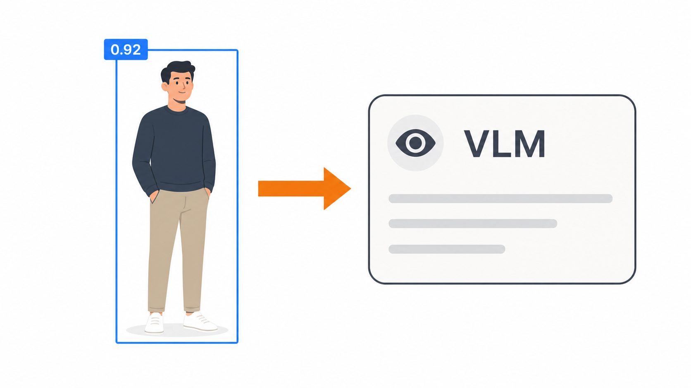

# Detection-to-VLM Assistant

## Metadata

| Field | Value |
| --- | --- |
| Category | genai |
| Difficulty | Advanced |
| Tags | object-detection, genai, yolo26, rtsp, insight, vlm |
| Languages | Python |
| Status | stable |
| Binary Name | detection-to-vlm-assistant |
| Model | yolo26m (w16a16) |

## Concept

Detects people in a live RTSP stream with YOLO26 and sends video to Insight. It can also crop the highest-confidence person and ask a configured vision-language model about them.

The decoded frame branches inside a single graph to the detector, to the H.264 sender, and back to the application for the GenAI crop. Video and metadata therefore carry timestamps from the same frame, which is what lets Insight draw each detection on the frame it came from.

## Preview



## Prerequisites

- `sima-cli` ([documentation](https://developer.sima.ai/software/tools/sima-cli/)) on the Modalix DevKit, or in a Neat SDK container paired with it.
- An RTSP source and an [Insight](https://developer.sima.ai/software/tools/insight/) URL reachable from the target.
- The [LLiMa model manager](https://developer.sima.ai/software/genai-llima/runtime) available on the target when GenAI is enabled.

## Install Apps

Install on the Modalix DevKit, or under `/workspace` in a Neat SDK container paired with it. Run the `llima` commands and the example itself on the DevKit. `sima-cli neat install apps` also offers to install the compatible Neat Library and Insight, and skips them when they are up to date. To keep the Neat Library and Insight you have without being asked, run the install as `NEAT_APPS_SKIP_DEPENDENCIES=1 sima-cli neat install apps`. See [Install Apps](https://github.com/sima-neat/apps/blob/main/README.md#install-apps).

Install the latest Neat Apps runtime and enter the installed bundle:

```bash
sima-cli neat install apps
cd prebuilt-apps
APP_DIR=examples/genai/detection-to-vlm-assistant
```

Run the remaining commands from `prebuilt-apps/`.

## Prepare the Model

The [model browser](https://developer.sima.ai/models/) has the YOLO26 detection models in five sizes, from n (nano) to x (extra large). The default detector is `yolo26m` with the `w16a16` variant. Download it and unpack it with `sima-cli` 2.1.20 or newer:

```bash
sima-cli models download --id yolo26m --variant w16a16
unzip -o models/yolo26m/w16a16/yolo26m_w16a16_default.zip -d models/yolo26m/w16a16
```

The download is a ZIP file with the model package and its license. `unzip` puts the model package, `models/yolo26m/w16a16/yolo26m_w16a16_mpk.tar.gz`, next to the ZIP file.

| ID | Variants | Role |
| --- | --- | --- |
| `yolo26m` | `w8a8`, `w8a16`, `w16a16` | Default (`w16a16`) |
| `yolo26n` | `w8a8`, `w8a16`, `w16a16` | Supported |
| `yolo26s` | `w8a8`, `w8a16`, `w16a16` | Supported |
| `yolo26l` | `w8a8`, `w8a16`, `w16a16` | Supported |
| `yolo26x` | `w8a8`, `w8a16`, `w16a16` | Supported |

To use another detector, replace `yolo26m` and `w16a16` in both commands and in `model.path`. The variant is the number format the model was compiled with: `w8a8` stores weights and activations as 8-bit integers, `w8a16` keeps 8-bit integer weights and stores activations in BF16, a 16-bit float format, and `w16a16` uses BF16 for both.

Set `model.path` to the unpacked `.tar.gz` package, not to the ZIP file.

The default VLM is `Qwen3-VL-4B-Instruct-Autoround-a16w4`.

Search the supported models:

```bash
llima search
```

Install the default model:

```bash
llima pull Qwen3-VL-4B-Instruct-Autoround-a16w4
```

LLiMa stores models under `/media/nvme/llima/models/` by default. Set `LLIMA_MODELS_PATH` before `llima pull` to use another model directory, then update `genai_server.model.path` accordingly.

## Prepare Insight

[Insight](https://developer.sima.ai/software/tools/insight/) can host the input stream and render the video and detection metadata. Install videos directly from the Insight catalog or through Insight's YouTube support.

In the Insight Web UI, start the required stream and copy its RTSP URL. Use the host and UDP port ranges reported by `neat` for the output settings. Use a host and published port that the target can reach, not `localhost` and not an address only Insight's own machine can resolve. Verify the URL from the target before running; the application prints the resolved source and its dimensions on startup.

## Configure

Open `${APP_DIR}/src/common/config.yaml`. Set the RTSP URL, detector model path, and Insight host and ports.

The packaged config sets `genai.enabled` to `true`. Check the server model name and path and update the prompts before using the VLM. Set it to `false` to run only detection and Insight output.

## Run

Install the Python dependencies:

```bash
source ~/pyneat/bin/activate
pip install -r ${APP_DIR}/src/python/requirements.txt
```

When GenAI is enabled, start the server in one terminal. The server uses port
`9998` and loads the VLM on the accelerator, as GenAI Studio does. If GenAI
Studio is running, for example after you set it up from Insight's GenAI tab,
stop it first with `run.sh stop` in its folder
(`~/prebuilt-apps/examples/genai/neat-genai-studio` when Insight installed it).

```bash
APP_DIR=examples/genai/detection-to-vlm-assistant
source ~/pyneat/bin/activate
python3 ${APP_DIR}/src/python/genai_server.py \
  --config ${APP_DIR}/src/common/config.yaml
```

Start the detection pipeline in another terminal:

```bash
APP_DIR=examples/genai/detection-to-vlm-assistant
source ~/pyneat/bin/activate
python3 ${APP_DIR}/src/python/detector_app.py \
  --config ${APP_DIR}/src/common/config.yaml
```

The GenAI path checks `/v1/models`, waits at least `genai.interval_seconds` between requests, and bounds queued and in-flight work with `genai.max_pending_requests`.

## Expected Result

Both lines below come from the **detector** terminal, not the server's. The
detector's startup banner reports the GenAI endpoint it will call, and it prints
each vision-language response as that response arrives:

```text
[genai-server] enabled model=Qwen3-VL-4B-Instruct-Autoround-a16w4 url=http://127.0.0.1:9998 interval=5s
[response #001] The person is seated and holding an object with both hands, appearing to rest or interact with it.
```

The server terminal prints its own lines instead, `added model: ...` followed by
`serving GenAI API on http://0.0.0.0:9998`; check there if the detector reports
the endpoint as unreachable.

Responses are deliberately infrequent. `genai.interval_seconds` sets the minimum
gap between requests, so at the default of `5` a short run produces only a
handful, and a response appears only when the detector has a person to crop. Few
responses is not a fault; none at all, on a source containing people, is.

## Troubleshooting

- Verify the RTSP URL and Insight ports before investigating inference.
- Verify `model.path` points to the detector package.
- Verify the VLM server lists `genai_server.model.name` under `/v1/models`.
- If the GenAI server cannot start on port `9998`, another server already uses
  it, usually GenAI Studio. Stop GenAI Studio as described in [Run](#run).
- Disable GenAI to isolate the detector and Insight path.

## Source Files

- Detector application: `src/python/detector_app.py`
- GenAI server: `src/python/genai_server.py`
- Shared runtime files: `src/common/`

## Development From Source

To modify or test this example, use the [Apps contributor workflow](https://github.com/sima-neat/apps/blob/main/CONTRIBUTING.md).
