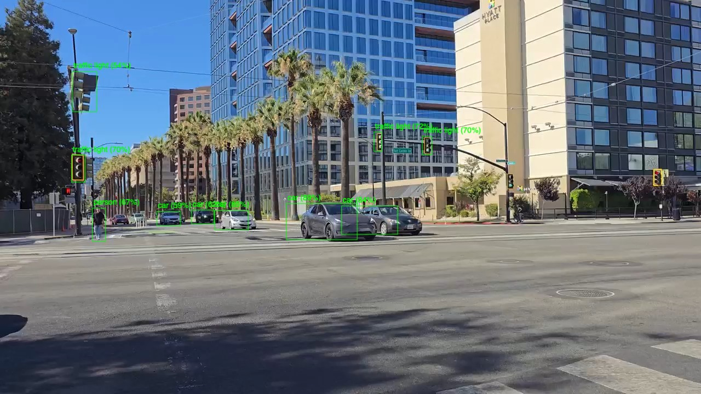

# Inference Hub

## Metadata

| Field | Value |
| --- | --- |
| Category | model-hub |
| Difficulty | Intermediate |
| Tags | model-registry, object-detection, classification, yolo26, rf-detr, resnet, rtsp, camera, insight |
| Languages | Python |
| Status | stable |
| Binary Name | inference-hub |
| Model | YOLO26, RF-DETR, or ResNet-50 from the Model Registry |

## Concept

Run a YOLO26, RF-DETR, or ResNet-50 model from the Model Registry on an RTSP stream or MIPI camera and view the video and results in Insight.

`main.py` owns the pipeline: it decodes the source once, forwards the video to Insight, and passes the newest decoded frames to the selected model. A 4-frame queue replaces stale frames when inference falls behind. Each folder under `src/python/hub_models/` holds one model family: `config.yaml` names its labels, Model Registry build, components, and variants, and `model.py` builds the Neat model and turns its output into Insight metadata. To add a model, add a folder with the same two files.

## Preview



## Prerequisites

- [`sima-cli`](https://developer.sima.ai/software/tools/sima-cli/) with Model Registry support on a supported Modalix or DevKit target, and `unzip`.
- An H.264, H.265, or MJPEG RTSP source, or a MIPI camera.
- An [Insight endpoint](https://developer.sima.ai/software/tools/insight/) reachable from the target.

## Install Apps

```bash
sima-cli neat install apps
cd prebuilt-apps
APP_DIR=examples/model-hub/inference-hub
```

Run the remaining commands from `prebuilt-apps/`.

## Prepare the Model

Select a model with `model.name` and `model.variant`:

| `model.name` | `model.variant` | Model Registry ID | Build | Insight metadata |
| --- | --- | --- | --- | --- |
| `yolo26` | `n`, `s`, `m`, `l`, `x` | `yolo26n` to `yolo26x` | `modalix_int8` | `object-detection` |
| `rf_detr` | `nano`, `small`, `medium`, `large` | `rf_detr_nano` to `rf_detr_large` | `modalix_int8_bf16` | `object-detection` |
| `resnet50` | `default` | `resnet_50` | `modalix_int8` | `classification` |

Install the selected model into `models/`. For YOLO26m, the default:

```bash
mkdir -p models
sima-cli models download --stg -b develop --id yolo26m --variant modalix_int8 -o models
unzip -o models/yolo26m/modalix_int8/yolo26m_modalix_int8_default.zip -d models
```

For another model, replace the ID and build with the values from the table. If the selected model is missing, the application prints the commands that install it.

## Configure

Edit `$APP_DIR/src/common/config.yaml`:

- Set `model.name` and `model.variant`. `model.dir` is the directory holding the installed models.
- For RTSP, keep `source.type: rtsp`, set `source.rtsp.url`, and set `source.rtsp.codec` to `h264`, `h265`, or `mjpeg`. The application reads the size and frame rate from the stream; a positive `source.rtsp.fps` overrides the frame rate.
- For a MIPI camera, set `source.type: camera` and the capture size and frame rate under `source.camera`. The camera path is not verified: on Platform 3.0.0 it currently stops with `A pipeline stage stopped while processing data`. Use RTSP until camera capture works.
- Set `insight.host`, `video_port`, and `metadata_port` to the values reported by Insight.
- Keep `inference.frames: 0` to run until Ctrl-C, or set a finite result count.

Per-model settings, such as the minimum score, live in `$APP_DIR/src/python/hub_models/<name>/config.yaml`.

## Run

```bash
source ~/pyneat/bin/activate
pip install -r "$APP_DIR/src/python/requirements.txt"
python3 "$APP_DIR/src/python/main.py" --config "$APP_DIR/src/common/config.yaml"
```

## Expected Result

The application writes nothing to disk. Insight shows the video with boxes or class labels, and the terminal prints a startup line and a closing summary:

```text
resnet50 default on rtsp 1280x720@30 -> Insight <insight-host-ip> video=9000 metadata=9100
published=600 results_fps=30.0
```

`results_fps` should track the source frame rate when the model keeps up. When it falls behind, the queue drops the oldest frames and the video in Insight keeps the source rate.

## Troubleshooting

- `model.name must be one of [...]` or `model.variant for <name> must be one of [...]` lists the valid choices.
- `<id> is not installed in models` is followed by the commands that install it.
- `cannot open RTSP source` means the URL is not reachable from the target. Use a host and port reachable from the board, not `localhost`.

## Source Files

- Python implementation: `src/python/main.py`
- Model folders: `src/python/hub_models/`
- Shared configuration and labels: `src/common/`

## Development From Source

To modify, compile, or test this example, use the [Apps contributor workflow](https://github.com/sima-neat/apps/blob/main/CONTRIBUTING.md).
