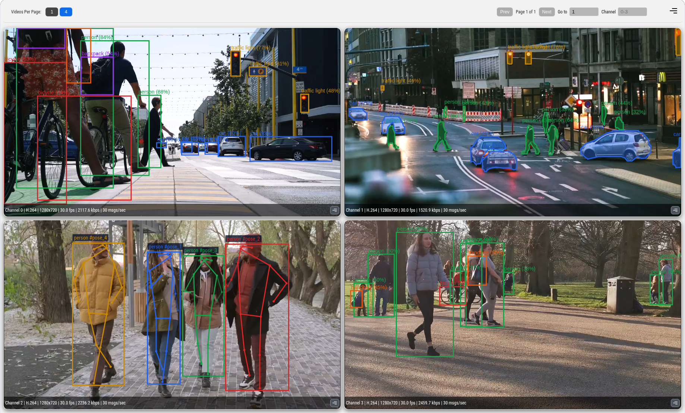

# Multi Stream Multi Model

## Metadata

| Field | Value |
| --- | --- |
| Category | multi-model |
| Difficulty | Advanced |
| Tags | multi-model, multi-stream, detection, segmentation, pose, yolo11, yolo26, rtsp, insight |
| Languages | C++, Python |
| Status | experimental |
| Binary Name | multi-stream-multi-model |
| Model | yolo11s (w8a8), yolo26s_seg (w8a16), yolo26m_pose (w8a8), yolo26m (w8a8) |

## Concept

Runs a different YOLO model on each of up to four RTSP cameras. Insight shows each camera's video with its detection, segmentation, or pose results.

```text
How does a frame move through multi-stream-multi-model?

╭┄┄┄┄┄┄┄┄┄┄┄┄┄┄┄┄┄┄┄┄┄┄┄┄┄┄┄┄┄┄┄┄┄┄┄┄┄┄┄┄┄┄┄┄┄┄┄┄┄┄┄┄┄┄┄┄┄┄┄┄┄┄┄┄┄┄┄┄┄┄┄┄┄┄┄┄╮
┆ RUN                                                                        ┆
┆   ┌────────────────────────┐                  ┌────────────────────────┐   ┆
┆   │ RtspEncodedInput × N   │─────────────────►│ VideoSender × N        │───┆──────┐
┆   └────────────────────────┘  latest/stream   └────────────────────────┘   ┆      │
┆       │ encoded frames                                                     ┆      │ video
┆       ▼                                                                    ┆      │
┆   ┌────────────────────────┐                                               ┆      │
┆   │ SimaDecode × N         │─────────────────►┌────────────────────────┐   ┆      │
┆   └────────────────────────┘  latest/stream   │ Output "frames_i" × N  │   ┆      │
┆       │ NV12, latest/stream                   └────────────────────────┘   ┆      │
┆       ▼                                           │ newest frame           ┆      │
┆   ┌────────────────────────┐                      │                        ┆      │
┆   │ YOLO Model × N         │ one per stream       │                        ┆      │
┆   └────────────────────────┘                      │                        ┆      │
┆       │ result tensors                            │                        ┆      │
┆       ▼                                           │                        ┆      │
┆   ┌────────────────────────┐                      │                        ┆      │
┆   │ Output "results_i" × N │                      │                        ┆      │
┆   └────────────────────────┘                      │                        ┆      │
╰┄┄┄┄┄┄┄│┄┄┄┄┄┄┄┄┄┄┄┄┄┄┄┄┄┄┄┄┄┄┄┄┄┄┄┄┄┄┄┄┄┄┄┄┄┄┄┄┄┄┄│┄┄┄┄┄┄┄┄┄┄┄┄┄┄┄┄┄┄┄┄┄┄┄┄╯      │
        ▼ pull                                      ▼ pull                          │
    ┌──────────────────────────────────────────────────┐                            │
    │ Pull loop: metadata, result deadline             │                            │
    └──────────────────────────────────────────────────┘                            │
        │ objects, segments, or poses as JSON                                       │
        ▼                                                                           ▼
    ┌────────────────────────┐                                               ┌────────────┐
    │ MetadataSender × N     │──────────────────────────────────────────────►│ Insight    │
    └────────────────────────┘                                               └────────────┘
```

- One graph and one `Run` hold every stream. Each stream has its own `SimaDecode`, its own model, and its own `Output "results_i"`.
- `RtspEncodedInput` sends each stream's encoded video to Insight unchanged. Insight draws every overlay from the metadata.
- The link into each model keeps the newest decoded frames. Core is meant to let each model hold 4 frames of its stream at once. That is not yet verified on a DevKit with `Output "frames_i"` on the same decoder.
- `Output "frames_i"` keeps only the newest decoded frame. The pull loop reads it to know that the decoder is sending. The RTSP input feeds only the decoder and the video sender, so Core runs the three as one pipeline.
- One pull loop reads every output in turn. It turns each result into Insight metadata and sends it on the stream's channel.
- Decoded frames that arrive with no result for 10 seconds stop the application with an error. The first result may take 30 seconds, because Core builds the rest of the pipeline on the first frame. A camera that pauses sends no frames, so it may wait without a limit.

## Preview



## Prerequisites

- `sima-cli` 2.1.20 or newer ([documentation](https://developer.sima.ai/software/tools/sima-cli/)) on the Modalix DevKit, or in a Neat SDK container paired with it.
- One to four RTSP streams, all H.264 or all H.265. Several streams may use the same URL. Each one still gets its own decoder and model.
- An [Insight](https://developer.sima.ai/software/tools/insight/) host that the DevKit can reach.
- Source frame rates that fit the decoder. Four 1920x1080@30 streams fit a DevKit. Four 1920x1080@60 H.265 streams exceed what the decoder admits. Lower the rate at the camera, or use fewer streams.

## Install Apps

Install on the Modalix DevKit, or under `/workspace` in a Neat SDK container paired with it. Only the example itself must run on the DevKit. `sima-cli neat install apps` also offers to install the compatible Neat Library and Insight, and skips them when they are up to date. To keep the Neat Library and Insight you have without being asked, run the install as `NEAT_APPS_SKIP_DEPENDENCIES=1 sima-cli neat install apps`. See [Install Apps](https://github.com/sima-neat/apps/blob/main/README.md#install-apps).

Install the latest Neat Apps runtime and enter the installed bundle:

```bash
sima-cli neat install apps
cd prebuilt-apps
APP_DIR=examples/multi-model/multi-stream-multi-model
```

Run the remaining commands from `prebuilt-apps/`.

## Prepare the Model

The four default packages come from the [model browser](https://developer.sima.ai/models/). Download and unpack each one:

```bash
sima-cli models download --id yolo11s --variant w8a8
unzip -o models/yolo11s/w8a8/yolo11s_w8a8_default.zip -d models/yolo11s/w8a8
sima-cli models download --id yolo26s_seg --variant w8a16
unzip -o models/yolo26s_seg/w8a16/yolo26s_seg_w8a16_default.zip -d models/yolo26s_seg/w8a16
sima-cli models download --id yolo26m_pose --variant w8a8
unzip -o models/yolo26m_pose/w8a8/yolo26m_pose_w8a8_default.zip -d models/yolo26m_pose/w8a8
sima-cli models download --id yolo26m --variant w8a8
unzip -o models/yolo26m/w8a8/yolo26m_w8a8_default.zip -d models/yolo26m/w8a8
```

Each download is a ZIP file with the model package and its license. `unzip` puts the model package next to the ZIP file. The packaged `app.model_paths` already points to these four files. A relative path starts at the config file, and `../../../../../models/` from `${APP_DIR}/src/common/` is `prebuilt-apps/models/`.

| Stream | Task | Model package | `app.model_ids` |
| --- | --- | --- | --- |
| 0 | Detection | `models/yolo11s/w8a8/yolo11s_w8a8_mpk.tar.gz` | `yolov8` |
| 1 | Segmentation | `models/yolo26s_seg/w8a16/yolo26s_seg_w8a16_mpk.tar.gz` | `yolo26-seg` |
| 2 | Pose | `models/yolo26m_pose/w8a8/yolo26m_pose_w8a8_mpk.tar.gz` | `yolo26-pose` |
| 3 | Detection | `models/yolo26m/w8a8/yolo26m_w8a8_mpk.tar.gz` | `yolo26` |

These four packages are the tested set. `app.model_ids` names each package's task and head layout. The package does not name its decoder. YOLO11 packages carry the YOLOv8 heads, so they take `yolov8`, `yolov8-seg`, or `yolov8-pose`. YOLO26 packages take `yolo26`, `yolo26-seg`, or `yolo26-pose`.

## Prepare Insight

In the Insight Web UI, install or pick up to four videos and start one stream per video. Copy their RTSP URLs into `input.source`. Use a host and port the DevKit can reach, not `localhost`.

## Configure

Open `${APP_DIR}/src/common/config.yaml` and set:

- `input.source`: one RTSP URL per stream. Stream i runs model i and goes to Insight channel i.
- `input.codec`: `h264` or `h265`, the same for every stream.
- `app.model_paths` and `app.model_ids`: one entry per stream, in `input.source` order. To run fewer streams, remove the same entries from all three lists.
- `output.insight.host`. Stream i sends video to `video_port_base` + i and results to `metadata_port_base` + i.

`inference.frames` at 0 or less runs until you stop the application.

## Run

### C++

```bash
./${APP_DIR}/src/cpp/pre-built/multi-stream-multi-model \
  --config ${APP_DIR}/src/common/config.yaml
```

### Python

```bash
source ~/pyneat/bin/activate
pip install -r ${APP_DIR}/src/python/requirements.txt
python3 ${APP_DIR}/src/python/main.py \
  --config ${APP_DIR}/src/common/config.yaml
```

Stop the application with `Ctrl-C`.

## Expected Result

The application prints one line per stream with its model, source, frame size, and Insight ports:

```text
[stream 0] yolov8 model=../../../../../models/yolo11s/w8a8/yolo11s_w8a8_mpk.tar.gz rtsp=rtsp://<insight-host-ip>:8554/src1 stream=1920x1080@30 insight=<insight-host-ip> video=9000 metadata=9100
[stream 1] yolo26-seg model=../../../../../models/yolo26s_seg/w8a16/yolo26s_seg_w8a16_mpk.tar.gz rtsp=rtsp://<insight-host-ip>:8554/src2 stream=1920x1080@30 insight=<insight-host-ip> video=9001 metadata=9101
[stream 2] yolo26-pose model=../../../../../models/yolo26m_pose/w8a8/yolo26m_pose_w8a8_mpk.tar.gz rtsp=rtsp://<insight-host-ip>:8554/src3 stream=1920x1080@30 insight=<insight-host-ip> video=9002 metadata=9102
[stream 3] yolo26 model=../../../../../models/yolo26m/w8a8/yolo26m_w8a8_mpk.tar.gz rtsp=rtsp://<insight-host-ip>:8554/src4 stream=1920x1080@30 insight=<insight-host-ip> video=9003 metadata=9103
```

Open a viewer tab in Insight for each channel. Detection channels show boxes, the segmentation channel shows mask outlines, and the pose channel shows skeletons.

When it stops, the application prints how many results each stream sent. A positive `inference.frames` stops it after that many results per stream. With `inference.frames: 300`:

```text
[stream 0] processed=300 left_out=0
[stream 1] processed=300 left_out=0
[stream 2] processed=300 left_out=0
[stream 3] processed=300 left_out=0
```

`left_out` counts the objects, segments, or poses that did not fit their metadata message. The lowest-confidence ones are left out first.

The metadata sender does not wait for a full network buffer. It drops the message instead, and the application then prints the count, such as `[stream 0] 3 metadata messages dropped`.

## Troubleshooting

- `<config> is missing <key>` or `<key> must be <type>` names a key the config lacks or sets to the wrong type. Compare it with the packaged config.
- `app.model_paths has 3 entries and input.source has 4`: give every list one entry per stream.
- `app.model_ids: unknown value` lists the values the application takes. Pick the one for the package's task and family.
- `failed to probe RTSP frame size: <url>` or `failed to probe RTSP frame rate: <url>`: a value left at 0 could not be read. Check that the URL is reachable from the DevKit. For a reachable stream, set the value the message names.
- `stream <i>: model <path> returned no result for 10 s while its decoder sent frames`: that stream's model stopped. Check its package and its `app.model_ids` entry, then start the application again. The same message with `30 s` means the model never returned its first result.
- Streams fall below the source rate: the MLA is oversubscribed. Use lighter packages or fewer streams.
- Boxes appear in about the right places but at the wrong sizes: the `app.model_ids` entry does not match the package's heads. Check it against the table above.
- A positive `left_out` at exit: a frame's results did not fit one message. Lower `inference.max_detections` or raise `inference.min_score`.
- No video or results in Insight: check the Insight host and the UDP ports. Make sure no other application sends to the same ports.

## Source Files

- C++ reference source: `src/cpp/main.cpp`, with the Insight metadata in `src/cpp/utils/insight_metadata.cpp` and the result deadline in `src/cpp/utils/pending_results.cpp`
- Python source: `src/python/main.py`, with the Insight metadata in `src/python/utils/insight_metadata.py` and the result deadline in `src/python/utils/pending_results.py`
- Shared config: `src/common/config.yaml`
- Class labels: `src/common/coco_label.txt`
- Helpers the examples share: `support/python/sima_examples/` at the root of the installed bundle. `main.py` finds it in a folder above itself. Their C++ reference source is in `support/cpp/sima_examples/`.

The packaged C++ source is an implementation reference. Run the executable under `src/cpp/pre-built/`. The installed bundle does not include CMake files.

## Development From Source

To modify, compile, or test this example, use the [Apps contributor workflow](https://github.com/sima-neat/apps/blob/main/CONTRIBUTING.md).
