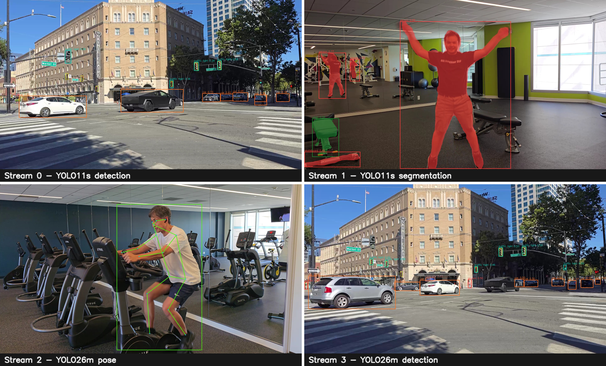

# Multi Stream Multi Model

## Metadata

| Field | Value |
| --- | --- |
| Category | multi-model |
| Difficulty | Advanced |
| Tags | multi-model, multi-stream, detection, segmentation, pose, yolo11, yolo26, rtsp, insight |
| Languages | C++, Python |
| Status | experimental |
| Binary Name | multi-stream-multi-model |
| Model | yolo_11s, yolo_11s_seg, yolo26m-pose-int8-b1, yolo26m-det-int8-b1 |

## Concept

Runs a different model on each of up to four RTSP cameras in one process, and sends every camera's video and its own detection, segmentation, or pose metadata to Insight.

Each stream uses its own model and Insight channel. The default configuration runs
object detection, instance segmentation, pose estimation, and object detection on
streams 0–3. Source timestamps keep each overlay paired with its camera frame.

```text
Per stream: RTSP encoded ─┬─> codec passthrough ──────────────> Insight video
                          └─> decode NV12 ─> NV12 frame output ─┐
                                                                │
Application, per stream:  NV12 frame ───────────────────────────┘
                          └─> model graph (Preproc ─> inference ─> BoxDecode)
                              ─> boxes, masks or keypoints ────> Insight metadata
```

Every camera's receive-and-decode chain shares one graph and one run, because Neat
grants a decoder-admission lease only when a single graph holds more than one decoder.
Each model gets a graph and run of its own, so a stalled model cannot stop its
neighbours. The video the viewer sees is the camera's own encoded stream, passed
through untouched; Insight draws every overlay from the metadata.

## Preview



## Prerequisites

- `sima-cli` ([documentation](https://developer.sima.ai/software/tools/sima-cli/)) on a supported Modalix or DevKit target.
- Up to four RTSP sources, all H.264 or all H.265, and an [Insight](https://developer.sima.ai/software/tools/insight/) host reachable from the target. Pointing several streams at the same camera is fine; each one still builds its own decode and its own model.
- Source frame rates that fit the decoder. Four 1920x1080@30 streams fit a DevKit; four 1920x1080@60 H.265 streams exceed decoder admission. Reduce the camera's frame rate or use fewer streams — the application does not resample, so `inference.fps` cannot work around this.

## Install Apps

Install the latest Neat Apps runtime and enter the installed bundle:

```bash
sima-cli neat install apps
cd prebuilt-apps
APP_DIR=examples/multi-model/multi-stream-multi-model
```

Run the remaining commands from `prebuilt-apps/`.

## Prepare the Model

Model packages come from the Model Zoo release below, which can differ from the installed platform
version. Set each `streams[].model` to the matching package and keep the archives compressed.

| Stream | Task | Model package | Source | `decode` |
| --- | --- | --- | --- | --- |
| 0 | Detection | `models/yolo_11s_mpk.tar.gz` | Direct artifact (Model Zoo `yolo_11s`) | `yolov8` |
| 1 | Segmentation | `models/yolo_11s_seg_mpk.tar.gz` | Direct artifact (Model Zoo `yolo_11s_seg`) | `yolov8` |
| 2 | Pose | `models/yolo26m-pose-int8-b1.tar.gz` | Direct artifact | `yolo26` |
| 3 | Detection | `models/yolo26m-det-int8-b1.tar.gz` | Direct artifact | `yolo26` |

```bash
export MODELZOO_VERSION="3.0.0"
mkdir -p models
cd models
sima-cli download "https://docs.sima.ai/pkg_downloads/SDK${MODELZOO_VERSION}/models/modalix/yolo_11s_mpk.tar.gz"
sima-cli download "https://docs.sima.ai/pkg_downloads/SDK${MODELZOO_VERSION}/models/modalix/yolo_11s_seg_mpk.tar.gz"
sima-cli download "https://docs.sima.ai/pkg_downloads/SDK${MODELZOO_VERSION}/models/modalix/yolo26-pose/yolo26m-pose-int8-b1.tar.gz"
sima-cli download "https://docs.sima.ai/pkg_downloads/SDK${MODELZOO_VERSION}/models/modalix/yolo26-detection/yolo26m-det-int8-b1.tar.gz"
cd ..
```

These four packages are the tested set. The `decode` setting selects the package's head layout:
use `yolov8` for these YOLO11 packages and `yolo26` for these YOLO26 packages.

## Prepare Insight

[Insight](https://developer.sima.ai/software/tools/insight/) can host the input streams and render
each output channel. Install videos directly from the Insight catalog or through Insight's YouTube
support.

In the Insight Web UI, start the four required streams and copy their RTSP URLs into `streams`. Use
a host and published port that the target can reach, not `localhost` and not an address only
Insight's own machine can resolve. Verify each URL from the target before running; the application
prints the resolved source and its dimensions for every stream on startup.

## Configure

Open `${APP_DIR}/src/common/config.yaml` and set:

- `streams[].url` — the RTSP URL for each camera.
- `streams[].task` — `detection`, `segmentation`, or `pose`.
- `streams[].decode` — `yolov8` or `yolo26`, matching the package's head layout.
- `streams[].model` — the downloaded package for that stream.
- `input.codec` — `h264` or `h265`. All streams share this one setting, so every camera must use
  the same codec.
- `input.tcp` — `true` to receive RTSP over TCP, `false` for UDP.
- `output.insight.host` — the host running Insight.
- `output.insight.video_port_base` and `output.insight.metadata_port_base` — the first Insight
  port for each kind of output (defaults `9000` and `9100`).

`inference.fps` must remain `0`: this application uses each camera's source frame
rate. Configure a lower rate at the camera or RTSP streamer when needed.

Drop stream entries to run fewer than four models; the example accepts one to four. Stream *i*
publishes video on `output.insight.video_port_base + i` and metadata on
`output.insight.metadata_port_base + i`.

## Run

### C++

```bash
./${APP_DIR}/src/cpp/pre-built/multi-stream-multi-model \
  --config ${APP_DIR}/src/common/config.yaml
```

### Python

```bash
source ~/pyneat/bin/activate
pip install -r ${APP_DIR}/src/python/requirements.txt
python3 ${APP_DIR}/src/python/main.py \
  --config ${APP_DIR}/src/common/config.yaml
```

Both implementations read the same config and accept `--validate-config-only` to check it without
touching the cameras.

## Expected Result

Each stream prints its resolved task, model, camera, and Insight ports at startup:

```text
[stream 0] task=detection decode=yolov8 model=yolo_11s_mpk.tar.gz rtsp=<url> stream=1920x1080@30 insight=<host> video=9000 metadata=9100
[stream 1] task=segmentation decode=yolov8 model=yolo_11s_seg_mpk.tar.gz rtsp=<url> stream=1920x1080@30 insight=<host> video=9001 metadata=9101
[stream 2] task=pose decode=yolo26 model=yolo26m-pose-int8-b1.tar.gz rtsp=<url> stream=1920x1080@30 insight=<host> video=9002 metadata=9102
[stream 3] task=detection decode=yolo26 model=yolo26m-det-int8-b1.tar.gz rtsp=<url> stream=1920x1080@30 insight=<host> video=9003 metadata=9103
```

When the run ends (Ctrl-C, or `inference.frames` reached), each stream reports what it published:

```text
[stream 0] task=detection processed=1229 dropped_objects=0
[stream 1] task=segmentation processed=1210 dropped_segments=0
[stream 2] task=pose processed=1203 dropped_poses=0
[stream 3] task=detection processed=1205 dropped_objects=0
```

Open the Insight Video Viewer and select the four channels. Open a viewer tab for **every**
channel you want to see: Insight only forwards frames to channels with a viewer attached, and a
channel with no tab open renders nothing and correlates no metadata. Each one shows its own camera with the
overlay its task publishes: boxes on the detection channels, masks on the segmentation channel, and
skeletons on the pose channel. Insight draws these from the metadata, so the video itself is the
untouched camera stream.

Setting `output.debug_dir` and `output.save_every` also writes annotated JPEGs named
`stream_<i>_frame_<n>.jpg`, which is the quickest way to confirm a stream's model without a browser.

With `runtime.profile: true`, the packaged default, the application also prints each pipeline and
its element counters (`Pipeline:`, `ElementFlow:`, `Backend:`), and each stream reports its
throughput every 100 frames:

```text
[profile stream=1 task=segmentation] frames=100 output_fps=30.3 avg_result_pull_ms=24.3 avg_metadata_send_ms=4.1 avg_instances=3.7
```

Set `runtime.profile: false` for a quiet run.

With the four default packages and debug saving disabled, every stream tracks its source rate on a
Modalix DevKit: four 1920x1080@30 H.264 cameras each report close to 30 fps in `output_fps`, in both
implementations. This is the source rate, not a capacity measurement; the device has headroom these
packages do not use.

Setting `output.debug_dir` adds a host NV12-to-BGR conversion for every frame the application
pulls, not only for the frames `output.save_every` writes. Leave `debug_dir` unset for a
performance run.

## Troubleshooting

- Boxes lag or lead the objects they describe: Insight is not matching metadata to video frames.
  Each message carries its source frame's timestamp and a frame ID (numbered per stream when the
  decoder supplies none); when the decoded camera frame has no PTS, the message is sent with
  timestamp `-1` and cannot be matched.
  Check `matched_video_first` in
  `curl -k https://<insight-host>:9900/api/ingest/stats` — it should track `messages_received`
  one-for-one. It also reads zero when two copies of the application publish to the same channel,
  so confirm only one is running.
- Boxes appear in roughly the right places but at the wrong sizes: `streams[].decode` does not match
  the package's head layout. Check it against the table above.
- One stream is silent while the others work: confirm that its camera URL plays and that its
  Insight metadata port is not taken by another application.
- A stream reports a nonzero `dropped_objects`, `dropped_segments` or `dropped_poses` at exit: a
  frame's results did not fit one metadata message, so the lowest-confidence ones were left out.
  Lower `inference.max_detections` or raise `inference.min_score`.
- The application exits with `consecutive decoded frames were unusable`: the decoder is not
  producing NV12 frames for that stream. Check that `input.codec` matches the camera.
- The application exits with a `source pull`, `model pull` or `model push failed` error: a camera,
  decoder or model stopped with the reason shown. Check that camera's URL and that model's package,
  then start the application again.
- One stream falls far behind the others while the rest hold the source rate: the MLA is
  oversubscribed. Four 1920x1080@30 streams fit the small INT8 defaults; heavier packages do not,
  and the shortfall concentrates on a single stream instead of spreading. Drop stream entries or
  return to the default packages.
- Every stream is slow, or a decoder fails to start: the source frame rates exceed decoder
  admission. Four 1920x1080@60 H.265 streams do not fit a DevKit. Lower the rate at the cameras or
  run fewer streams; the application cannot resample, so `inference.fps` is rejected rather than
  silently dropping frames.

## Source Files

- C++ reference source: `src/cpp/main.cpp`
- Python source: `src/python/main.py`
- Shared runtime files: `src/common/`

The packaged C++ source is an implementation reference. Run the executable under `src/cpp/pre-built/`; the installed bundle does not include CMake files.

## Development From Source

To modify, compile, or test this example, use the [Apps contributor workflow](https://github.com/sima-neat/apps/blob/main/CONTRIBUTING.md).
