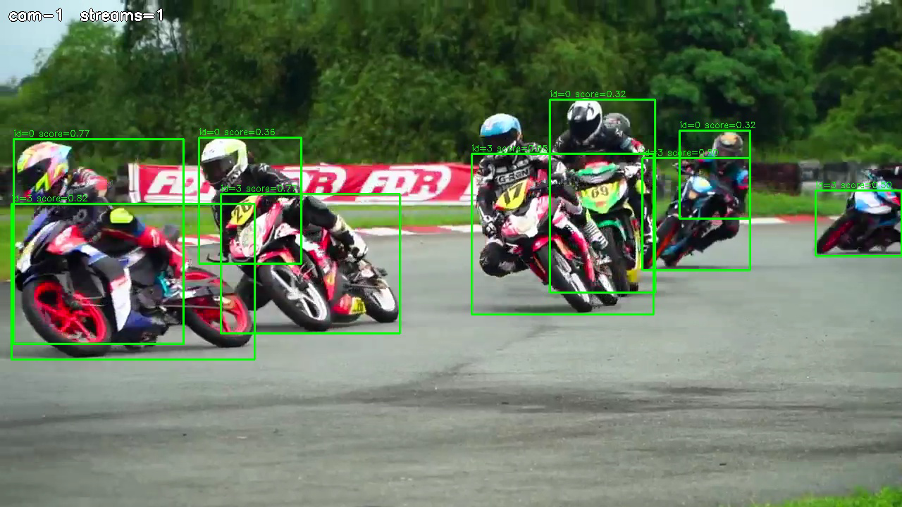

# Adaptive Resolution Object Detector

## Metadata

| Field | Value |
| --- | --- |
| Category | object-detection |
| Difficulty | Advanced |
| Tags | object-detection, rtsp, multistream, adaptive-resolution, insight, yolo26 |
| Languages | C++, Python |
| Status | stable |
| Binary Name | adaptive-resolution-object-detector |
| Model | yolo26n-det-int8-b1 |

## Concept

Runs YOLO26 object detection across many RTSP streams of mixed resolution and frame rate, and sends each stream's video and detection metadata to Insight.

Every stream is detected at its own resolution, so 720p, 1080p, and 4K sources
can run together. The `mode` setting in the config picks how the streams share
the hardware:

| Mode | Topology | Changing the stream list | Use it for |
| --- | --- | --- | --- |
| `live` | One graph per stream; video is re-encoded for Insight | Edit the config while running; only the changed streams start or stop | Adding and removing streams without downtime |
| `scale` | One graph for all streams with one shared detector; each source's H.264 goes to Insight untouched | Restart the application | The highest stream count |
| `group` | The `scale` topology run as several processes of `group.size` streams each | Edit the config while running; only the groups whose streams changed restart | Keeping a failure or a change inside one group of streams |

Measured on one DevKit: `live` rendered every box in Insight up to 6 streams,
and `scale` forwarded 99% of detections at 16 streams of 25 fps. Re-measure with
your own sources before relying on a stream count.

## Preview



## Prerequisites

- `sima-cli` ([documentation](https://developer.sima.ai/software/tools/sima-cli/)) on a supported Modalix or DevKit target.
- H.264 RTSP sources, and an [Insight](https://developer.sima.ai/software/tools/insight/) host reachable from the target.

## Install Apps

Install the latest Neat Apps runtime and enter the installed bundle:

```bash
sima-cli neat install apps
cd prebuilt-apps
APP_DIR=examples/object-detection/adaptive-resolution-object-detector
```

Run the remaining commands from `prebuilt-apps/`.

## Prepare the Model

| Model file | Role |
| --- | --- |
| `yolo26n-det-int8-b1.tar.gz` | Default |
| `yolo26n-det-bf16-mla_tess-b1.tar.gz` | Supported |

Model packages come from the Model Zoo release below, which can differ from the installed platform version. Replace `<model-file>` with a file from the table.

```bash
export MODELZOO_VERSION="3.0.0"
mkdir -p models
cd models
sima-cli download "https://docs.sima.ai/pkg_downloads/SDK${MODELZOO_VERSION}/models/modalix/yolo26-detection/<model-file>"
cd ..
```

Set `model.path` in the config to the downloaded package.

## Prepare Insight

[Insight](https://developer.sima.ai/software/tools/insight/) hosts the input streams and renders each output channel.

1. In the Insight Web UI, open **Media Sources** and add a video for each stream, from the catalog or your own file.
2. Start each stream and copy its RTSP URL.
3. Note the host and the UDP video and metadata port ranges reported by `neat`.

Use a host and published port that the target can reach, not `localhost`. Use
sources at about 25–30 fps: a much faster clip starts and delivers video but
can show no boxes, because Insight evicts pending metadata before the matching
frame arrives.

## Configure

Open `${APP_DIR}/src/common/config.yaml` and set:

- `mode` to `live`, `scale`, or `group`.
- `model.path` to the downloaded package.
- One entry per stream under `streams.sources`, each with a unique `id` and the `url` copied from Insight.
- `output.insight.host`, `video_port`, and `metadata_port`. The stream on channel N publishes to `video_port + N` and `metadata_port + N`, and channels follow the order of `streams.sources`.
- `group.size` in `group` mode: the number of streams each process runs.

In `live` and `group` mode the application checks the config every
`runtime.config_watch_seconds`. Add, remove, or change an entry under
`streams.sources` and save the file:

- `live` starts or stops only the affected streams.
- `group` restarts only the groups whose streams changed, for about 10–30 s;
  the other groups keep running. Streams are assigned to groups in config
  order, so adding a stream at the end restarts only the last group, while
  removing an early stream moves every later stream to a new group and
  channel.

An invalid edit is reported and ignored. `streams.max_streams` is the number of
Insight channels reserved at startup, so raising it needs a restart. Other
settings are read only at startup.

## Run

Validate the config without opening streams:

```bash
./${APP_DIR}/src/cpp/pre-built/adaptive-resolution-object-detector \
  --config ${APP_DIR}/src/common/config.yaml \
  --validate-config-only
```

### C++

```bash
./${APP_DIR}/src/cpp/pre-built/adaptive-resolution-object-detector \
  --config ${APP_DIR}/src/common/config.yaml
```

### Python

```bash
source ~/pyneat/bin/activate
pip install -r ${APP_DIR}/src/python/requirements.txt
python3 ${APP_DIR}/src/python/main.py \
  --config ${APP_DIR}/src/common/config.yaml
```

Stop with Ctrl-C. The application closes every graph before it exits, which
releases the decoder memory for the next run.

## Expected Result

The application prints one line per stream with its channel, source size, and
Insight ports:

```text
[stream cam-1] channel=0 rtsp=rtsp://<rtsp-source-ip>:8554/src1 size=1920x1080@30 video=9000 metadata=9100
[stream cam-2] channel=1 rtsp=rtsp://<rtsp-source-ip>:8554/src2 size=1280x720@25 video=9001 metadata=9101
```

`scale` and `group` also print `[app] graph running: N stream(s)` once their
graph starts, and report the shared detector input when source sizes differ.
`group` prints one `[group N]` line per process with its streams and channels.

Each Insight channel shows its stream's video with detection boxes. Set
`runtime.profile: true` to print per-stream output rate and detection counts.
With `inference.frames` set to a positive number, each stream stops after that
many frames and prints `[stream <id>] processed=<count>`.

## Troubleshooting

- Replace every placeholder URL and the Insight host before running.
- `scale` mixes source sizes by scaling every stream to one detector input. Keep sources within 2x of each other: the hardware scaler does not upscale further, and a stream past that limit shows video with no boxes. The application warns when this happens.
- In `live` mode, a stream that fails is reported and its channel is released; the other streams keep running.
- In `group` mode, a group that fails is reported and the other groups keep running; editing that group's streams restarts it. A run with a positive `inference.frames` exits with an error naming the failed groups.
- To inspect results without Insight, set `output.save_dir` to a directory and `output.save_every` to a positive interval. Annotated frames are saved as `stream_<channel>_frame_<n>.jpg`.

## Source Files

- C++ reference source: `src/cpp/main.cpp`
- Python source: `src/python/main.py`
- Shared runtime files: `src/common/`

The packaged C++ source is an implementation reference. Run the executable under `src/cpp/pre-built/`; the installed bundle does not include CMake files.

## Development From Source

To modify, compile, or test this example, use the [Apps contributor workflow](https://github.com/sima-neat/apps/blob/main/CONTRIBUTING.md).
