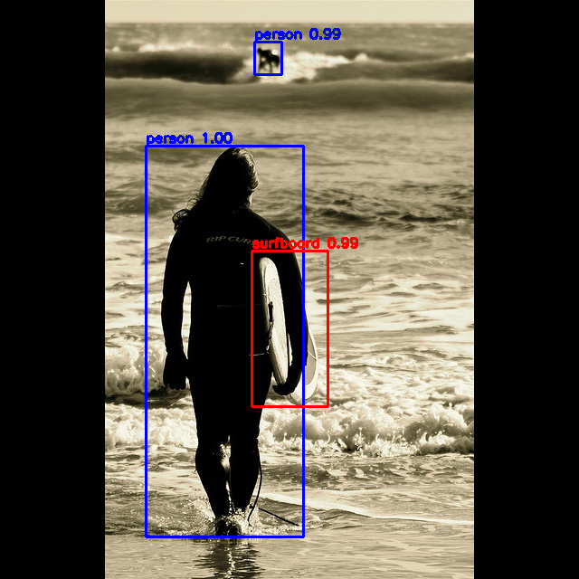

# DETR Object Detector

## Metadata

| Field | Value |
| --- | --- |
| Category | object-detection |
| Difficulty | Intermediate |
| Tags | detr, object-detection, folder-input, coco |
| Languages | C++, Python |
| Status | stable |
| Binary Name | detr-object-detector |
| Model | detr_resnet_50 (w16a16) |

## Concept

Detects objects in a folder of images with DETR and saves annotated images with class labels and confidence scores.

The application passes each image to Neat with the model's preprocessing and
DETR box decoder enabled. Neat stretches the image to the model's input size
without padding, as its DETR decoder requires, with antialiased bilinear
resampling to match how the registry calibrated the model, and applies ImageNet
normalization. Its DETR decoder turns the 100 query outputs into boxes
in original-image pixels, keeps those above `decode.confidence_threshold`, and
returns at most `decode.max_draw` of them. DETR predicts each object once, so
no overlap removal is needed. The application can keep only the COCO `person`
class and writes the annotated result.

## Preview



## Prerequisites

- `sima-cli` ([documentation](https://developer.sima.ai/software/tools/sima-cli/)) on the Modalix DevKit, or in a Neat SDK container paired with it.

## Install Apps

Install on the Modalix DevKit, or under `/workspace` in a Neat SDK container paired with it. Only the example itself must run on the DevKit. `sima-cli neat install apps` also offers to install the compatible Neat Library and Insight, and skips them when they are up to date. To keep the Neat Library and Insight you have without being asked, run the install as `NEAT_APPS_SKIP_DEPENDENCIES=1 sima-cli neat install apps`. See [Install Apps](https://github.com/sima-neat/apps/blob/main/README.md#install-apps).

Install the latest Neat Apps runtime and enter the installed bundle:

```bash
sima-cli neat install apps
cd prebuilt-apps
APP_DIR=examples/object-detection/detr-object-detector
```

Run the remaining commands from `prebuilt-apps/`.

## Prepare the Model

| Model | Variant | Role | Source |
| --- | --- | --- | --- |
| `detr_resnet_50` | `w16a16` | Default | Model Registry |
| `detr_resnet_101` | `w16a16` | Alternative | Model Registry |

Download the default package from the Model Registry:

```bash
sima-cli models download --id detr_resnet_50 --variant w16a16
```

The package lands at
`models/detr_resnet_50/w16a16/detr_resnet_50_w16a16_mpk.tar.gz`. To use
ResNet-101 instead, change `--id` to `detr_resnet_101`. Neat reads the input
size from the package, so both rows work with the same config.

## Configure

Open `${APP_DIR}/src/common/config.yaml` and set `model.path` to the downloaded package, then set `io.input_dir` and `io.output_dir`. Set `decode.person_only` to `true` if you only want person detections. It filters the `decode.max_draw` highest-scoring detections.

## Run

### C++

```bash
./${APP_DIR}/src/cpp/pre-built/detr-object-detector \
  --config ${APP_DIR}/src/common/config.yaml
```

### Python

```bash
source ~/pyneat/bin/activate
pip install -r ${APP_DIR}/src/python/requirements.txt
python3 ${APP_DIR}/src/python/main.py \
  --config ${APP_DIR}/src/common/config.yaml
```

## Expected Result

The application prints one line per image with its detection count and output
file:

```text
[1/21] 000000081061.jpg: 3 detections -> 000000081061_detr.png
[2/21] 000000116439.jpg: 10 detections -> 000000116439_detr.png
```

`io.output_dir` (default `sandbox/detr-object-detector`) then holds one
annotated PNG per input image; with the packaged `assets/datasets/coco` folder
that is 21 files. Detection counts vary by image. A run that writes every file
with `0 detections` usually means `decode.confidence_threshold` is too high for
the content.

## Troubleshooting

- Verify `model.path` if model loading fails.
- Lower `decode.confidence_threshold` if expected objects are missing.
- Use a package from the table above. Neat's DETR decoder expects a class-logit output with a final no-object channel and a four-channel box-logit output, on a stretched input.
- Confirm `io.output_dir` can be created.

## Source Files

- C++ reference source: `src/cpp/main.cpp`
- Python source: `src/python/main.py`
- Shared config: `src/common/config.yaml`

The packaged C++ source is an implementation reference. Run the executable under `src/cpp/pre-built/`; the installed bundle does not include CMake files.

## Development From Source

To modify, compile, or test this example, use the [Apps contributor workflow](https://github.com/sima-neat/apps/blob/main/CONTRIBUTING.md).
