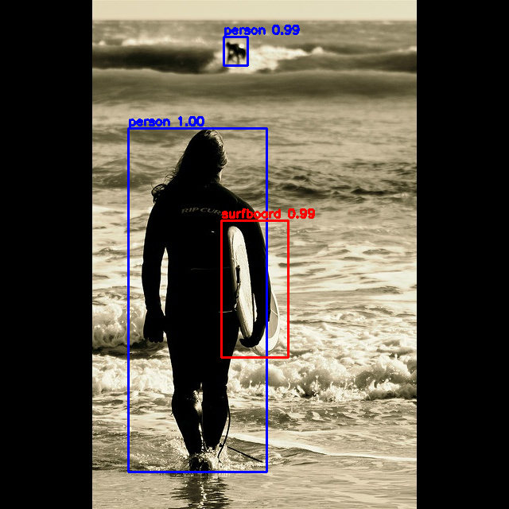

# DETR Object Detector

## Metadata

| Field | Value |
| --- | --- |
| Category | object-detection |
| Difficulty | Intermediate |
| Tags | detr, object-detection, folder-input, coco |
| Languages | C++, Python |
| Status | stable |
| Binary Name | detr-object-detector |
| Model | detr_resnet_50 (w16a16) |

## Concept

Detects objects in a folder of images with DETR and saves annotated images with class labels and confidence scores.

```text
How does an image move through detr-object-detector?

   ┌────────────────────────────────────────────┐
   │ Image folder, input.source                 │
   └────────────────────────────────────────────┘
        │ one BGR image at a time, runner.run
╭┄┄┄┄┄┄┄│┄┄┄┄┄┄┄┄┄┄┄┄┄┄┄┄┄┄┄┄┄┄┄┄┄┄┄┄┄┄┄┄┄┄┄┄┄┄┄┄┄┄┄┄╮
┆ RUN   ▼ from model.build                           ┆
┆  ┌────────────────────────────────────────────┐    ┆
┆  │ DETR Model                                 │    ┆
┆  │ stretch, ImageNet, MLA, DETR box decode    │    ┆
┆  └────────────────────────────────────────────┘    ┆
╰┄┄┄┄┄┄┄│┄┄┄┄┄┄┄┄┄┄┄┄┄┄┄┄┄┄┄┄┄┄┄┄┄┄┄┄┄┄┄┄┄┄┄┄┄┄┄┄┄┄┄┄╯
        ▼ BBOX tensor, decode_bbox_tensor
   ┌────────────────────────────────────────────┐
   │ annotate.draw_detections (utils/)          │
   └────────────────────────────────────────────┘
        │ boxes drawn
        ▼
   ┌────────────────────────────────────────────┐
   │ output.dir, one <image>_detr.png per image │
   └────────────────────────────────────────────┘
```

- The application reads the images one at a time with OpenCV and sends each through `runner.run`, the run that `model.build` creates from the first image. The run accepts images up to the largest width and height in the folder, so a photo above 1920x1080 also works.
- Neat stretches each image to the model's input size without padding, as its DETR decoder requires, with antialiased bilinear resampling to match how the registry calibrated the model, and applies ImageNet normalization.
- Neat's DETR decoder turns the 100 query outputs into boxes in the image's pixels, keeps those above `inference.min_score`, and returns at most `inference.max_detections`. DETR predicts each object once, so no overlap removal is needed.
- The application draws each image's boxes with their labels from `model.labels` and saves the result under `output.dir`.

## Preview



## Prerequisites

- `sima-cli` ([documentation](https://developer.sima.ai/software/tools/sima-cli/)) on the Modalix DevKit, or in a Neat SDK container paired with it.

## Install Apps

Install on the Modalix DevKit, or under `/workspace` in a Neat SDK container paired with it. Only the example itself must run on the DevKit. `sima-cli neat install apps` also offers to install the compatible Neat Library and Insight, and skips them when they are up to date. To keep the Neat Library and Insight you have without being asked, run the install as `NEAT_APPS_SKIP_DEPENDENCIES=1 sima-cli neat install apps`. See [Install Apps](https://github.com/sima-neat/apps/blob/main/README.md#install-apps).

Install the latest Neat Apps runtime and enter the installed bundle:

```bash
sima-cli neat install apps
cd prebuilt-apps
APP_DIR=examples/object-detection/detr-object-detector
```

Run the remaining commands from `prebuilt-apps/`.

## Prepare the Model

| Model | Variants | Role | Source |
| --- | --- | --- | --- |
| `detr_resnet_50` | `w16a16`, `w8a8_mixed` | Default (`w16a16`) | Model browser |
| `detr_resnet_101` | `w16a16`, `w8a8_mixed` | Alternative | Model browser |

Download the default package from the model browser with `sima-cli` 2.1.20 or
newer and extract the model archive from the downloaded ZIP:

```bash
sima-cli models download --id detr_resnet_50 --variant w16a16
unzip -o models/detr_resnet_50/w16a16/detr_resnet_50_w16a16_default.zip -d models/detr_resnet_50/w16a16
```

The packaged config reads
`models/detr_resnet_50/w16a16/detr_resnet_50_w16a16_mpk.tar.gz`; Neat cannot
load the ZIP itself. To use ResNet-101 instead, replace `detr_resnet_50` with
`detr_resnet_101` in both commands and in `model.path`. To use the `w8a8_mixed`
variant, replace `w16a16` in both commands and in `model.path`. Neat reads the
input size from the package, so both rows work with the same config.

## Configure

Open `${APP_DIR}/src/common/config.yaml`. It reads the downloaded default model from `models/`. Set:

- `input.source`: the folder of images. The application processes every `.jpg`, `.jpeg`, `.png`, and `.bmp` file directly inside it, in file-name order, and does not search subfolders. The packaged `assets/datasets/coco` folder holds 21 images.
- `output.dir`: the folder for the annotated PNGs, one per input image. Keep it apart from `input.source`.
- `model.path`: only for another model from the table above; a relative path starts at the config file.

## Run

### C++

```bash
./${APP_DIR}/src/cpp/pre-built/detr-object-detector \
  --config ${APP_DIR}/src/common/config.yaml
```

### Python

```bash
source ~/pyneat/bin/activate
pip install -r ${APP_DIR}/src/python/requirements.txt
python3 ${APP_DIR}/src/python/main.py \
  --config ${APP_DIR}/src/common/config.yaml
```

## Expected Result

The application prints one line per image with its detection count and output
file, then the number of images it processed:

```text
[1/21] 000000081061.jpg: 3 detections -> 000000081061_detr.png
[2/21] 000000116439.jpg: 10 detections -> 000000116439_detr.png
...
Done: 21 images processed
```

`output.dir` (default `sandbox/detr-object-detector`) then holds one annotated
PNG per input image: 21 files for the packaged `assets/datasets/coco` folder.
Detection counts vary by image. Both implementations print this format. A run
that writes every file with `0 detections` usually means `inference.min_score`
is too high for the content.

## Troubleshooting

- `input.source has no .jpg, .jpeg, .png, or .bmp files`: point `input.source` at a folder that holds images directly, not in subfolders.
- If the model fails to load, check that `model.path` points to the extracted `_mpk.tar.gz` file, not the ZIP; a relative path starts at the config file.
- Lower `inference.min_score` if expected objects are missing.
- Use a package from the table above. Neat's DETR decoder expects a class-logit output with a final no-object channel and a four-channel box-logit output, on a stretched input.

## Source Files

- C++ reference source: `src/cpp/main.cpp`, with `src/cpp/utils/images.h` for the image folder and `src/cpp/utils/annotate.h` for the annotated images
- Python source: `src/python/main.py`, with `src/python/utils/images.py` and `src/python/utils/annotate.py`
- Shared config: `src/common/config.yaml`
- Class labels: `src/common/coco_labels.txt`
- Helpers the examples share: `support/python/sima_examples/` at the root of the installed bundle, which `main.py` finds in a folder above itself, and their C++ reference source in `support/cpp/sima_examples/`

The packaged C++ source is an implementation reference. Run the executable under `src/cpp/pre-built/`; the installed bundle does not include CMake files.

## Development From Source

To modify, compile, or test this example, use the [Apps contributor workflow](https://github.com/sima-neat/apps/blob/main/CONTRIBUTING.md).
