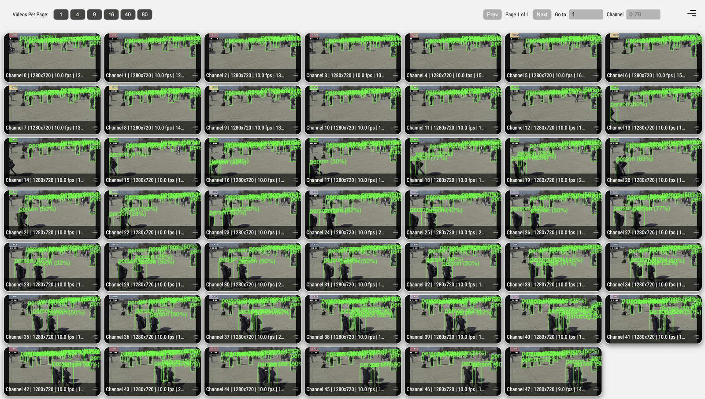

# High-Density Multi-Stream Object Detector

## Metadata

| Field | Value |
| --- | --- |
| Category | object-detection |
| Difficulty | Advanced |
| Tags | object-detection, rtsp, multistream, high-density, insight, yolo26 |
| Languages | C++, Python |
| Status | stable |
| Binary Name | high-density-multi-stream-object-detector |
| Model | yolo26n (w8a8) |

## Concept

Runs one YOLO26 detector across 20, 30, or 60 RTSP streams and sends synchronized video and detection metadata to Insight.

```text
How does a frame move through high-density-multi-stream-object-detector?

╭┄┄┄┄┄┄┄┄┄┄┄┄┄┄┄┄┄┄┄┄┄┄┄┄┄┄┄┄┄┄┄┄┄┄┄┄┄┄┄┄┄┄┄┄┄┄┄┄┄┄┄┄┄┄┄┄┄┄┄┄┄┄┄┄┄╮
┆ RUN                                                             ┆
┆  ┌──────────────────────┐  encoded frames  ┌──────────────────┐ ┆
┆  │ RtspEncodedInput × N │─────────────────►│ VideoSender × N  │──────┐
┆  └──────────────────────┘  latest/stream   └──────────────────┘ ┆    │
┆             │ encoded frames                                    ┆    │ video
┆             ▼                                                   ┆    │
┆  ┌──────────────────────┐                                       ┆    │
┆  │ SimaDecode × N       │                                       ┆    │
┆  └──────────────────────┘                                       ┆    │
┆             │ NV12, latest/stream                               ┆    │
┆             ▼                                                   ┆    │
┆  ┌──────────────────────┐                                       ┆    │
┆  │ YOLO26 Model         │                                       ┆    │
┆  └──────────────────────┘                                       ┆    │
┆             │ BBOX tensor                                       ┆    │
┆             ▼                                                   ┆    │
┆  ┌──────────────────────┐                                       ┆    │
┆  │ Output "detections"  │                                       ┆    │
┆  └──────────────────────┘                                       ┆    │
╰┄┄┄┄┄┄┄┄┄┄┄┄┄│┄┄┄┄┄┄┄┄┄┄┄┄┄┄┄┄┄┄┄┄┄┄┄┄┄┄┄┄┄┄┄┄┄┄┄┄┄┄┄┄┄┄┄┄┄┄┄┄┄┄┄╯    │
              ▼ pull                                                   ▼
   ┌──────────────────────┐   boxes as JSON                     ┌──────────────┐
   │ MetadataSender × N   │────────────────────────────────────►│ Insight      │
   └──────────────────────┘                                     └──────────────┘
```

Unlike the general multi-stream detector, this application tunes the pipeline for high stream counts.

Each RTSP source is depacketized once, then Core fuses two branches into the same source pipeline:

```text
RTSP H.264/H.265
  ├─ latest encoded edge ─> VideoSender ─> Insight video channel N
  └─ decode ─> shared YOLO26 detector ─> timestamped metadata ─> channel N
```

The application expresses this fan-out with ordinary `Graph::connect()` and starts it with ordinary `Graph::build()`. Core fuses the eligible topology internally. `VideoSender` consumes the read-only encoded access unit before the decoder, so the application does not open a second RTSP session, copy a decoded EV buffer, run an encoder, or shuttle encoded frames through appsink/appsrc. The UDP sender uses `async=false` so its sink cannot hold the shared live pipeline in `PAUSED` while waiting for preroll from every stream. The encoded edge uses `RealtimeLatestByStream`; a congested Insight channel can drop stale encoded work without blocking that stream's decoder branch.

`inference.max_inflight_per_stream` and `inference.max_inflight_total` bound raw decoder-backed frames admitted to the shared detector. The 20- and 60-stream profiles use a total limit of eight; the 30-stream profile uses 30 so one aggregate frame interval can be admitted without an unbounded queue. The realtime mux retains only the latest pending frame for each stream.

Detection metadata is sent with nonblocking UDP. Its `timestamp`, the frame's presentation time in milliseconds, is what Insight matches to the video frame before WebRTC forwarding. Keep one active viewer while validating metadata, as described below.

The three checked-in profiles use the same application and model:

| Config | Streams | Source resolution and FPS | Target FPS per channel |
| --- | ---: | --- | ---: |
| `config.yaml` | 20 | 1280×720 at 30 or 29.97 FPS, detected from the source | Source rate |
| `config-30x720p20fps.yaml` | 30 | 1280×720 at 20 FPS | 20 FPS |
| `config-60x720p10fps.yaml` | 60 | 1280×720 at 10 FPS | 10 FPS |

The target rate applies to both Insight video and detection metadata after startup. Each profile needs about 600 aggregate FPS, and none is yet validated to sustain its target: a C++ run of the 30-stream profile measured 18.6 to 20.2 FPS per channel.

## Preview



## Prerequisites

- A Modalix DevKit compatible with the selected Apps release, with the decoder service running.
- An [Insight](https://developer.sima.ai/software/tools/insight/) URL reachable from the DevKit.
- 20, 30, or 60 H.264 or H.265 RTSP sources matching `input.codec` and the selected profile.
- For H.265, the computer running the Insight viewer must support hardware HEVC decoding; Chromium does not provide a software decoder fallback for WebRTC H.265.
- H.265 playback in Chrome on macOS renders, but is not stable. Chrome's WebRTC HEVC decoder can stop producing frames mid-stream and fall back to a null decoder that discards what follows, at which point the tile stalls until the viewer reconnects it.
- Constant source frame rate, 1280×720 resolution, no B-frames in the selected codec, and a short, regular IDR interval. The validated sources use one IDR per second.
- The `yolo26n` model, variant `w8a8`, from the [model browser](https://developer.sima.ai/models/), and `sima-cli` 2.1.20 or newer to download it.

The application starts all source graphs together. Start every RTSP publisher before starting the application.

## Install Apps

Install on the Modalix DevKit, or under `/workspace` in a Neat SDK container paired with it. Only the example itself must run on the DevKit. `sima-cli neat install apps` also offers to install the compatible Neat Library and Insight, and skips them when they are up to date. To keep the Neat Library and Insight you have without being asked, run the install as `NEAT_APPS_SKIP_DEPENDENCIES=1 sima-cli neat install apps`. See [Install Apps](https://github.com/sima-neat/apps/blob/main/README.md#install-apps).

Install the latest Neat Apps runtime and enter the installed bundle:

```bash
sima-cli neat install apps
cd prebuilt-apps
APP_DIR=examples/object-detection/high-density-multi-stream-object-detector
```

Run the remaining commands from `prebuilt-apps/`.

## Prepare the Model

The application uses the YOLO26 nano detection model, `yolo26n`, with the `w8a8` variant, which stores weights and activations as 8-bit integers. Download it and unpack it:

```bash
sima-cli models download --id yolo26n --variant w8a8
unzip -o models/yolo26n/w8a8/yolo26n_w8a8_default.zip -d models/yolo26n/w8a8
```

The download is a ZIP file with the model package and its license. `unzip` puts the model package, `models/yolo26n/w8a8/yolo26n_w8a8_mpk.tar.gz`, next to the ZIP file. The application reads only the `.tar.gz` file.

Set `model.path` in the selected config to that `.tar.gz` file, not to the ZIP file.

A relative `model.path` resolves from the config file, not from `prebuilt-apps/`.
A bare `models/yolo26n/w8a8/yolo26n_w8a8_mpk.tar.gz` therefore points at
`${APP_DIR}/src/common/models/yolo26n/w8a8/` and fails with
`ModelPack: invalid_archive: archive path does not exist`. Use an absolute path
to the file downloaded above.

Print it from `prebuilt-apps/`:

```bash
echo "$(pwd)/models/yolo26n/w8a8/yolo26n_w8a8_mpk.tar.gz"
```

Then set that value as `model.path` in the selected config. Change only that
line. `model.labels` resolves from `prebuilt-apps/`, so its packaged value needs no change.

## Prepare Insight

[Insight](https://developer.sima.ai/software/tools/insight/) can host the input streams and render each output channel. Install videos directly from the Insight catalog or through YouTube support. In the Insight Web UI, start the required streams and copy their RTSP URLs into `input.source`. One stream URL may repeat in every entry, so a single Insight stream can feed all 20, 30, or 60 channels. Use the host and UDP port ranges reported by `neat` for the output settings. Use a host and published port that the target can reach, not `localhost` and not an address only Insight's own machine can resolve. Verify the URL from the target before running.

Verify each source before starting the application. A Modalix DevKit does not
ship `ffprobe`, so run this from the machine hosting the sources or from any
workstation with FFmpeg installed:

```bash
ffprobe -v error \
  -select_streams v:0 \
  -show_entries stream=codec_name,width,height,avg_frame_rate,has_b_frames \
  -of default=noprint_wrappers=1 \
  <rtsp-url>
```

The result must report the codec selected by `input.codec`, `1280x720`, the selected profile FPS, and no B-frames. Using a different source FPS changes the output rate and is not the documented profile. The encoded Insight edge retains the latest complete access unit under congestion, so a one-second-or-shorter IDR interval bounds receiver recovery if an older access unit is replaced.

## Configure

Choose one config under `${APP_DIR}/src/common/` and edit:

- `model.path`
- every entry under `input.source`
- `output.insight.host`
- `input.codec`: `h264`, the validated default, or `h265`
- `input.width`, `input.height`, and `input.fps`: leave each at 0 to read it from every source, so sources of another size need no config change. Every source must have the same frame size, because the streams share one model. The 30- and 60-stream configs set `input.fps` to their profile's rate. Set a size only for a source that does not report one.

Insight channel and port mapping is deterministic:

```text
channel index: 0 .. stream_count - 1
video port:    9000 + channel index
metadata port: 9100 + channel index
```

## Run

Set the example and selected profile from the `prebuilt-apps/` root:

```bash
APP_DIR=examples/object-detection/high-density-multi-stream-object-detector
APP=./${APP_DIR}/src/cpp/pre-built/high-density-multi-stream-object-detector
CONFIG="$APP_DIR/src/common/config.yaml"
```

Use one of the named configs for the larger profiles:

```bash
CONFIG="$APP_DIR/src/common/config-30x720p20fps.yaml"
CONFIG="$APP_DIR/src/common/config-60x720p10fps.yaml"
```

Run the C++ application:

```bash
"$APP" --config "$CONFIG"
```

Run the Python implementation with the same config:

```bash
source ~/pyneat/bin/activate
python3 -m pip install -r "$APP_DIR/src/python/requirements.txt"
python3 "$APP_DIR/src/python/main.py" --config "$CONFIG"
```

Stop the application with `Ctrl-C`.

Use one active Insight viewer while validating metadata. Insight currently has a single-viewer metadata rendering limitation; multiple simultaneous viewers can make box delivery appear intermittent even when the application is advancing normally.

## Expected Result

- Every configured Insight channel receives live video.
- Detection boxes appear on the matching channel.
- Video and metadata approach the source cadence for 20 streams, 20 FPS for 30 streams, or 10 FPS for 60 streams. See the profile table for the measured rate.
- Metadata messages the nonblocking sender drops are counted per stream and reported when the application stops.
- `Ctrl-C` closes the graph and exits cleanly.

If channels do not start, confirm that every publisher was already reachable and that the configured source caps match the selected profile. Restart the application after restarting the publishers.

## Troubleshooting

- `ModelPack: invalid_archive: archive path does not exist` at run time means
  `model.path` resolved from the config file rather than from `prebuilt-apps/`.
  Use the absolute path printed in Prepare the Model.
- `<config> is missing <key>` or `<key> must be <type>` names a key the config
  lacks or sets to the wrong type. Compare it with the packaged config.
- `failed to probe RTSP frame size: <url>` or `failed to probe RTSP frame rate: <url>`
  appears when a value left at 0 cannot be read: the source is unreachable from the
  board, or it does not report that value. Verify the URL from the board itself; the
  URL Insight displays is not always reachable from the target. For a reachable source,
  set the value the message names.
- `every input.source stream needs the same frame size` names two sources whose
  sizes differ. Use sources of one size, because the streams share one model.

## Source Files

- C++ reference source: `src/cpp/main.cpp`
- Python implementation: `src/python/main.py`
- Default 20-stream profile: `src/common/config.yaml`
- 30-stream profile: `src/common/config-30x720p20fps.yaml`
- 60-stream profile: `src/common/config-60x720p10fps.yaml`
- Class labels: `support/labels/coco80.txt` in `prebuilt-apps/`, shared with the other examples that score the same classes
- Helpers shared with other examples, with no Neat API calls: `support/python/sima_examples/` in `prebuilt-apps/`, and their C++ reference source in `support/cpp/sima_examples/`

The packaged C++ source is an implementation reference. Run the executable under `src/cpp/pre-built/`; the installed bundle does not include CMake files.

## Development From Source

To modify, compile, or test this example, use the [Apps contributor workflow](https://github.com/sima-neat/apps/blob/main/CONTRIBUTING.md). The 20-, 30-, and 60-stream profiles still require Modalix, live RTSP publishers, and Insight for runtime validation.
