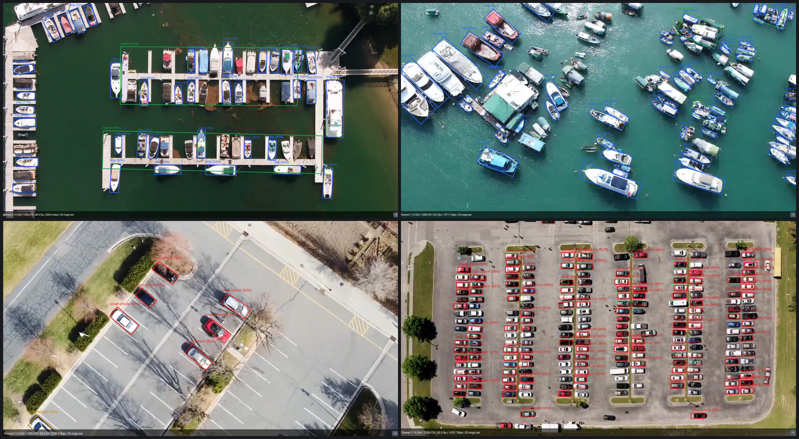

# Multi-Stream OBB Detector

## Metadata

| Field | Value |
| --- | --- |
| Category | object-detection |
| Difficulty | Advanced |
| Tags | object-detection, oriented-boxes, aerial, rtsp, multistream, insight, yolo26, yolov8, yolo11 |
| Languages | C++, Python |
| Status | stable |
| Binary Name | multi-stream-obb-detector |
| Model | yolo26n_obb (w8a8) |

## Concept

Runs one YOLO26, YOLOv8, or YOLO11 oriented-box detector on several RTSP streams of top-down aerial video. Each stream's video and rotated boxes go to Insight on their own channel.

An oriented bounding box (OBB) turns with the object. It fits ships, planes, and vehicles seen from above, which an upright box would cover with mostly background. The model detects the 15 DOTA classes in `src/common/dota_label.txt`, such as plane, ship, storage tank, and small vehicle.

```text
How does a frame move through multi-stream-obb-detector?

╭┄┄┄┄┄┄┄┄┄┄┄┄┄┄┄┄┄┄┄┄┄┄┄┄┄┄┄┄┄┄┄┄┄┄┄┄┄┄┄┄┄┄┄┄┄┄┄┄┄┄┄┄┄┄┄┄┄┄┄┄┄┄┄┄┄╮
┆ RUN                                                             ┆
┆  ┌──────────────────────┐  encoded frames  ┌──────────────────┐ ┆
┆  │ RtspEncodedInput × N │─────────────────►│ VideoSender × N  │──────┐
┆  └──────────────────────┘  latest/stream   └──────────────────┘ ┆    │
┆             │ encoded frames                                    ┆    │ video
┆             ▼                                                   ┆    │
┆  ┌──────────────────────┐                                       ┆    │
┆  │ SimaDecode × N       │                                       ┆    │
┆  └──────────────────────┘                                       ┆    │
┆             │ NV12, latest/stream                               ┆    │
┆             ▼                                                   ┆    │
┆  ┌──────────────────────┐                                       ┆    │
┆  │ YOLO OBB Model       │  one model for every stream           ┆    │
┆  └──────────────────────┘                                       ┆    │
┆             │ BBOX_OBB_V1 tensor                                ┆    │
┆             ▼                                                   ┆    │
┆  ┌──────────────────────┐                                       ┆    │
┆  │ Output "detections"  │                                       ┆    │
┆  └──────────────────────┘                                       ┆    │
╰┄┄┄┄┄┄┄┄┄┄┄┄┄│┄┄┄┄┄┄┄┄┄┄┄┄┄┄┄┄┄┄┄┄┄┄┄┄┄┄┄┄┄┄┄┄┄┄┄┄┄┄┄┄┄┄┄┄┄┄┄┄┄┄┄╯    │
              ▼ pull                                                   ▼
   ┌──────────────────────┐   rotated boxes as JSON             ┌──────────────┐
   │ MetadataSender × N   │────────────────────────────────────►│ Insight      │
   └──────────────────────┘                                     └──────────────┘
```

Each stream is read once. Its encoded frames go to Insight unchanged, and only the branch to the model is decoded. Every stream's decoder feeds the same model. The link into the model keeps each stream's newest frames and tags them with the stream's ID. One pull loop on `detections` sends each result to its stream's channel.

## Preview



## Prerequisites

- `sima-cli` 2.1.20 or newer ([documentation](https://developer.sima.ai/software/tools/sima-cli/)) on the Modalix DevKit, or in a Neat SDK container paired with it.
- H.264, H.265, or MJPEG RTSP streams of top-down aerial video, such as drone or satellite footage. The model was trained on overhead images and finds little in street-level video.
- An [Insight](https://developer.sima.ai/software/tools/insight/) version that draws `oriented_bbox`, reachable from the DevKit. For MJPEG streams, Insight must also show JPEG channels.
- For H.265, the computer running the Insight viewer must support hardware HEVC decoding. Chromium has no software decoder for WebRTC H.265.

## Install Apps

Install on the Modalix DevKit, or under `/workspace` in a Neat SDK container paired with it. Only the example itself must run on the DevKit. `sima-cli neat install apps` also offers to install the compatible Neat Library and Insight, and skips them when they are up to date. To keep the Neat Library and Insight you have without being asked, run the install as `NEAT_APPS_SKIP_DEPENDENCIES=1 sima-cli neat install apps`. See [Install Apps](https://github.com/sima-neat/apps/blob/main/README.md#install-apps).

Install the latest Neat Apps runtime and enter the installed bundle:

```bash
sima-cli neat install apps
cd prebuilt-apps
APP_DIR=examples/object-detection/multi-stream-obb-detector
```

Run the remaining commands from `prebuilt-apps/`.

## Prepare the Model

The default model is `yolo26n_obb` with the `w8a8` variant. Download it and unpack it:

```bash
sima-cli models download --id yolo26n_obb --variant w8a8
unzip -o models/yolo26n_obb/w8a8/yolo26n_obb_w8a8_default.zip -d models/yolo26n_obb/w8a8
```

The download is a ZIP file with the model package and its license. `unzip` puts the model package, `models/yolo26n_obb/w8a8/yolo26n_obb_w8a8_mpk.tar.gz`, next to the ZIP file. The packaged `model.path` already points to that file. A relative `model.path` starts at the config file, and `../../../../../models/` from `${APP_DIR}/src/common/` is `prebuilt-apps/models/`.

The [model browser](https://developer.sima.ai/models/) has each family in five sizes, from n (nano) to x (extra large):

| Model browser ID | Variants | `model.id` |
| --- | --- | --- |
| `yolo26{n,m,x}_obb` | `w8a8`, `w16a16` | `yolo26` |
| `yolo26{s,l}_obb` | `w8a8`, `w16a16`, `w8a16` | `yolo26` |
| `yolov8{n,s,m,l,x}_obb` | `w8a8`, `w16a16` | `yolov8` |
| `yolo11{n,s,m,l,x}_obb` | `w8a8`, `w16a16` | `yolo11` |

To use another model, replace the model browser ID and variant in both commands and in `model.path`. Set `model.id` to the family in the table, because the model package does not name its decoder. YOLO26 needs no overlap removal. For YOLOv8 and YOLO11, the application removes overlapping boxes with rotated non-maximum suppression.

All streams share one model, so its rate is split among them. Larger sizes find more objects but run slower. A slower model also lowers the video frame rate in Insight. For smooth video with a larger model, use fewer streams.

## Prepare Insight

In the Insight Web UI, install or pick aerial videos and start one stream per video. Copy their RTSP URLs into `input.source`. Use the host and UDP port ranges that `neat` reports for the output settings. Use a host and port the DevKit can reach, not `localhost`.

## Configure

Open `${APP_DIR}/src/common/config.yaml` and set:

- `input.source`: one RTSP URL per stream. Stream i goes to Insight channel i.
- `input.codec`: `h264`, `h265`, or `mjpeg`, the same for every stream.
- `input.width`, `input.height`, and `input.fps`: leave each at 0 to read it from the stream. Set a value only for a stream that does not report it. Every stream needs the same frame size, because the streams share one model.
- `output.insight.host`. Stream i sends video to `video_port_base` + i and boxes to `metadata_port_base` + i.

Keep `inference.frames` at `0` to run until you stop the application.

## Run

### C++

```bash
./${APP_DIR}/src/cpp/pre-built/multi-stream-obb-detector \
  --config ${APP_DIR}/src/common/config.yaml
```

### Python

```bash
source ~/pyneat/bin/activate
pip install -r ${APP_DIR}/src/python/requirements.txt
python3 ${APP_DIR}/src/python/main.py \
  --config ${APP_DIR}/src/common/config.yaml
```

Stop the application with `Ctrl-C`.

## Expected Result

The application prints one line per stream with its source, frame size, and Insight ports, for example:

```text
[stream 0] rtsp=rtsp://<insight-host>:8554/src1 stream=1280x720@30 insight=<insight-host> video=9000 metadata=9100
[stream 1] rtsp=rtsp://<insight-host>:8554/src2 stream=1280x720@30 insight=<insight-host> video=9001 metadata=9101
```

Insight shows each stream on its own channel, with a rotated box and a label around each detected object.

When it stops, the application prints how many frames each stream processed. A positive `inference.frames` stops it after that many frames per stream. With `inference.frames: 300`, for example:

```text
[stream 0] processed=300
[stream 1] processed=300
```

The metadata sender does not wait for a full network buffer. It drops the message instead, and the application then prints the count, such as `[stream 0] 3 metadata messages dropped`.

## Troubleshooting

- `<config> is missing <key>` or `<key> must be <type>` names a key the config lacks or sets to the wrong type. Compare it with the packaged config.
- `failed to probe RTSP frame size: <url>` or `failed to probe RTSP frame rate: <url>`: a value left at 0 could not be read. Check that the URL is reachable from the DevKit itself. For a reachable stream, set the value the message names.
- `every input.source stream needs the same frame size` names two streams whose sizes differ. Use streams of one size, because they share one model.
- `oriented boxes require equal authoritative affine scales`: Neat could not scale the frames to the model input by one factor on both axes. 1280x720 and 1920x1080 streams work, and a 640x512 stream fails. Re-encode such a stream to 1280x720.
- Few or no detections: check that the video looks straight down at the ground. Lower `inference.min_score` if objects are missed, and raise it if boxes appear on background.
- Boxes missing on dense scenes: raise `inference.max_detections`. Each box adds about 150 bytes, up to 160, so about 400 boxes fit in one message. A message over 65507 bytes stops the application with `MetadataSender payload exceeds 65507 bytes`.
- Insight shows upright boxes: the installed Insight does not draw `oriented_bbox`. Update Insight.
- MJPEG video fails to reach Insight: MJPEG frames go out as RTP/JPEG, which carries sides in multiples of 8 up to 2040. Neat learns an RTSP stream's frame size only once frames arrive. So a caps check rejects other sizes while running, not when the application starts. Use a stream whose sides are multiples of 8, such as 1280x720 or 1920x1080.
- No video or boxes in Insight: check the Insight host and the UDP ports.

## Source Files

- C++ reference source: `src/cpp/main.cpp`, with the Insight objects in `src/cpp/utils/oriented_boxes.cpp`
- Python source: `src/python/main.py`, with the Insight objects in `src/python/utils/oriented_boxes.py`
- Shared config: `src/common/config.yaml`
- Class labels: `src/common/dota_label.txt`
- Helpers the examples share: `support/python/sima_examples/` at the root of the installed bundle. `main.py` finds it in a folder above itself. Their C++ reference source is in `support/cpp/sima_examples/`.

The packaged C++ source is an implementation reference. Run the executable under `src/cpp/pre-built/`. The installed bundle does not include CMake files.

## Development From Source

To modify, compile, or test this example, use the [Apps contributor workflow](https://github.com/sima-neat/apps/blob/main/CONTRIBUTING.md).
