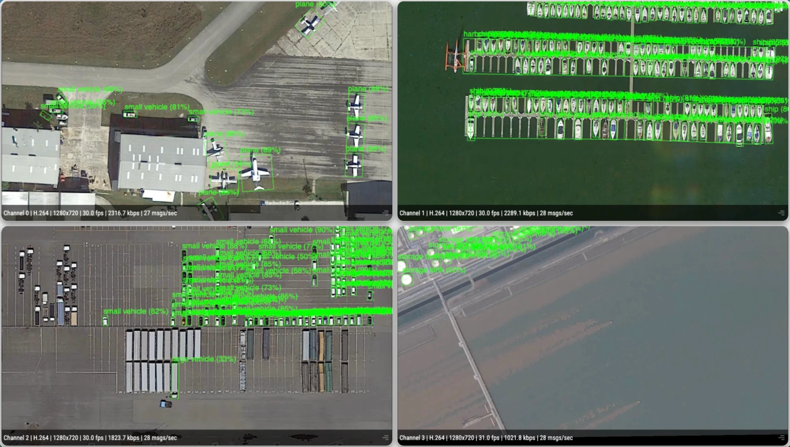

# Multi-Stream OBB Detector

## Metadata

| Field | Value |
| --- | --- |
| Category | object-detection |
| Difficulty | Advanced |
| Tags | object-detection, oriented-boxes, aerial, rtsp, multistream, insight, yolo26 |
| Languages | C++, Python |
| Status | stable |
| Binary Name | multi-stream-obb-detector |
| Model | yolo26n_obb_w8a8_mpk |

## Concept

Runs YOLO26 oriented-box detection on up to four RTSP streams of top-down aerial video and sends each stream's video and rotated boxes to Insight.

An oriented bounding box (OBB) is a box that turns with the object. It fits ships,
planes, and vehicles seen from above, which an upright box would cover with
mostly background. The model detects the 15 DOTA classes listed in
`src/common/dota_label.txt`, such as plane, ship, storage tank, and small vehicle.

## Preview



## Prerequisites

- `sima-cli` ([documentation](https://developer.sima.ai/software/tools/sima-cli/)) on the Modalix DevKit, or in a Neat SDK container paired with it.
- H.264 or H.265 RTSP sources of top-down aerial video, such as drone or satellite footage, matching `input.codec`. The model was trained on overhead imagery and finds little in street-level video.
- An [Insight](https://developer.sima.ai/software/tools/insight/) version that draws `oriented_bbox`, reachable from the target.
- For H.265, the computer running the Insight viewer must support hardware HEVC decoding; Chromium does not provide a software decoder fallback for WebRTC H.265.

## Install Apps

Install on the Modalix DevKit, or under `/workspace` in a Neat SDK container paired with it. Only the example itself must run on the DevKit. `sima-cli neat install apps` also installs the compatible Core and Insight, and skips them when they are already installed. To keep the Core and Insight you have instead, run the install as `NEAT_APPS_SKIP_DEPENDENCIES=1 sima-cli neat install apps`. See [Install Apps](https://github.com/sima-neat/apps/blob/main/README.md#install-apps).

Install the latest Neat Apps runtime and enter the installed bundle:

```bash
sima-cli neat install apps
cd prebuilt-apps
APP_DIR=examples/object-detection/multi-stream-obb-detector
```

Run the remaining commands from `prebuilt-apps/`.

## Prepare the Model

| Model file | Role |
| --- | --- |
| `yolo26n_obb_w8a8_mpk.tar.gz` | Default |
| `yolo26n_obb_w16a16_mpk.tar.gz` | Supported |

Model packages come from the Model Zoo release below, which can differ from the installed platform version. Replace `<model-file>` with a file from the table.

```bash
export MODELZOO_VERSION="3.0.0"
mkdir -p models
cd models
sima-cli download "https://docs.sima.ai/pkg_downloads/SDK${MODELZOO_VERSION}/models/modalix/<model-file>"
cd ..
```

Set `model.path` in the config to the downloaded package.

## Prepare Insight

In the Insight Web UI, upload your aerial videos, start one stream per video, and copy their RTSP URLs into `streams`. Use the host and UDP port ranges reported by `neat` for the output settings. Use a host and published port that the target can reach, not `localhost` and not an address only Insight's own machine can resolve.

## Configure

Open `${APP_DIR}/src/common/config.yaml`. Set `model.path`, add each RTSP URL under `streams`, and set the Insight host and starting video and metadata ports. Set `input.codec` to match the streams.

## Run

Validate the config without opening streams:

```bash
./${APP_DIR}/src/cpp/pre-built/multi-stream-obb-detector \
  --config ${APP_DIR}/src/common/config.yaml \
  --validate-config-only
```

### C++

```bash
./${APP_DIR}/src/cpp/pre-built/multi-stream-obb-detector \
  --config ${APP_DIR}/src/common/config.yaml
```

### Python

```bash
source ~/pyneat/bin/activate
pip install -r ${APP_DIR}/src/python/requirements.txt
python3 ${APP_DIR}/src/python/main.py \
  --config ${APP_DIR}/src/common/config.yaml
```

## Expected Result

The application prints one line per stream with its source, frame size, and Insight ports:

```text
[stream 0] rtsp=rtsp://<insight-host>:8554/src1 stream=1280x720@30 insight=<insight-host> video=9000 metadata=9100
[stream 1] rtsp=rtsp://<insight-host>:8554/src2 stream=1280x720@30 insight=<insight-host> video=9001 metadata=9101
```

Insight shows each stream on its own channel, with a rotated box and a label around each detected object.

The packaged config sets `inference.frames: 0`, which runs until Ctrl-C. Set a positive value to stop after that many frames per stream. Either way, the application ends by printing each stream's processed frame count:

```text
[stream 0] processed=300
[stream 1] processed=300
```

To also save annotated frames, set `output.save_every` to a positive interval. Every that-many frames, each stream writes `stream_<N>_frame_<count>.jpg` with the rotated boxes under `output.debug_dir`, which the packaged config sets to `sandbox/multi-stream-obb-detector`.

## Troubleshooting

- Replace all placeholder stream URLs and the Insight host before running.
- `oriented boxes require equal authoritative affine scales`: Neat could not scale the stream's frames to the model input by the same factor on both axes. 1280x720 and 1920x1080 streams work; a 640x512 stream fails. Re-encode the stream to 1280x720.
- Few or no detections: check that the video looks straight down at the ground. Lower `inference.min_score` if objects are present but missed, and raise it if the overlay shows boxes on background.
- Python output falls below the stream rate on dense scenes: lower `inference.max_detections`. Each box adds to the metadata sent to Insight; at the default 300 with four dense 30 fps streams, C++ keeps about 28 fps per stream and Python about 20 to 27 fps.
- Insight shows upright boxes: the installed Insight does not draw `oriented_bbox`. Update Insight.
- Verify host and UDP port ranges if Insight receives no output.

## Source Files

- C++ reference source: `src/cpp/main.cpp`
- Python source: `src/python/main.py`
- Shared runtime files: `src/common/`

The packaged C++ source is an implementation reference. Run the executable under `src/cpp/pre-built/`; the installed bundle does not include CMake files.

## Development From Source

To modify, compile, or test this example, use the [Apps contributor workflow](https://github.com/sima-neat/apps/blob/main/CONTRIBUTING.md).
