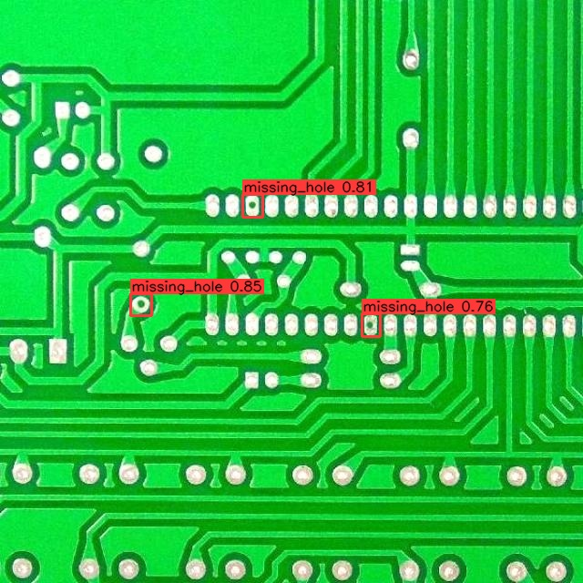

# PCB Defect Detector

## Metadata

| Field | Value |
| --- | --- |
| Category | object-detection |
| Difficulty | Beginner |
| Tags | object-detection, yolo26, pcb, defect-detection, industrial-inspection |
| Languages | C++, Python |
| Status | stable |
| Binary Name | pcb-defect-detector |
| Model | yolo26n_plc |

## Concept

Batch visual inspection of printed circuit boards with a custom-trained YOLO26n detector. Every image in a folder is run on the MLA and saved annotated with its defect boxes and labels.

```text
How does an image move through pcb-defect-detector?

 ┌────────────────────────────────────┐
 │ imread, one image at a time        │
 └────────────────────────────────────┘
                    │ BGR image, any size
                    ▼
╭┄┄┄┄┄┄┄┄┄┄┄┄┄┄┄┄┄┄┄┄┄┄┄┄┄┄┄┄┄┄┄┄┄┄┄┄┄┄┄┄┄┄╮
┆ RUN: Model::Runner from model.build      ┆
┆ ┌────────────────────────────────────┐   ┆
┆ │ YOLO26n Model                      │   ┆
┆ └────────────────────────────────────┘   ┆
╰┄┄┄┄┄┄┄┄┄┄┄┄┄┄┄┄┄┄┄│┄┄┄┄┄┄┄┄┄┄┄┄┄┄┄┄┄┄┄┄┄┄╯
                    ▼ BBOX tensor, from runner.run
 ┌────────────────────────────────────┐
 │ decode_bbox_tensor, draw_boxes     │
 └────────────────────────────────────┘
                    │ annotated image
                    ▼
 ┌────────────────────────────────────┐
 │ imwrite to output.dir              │
 └────────────────────────────────────┘
```

- `model.build` makes one `Model::Runner` (Python `pyneat.ModelRunner`) for the whole folder, seeded with an image of the largest accepted size, `app.input_max_width` x `app.input_max_height`. Images of any size up to that, mixed in one folder, go through it: Core letterboxes each one to the model input on the device and returns the boxes in the image's own pixels, so the application does no geometry.
- `runner.run` sends one image and waits for its result. The run uses the `Realtime` preset, the only one that applies a new input size on the first frame.
- `draw_boxes` (in `src/*/utils/overlay.*`) draws each defect in its class's color on the source image.

Six manufacturing defect classes are detected:

```text
missing_hole, mouse_bite, open_circuit, short, spur, spurious_copper
```

## Preview



## Prerequisites

- `sima-cli` ([documentation](https://developer.sima.ai/software/tools/sima-cli/)) on the Modalix DevKit, or in a Neat SDK container paired with it.
- Network access to `docs.sima.ai` to download the model package.

## Install Apps

Install on the Modalix DevKit, or under `/workspace` in a Neat SDK container paired with it. Only the example itself must run on the DevKit. `sima-cli neat install apps` also offers to install the compatible Neat Library and Insight, and skips them when they are up to date. To keep the Neat Library and Insight you have without being asked, run the install as `NEAT_APPS_SKIP_DEPENDENCIES=1 sima-cli neat install apps`. See [Install Apps](https://github.com/sima-neat/apps/blob/main/README.md#install-apps).

Install the latest Neat Apps runtime and enter the installed bundle:

```bash
sima-cli neat install apps
cd prebuilt-apps
APP_DIR=examples/object-detection/pcb-defect-detector
```

Run the remaining commands from `prebuilt-apps/`.

## Prepare the Model

| Model | Role | Source |
| --- | --- | --- |
| `yolo26n_plc_mpk.tar.gz` | Default | Direct artifact |

Model packages come from the Model Zoo release below, which can differ from the installed platform version.

```bash
export MODELZOO_VERSION="3.0.0"
mkdir -p models
cd models
sima-cli download "https://docs.sima.ai/pkg_downloads/SDK${MODELZOO_VERSION}/models/modalix/yolo26n_plc_mpk.tar.gz"
cd ..
```

The shipped `model.path` points at this file, `models/yolo26n_plc_mpk.tar.gz` under `prebuilt-apps/`.

The detector is trained on a custom PCB defect dataset rather than published in
Model Zoo. The pack is a BF16 build with MLA tessellation, compiled from the
trained YOLO26n ONNX export with the raw detection heads exposed and C2PSA
attention rewritten to BF16-friendly Einsum nodes. Class order is fixed by the
checkpoint and must match `src/common/pcb_label.txt`.

Dataset and source-model reference:
[PCB defects detection](https://platform.ultralytics.com/muhammadrizwanmunawar/datasets/pcb-defects-detection).

## Configure

Five sample boards ship under `assets/datasets/pcb/`, so the example runs with the shipped `${APP_DIR}/src/common/config.yaml` once the model is in place. To inspect your own boards, set:

- `input.source`: the folder of `.jpg`, `.jpeg`, `.png`, or `.bmp` images.
- `output.dir`: the folder for the annotated images, not `input.source`.
- `app.input_max_width` and `app.input_max_height`: the largest image size, 3840 x 2160 as shipped. A larger image is reported as failed; raise both for larger scans.
- `inference.min_score`: lower it to show more defects, raise it to show fewer.

## Run

### C++

```bash
./${APP_DIR}/src/cpp/pre-built/pcb-defect-detector \
  --config ${APP_DIR}/src/common/config.yaml
```

### Python

```bash
source ~/pyneat/bin/activate
pip install -r ${APP_DIR}/src/python/requirements.txt
python3 ${APP_DIR}/src/python/main.py \
  --config ${APP_DIR}/src/common/config.yaml
```

## Expected Result

Each input image produces one annotated copy in `output.dir`, named `<stem>_pcb` with the source extension kept:

```text
pcb_01_missing_hole.jpg -> pcb_01_missing_hole_pcb.jpg
```

Each image prints one line with its defect count and classes, and the run ends with the totals:

```text
[1/5] pcb_01_missing_hole.jpg -> pcb_01_missing_hole_pcb.jpg (<n> defects) {missing_hole: <n>}
...
Done: 5/5 images in <seconds> s | images_with_defects=<n> total_defects=<n> failed=0
Per-class totals: {<class>: <n>, ...}
```

## Troubleshooting

- `[ERR] <image>: not a readable image`: the file has an image extension but does not decode. The run continues and exits 1.
- `[ERR] <image>: <width>x<height> is larger than app.input_max_width x app.input_max_height`: raise both keys to at least the image's size.
- `[ERR] input.source: no .jpg, .jpeg, .png, or .bmp images in <folder>`: point `input.source` at a folder that holds images.
- `[ERR] <output path>: could not be written`: check that `output.dir` is writable. The run continues and exits 1.
- If no defects are reported, lower `inference.min_score`; if boxes overlap heavily, lower `inference.nms_iou`.
- Class names in `src/common/pcb_label.txt` follow the model's class order. Loading fails when the file lists a different number of classes than the model.

## Source Files

- C++ reference source: `src/cpp/main.cpp`, with `src/cpp/utils/images.*` and `src/cpp/utils/overlay.*`
- Python source: `src/python/main.py`, with `src/python/utils/images.py` and `src/python/utils/overlay.py`
- Shared config: `src/common/config.yaml`
- Class labels: `src/common/pcb_label.txt`
- Sample images: `assets/datasets/pcb/`

The packaged C++ source is an implementation reference. Run the executable under `src/cpp/pre-built/`; the installed bundle does not include CMake files.

## Development From Source

To modify, compile, or test this example, use the [Apps contributor workflow](https://github.com/sima-neat/apps/blob/main/CONTRIBUTING.md).
