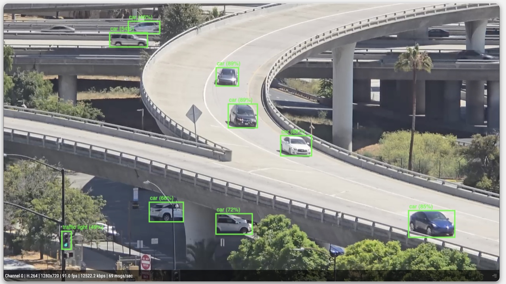

# RF-DETR Detection and Segmentation

## Metadata

| Field | Value |
| --- | --- |
| Category | object-detection |
| Difficulty | Advanced |
| Tags | object-detection, instance-segmentation, rfdetr, rtsp, insight |
| Languages | C++, Python |
| Status | stable |
| Binary Name | rfdetr-detection-segmentation |
| Model | RF-DETR Nano, Small, Medium, Large, or Segmentation Medium |

## Concept

Run RF-DETR detection or instance segmentation on one H.264, H.265, or MJPEG RTSP stream and view the result in Insight.

The application decodes to NV12 once. A 4-frame queue replaces stale decoded frames when inference falls behind. EV74 converts, resizes, and normalizes admitted frames for the backbone. Host code selects the strongest proposals and passes their boxes and feature tensor to the transformer. Insight receives video and matching detection boxes or segmentation polygons.

The backbone output and transformer input each use a four-entry blocking queue to preserve completed backbone work. These capacities do not include buffers held by active stages.

MJPEG reserves 32 decoded buffers so decoding can continue while inference and preview retain frames. This is tested headroom for the application, not an exact count of graph-held buffers. The raw NV12 storage is about 44 MB at 720p, 100 MB at 1080p, or 398 MB at 4K, before alignment.

TCP sources use RTP timestamps directly to avoid arrival-time corrections during high-rate replay. H.264 and H.265 video reach Insight as encoded passthrough. MJPEG video is re-encoded to H.264 from the decoded frames; when the encoder falls behind, the preview keeps the newest frames and inference keeps the full input rate.

## Preview



## Prerequisites

- [`sima-cli` 2.1.15 or newer](https://developer.sima.ai/software/tools/sima-cli/) on the Modalix DevKit, or in a Neat SDK container paired with it.
- An H.264, H.265, or MJPEG RTSP source and an [Insight endpoint](https://developer.sima.ai/software/tools/insight/) reachable from the target.

## Install Apps

Install on the Modalix DevKit, or under `/workspace` in a Neat SDK container paired with it. Only the example itself must run on the DevKit. `sima-cli neat install apps` also offers to install the compatible Neat Library and Insight, and skips them when they are already installed. To keep the Neat Library and Insight you have without being asked, run the install as `NEAT_APPS_SKIP_DEPENDENCIES=1 sima-cli neat install apps`. See [Install Apps](https://github.com/sima-neat/apps/blob/main/README.md#install-apps).

Install the latest Neat Apps runtime and enter the installed bundle:

```bash
sima-cli neat install apps
cd prebuilt-apps
APP_DIR=examples/object-detection/rfdetr-detection-segmentation
```

Run the remaining commands from `prebuilt-apps/`.

## Prepare the Model

Prepare the model directory, then download the pair for your selected task:

```bash
export MODELZOO_VERSION="3.0.0"
mkdir -p models
cd models
```

For detection, set `VARIANT` to `nano`, `small`, `medium`, or `large`. Small is selected by default:

```bash
VARIANT=small
sima-cli download "https://docs.sima.ai/pkg_downloads/SDK${MODELZOO_VERSION}/models/modalix/rf_detr_${VARIANT}_w8a8_w16a16_backbone_mpk.tar.gz"
sima-cli download "https://docs.sima.ai/pkg_downloads/SDK${MODELZOO_VERSION}/models/modalix/rf_detr_${VARIANT}_w8a8_w16a16_decoder_mpk.tar.gz"
```

For segmentation, download the RF-DETR Segmentation Medium model pair:

```bash
sima-cli download "https://docs.sima.ai/pkg_downloads/SDK${MODELZOO_VERSION}/models/modalix/rfdetr-seg-medium-backbone.tar.gz"
sima-cli download "https://docs.sima.ai/pkg_downloads/SDK${MODELZOO_VERSION}/models/modalix/rfdetr-seg-medium-transformer.tar.gz"
```

Return to `prebuilt-apps/` after downloading your model pair:

```bash
cd ..
```

## Prepare an RTSP source

1. In Insight, open **Media Sources** and import a video from the catalog or your own file.
2. Assign the video under **Streaming Sources** and start the source.
3. Copy its RTSP URL into `source.rtsp_url` and set `source.codec` to match the video. Use a host and published port reachable from the target, not `localhost`.

## Configure

Edit `$APP_DIR/src/common/config.yaml`:

- Set `model.task` to `detection` or `segmentation`.
- For detection, set `model.detection.variant` to `nano`, `small`, `medium`, or `large`.
- Set `source.rtsp_url` and select `source.codec` as `h264`, `h265`, or `mjpeg`.
- Leave `source.width`, `height`, and `fps` at `0` to probe the stream. Width and height are fallbacks; a positive FPS overrides the detected value.
- Set `output.insight.host`, `video_port`, and `metadata_port` to the values reported by Insight.
- Keep `inference.frames: 0` to run continuously, or set a finite result count.

EV74 resizes the decoded frame to the input size required by the selected model.

Segmentation uses `inference.segmentation.mask_grid_size: 640` for smoother outlines. Set it to `108` for native contours with less CPU work, or `432` as an intermediate option. This only upsamples mask probabilities before contour extraction; the model output remains 108×108.

## Run

### C++

```bash
"$APP_DIR/src/cpp/pre-built/rfdetr-detection-segmentation" --config "$APP_DIR/src/common/config.yaml"
```

### Python

```bash
source ~/pyneat/bin/activate
pip install -r "$APP_DIR/src/python/requirements.txt"
python3 "$APP_DIR/src/python/main.py" --config "$APP_DIR/src/common/config.yaml"
```

Insight receives `object-detection` metadata for detection or `segmentation` polygon metadata for segmentation. Stop a continuous run with Ctrl-C.

## Expected Result

This application writes nothing to disk; its output is the Insight stream plus a
startup line and a closing summary:

```text
RF-DETR detection small h264: rtsp://<host>:<port>/<stream> (1280x720@30) -> Insight video=9000 metadata=9100
RF-DETR detection: completed=200 output_fps=30.8
```

The `output_fps` value above is Python's, which prints one decimal place. The
C++ binary prints the same line at the default stream precision, for example
`output_fps=30.7692`.

The startup line prints as soon as the source is probed, so it confirms the
task, variant, codec and resolution straight away. Check that probed resolution
matches the source you intended.

The packaged config ships `inference.frames: 0`, which runs continuously. Both
implementations handle `SIGINT`, so stopping with Ctrl-C still prints the closing
`completed=` line. Set a positive `inference.frames` if you want the run to end
on its own instead.

`completed` reports the frames processed, and `output_fps` should track the
source frame rate; a much lower `output_fps` means the pipeline is not keeping
up with the source.

## Troubleshooting

Check the configuration before involving hardware. This validates and exits
without opening a stream:

```bash
python3 ${APP_DIR}/src/python/main.py \
  --config ${APP_DIR}/src/common/config.yaml --validate-config-only
```

A valid configuration prints, for example, `RF-DETR detection small
configuration is valid`. The C++ binary prints the same line without the variant,
as `RF-DETR detection configuration is valid`.

- `source.codec must be h264/avc, h265/hevc, or mjpeg` means `source.codec` names
  a codec this example does not decode. Set it to match the source.
- `model.task must be detection or segmentation` means `model.task` is not one
  of the supported tasks.
- A `model.detection.variant` with no model pair under `model.detection`, for
  example `xlarge`, fails with `xlarge must be a mapping` in Python and
  `model.detection.xlarge.backbone and transformer must be set` in C++.
- `model archive must use .tar.gz: None` means one half of the model pair was
  left blank in the config. Both `backbone` and `transformer` must name a
  downloaded archive for the selected task and variant. This is specific to the
  Python entrypoint, where a blank value becomes the literal string `None` and
  slips past validation, so the failure appears only once the run starts. The
  C++ binary rejects the same config during validation, naming the selected
  variant, for example
  `model.detection.small.backbone and transformer must be set`.
- `failed to resolve RTSP width, height, and FPS` means the source could not be
  probed, usually because the URL is not reachable from the board. Verify it from
  the board itself; the URL Insight displays is not always reachable from the
  target. Where the source is reachable but does not report its properties, set
  `source.width`, `source.height` and `source.fps` as fallbacks.

## Performance

End-to-end throughput measured on Modalix with the Python application and no other workload on the board. Each figure is the average inference output rate, in FPS, over at least 20 seconds of continuous processing. Detector input streams run at 300 FPS for 720p and 1080p and at 60 FPS for 4K. Segmenter input streams run at 360 FPS for 720p H.264 and H.265, 60 FPS for 720p MJPEG, 120 FPS for 1080p, and 60 FPS for 4K, and segmentation uses `mask_grid_size: 108`.

| Input resolution | Codec | Nano detector | Small detector | Medium detector | Large detector | Medium segmenter |
| --- | --- | ---: | ---: | ---: | ---: | ---: |
| 720p | H.264 | 208 | 121 | 82 | 43 | 31 |
| 720p | H.265 | 212 | 121 | 82 | 43 | 31 |
| 720p | MJPEG | 186 | 121 | 81 | 43 | 31 |
| 1080p | H.264 | 211 | 121 | 82 | 43 | 32 |
| 1080p | H.265 | 205 | 120 | 82 | 43 | 31 |
| 4K | H.264 | 62\* | 61\* | 62\* | 43 | 23 |

\* Limited by the 60 FPS input stream.

## Source Files

- C++ implementation: `src/cpp/main.cpp`
- Python implementation: `src/python/main.py`
- Shared configuration and COCO labels: `src/common/`

The packaged C++ source is an implementation reference. Run the executable under `src/cpp/pre-built/`; the installed bundle does not include CMake files.

## Development From Source

To modify, compile, or test this example, use the [Apps contributor workflow](https://github.com/sima-neat/apps/blob/main/CONTRIBUTING.md).
