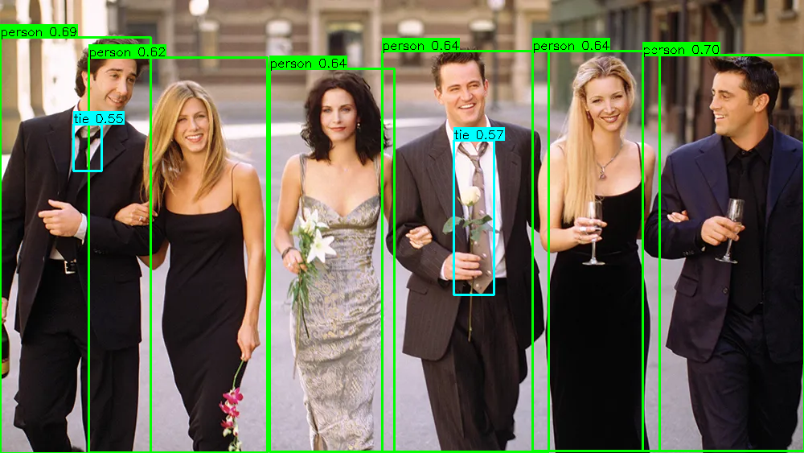

# Single-Stream Object Detector

## Metadata

| Field | Value |
| --- | --- |
| Category | object-detection |
| Difficulty | Intermediate |
| Tags | object-detection, yolo26, rtsp, insight |
| Languages | C++, Python |
| Status | stable |
| Binary Name | single-stream-object-detector |
| Model | yolo26m (w16a16) |

## Concept

Detects objects in one RTSP, HTTP MJPEG, or USB camera stream with YOLO26 and sends synchronized video and detection metadata to Insight.

```text
How does a frame move through single-stream-object-detector?

╭┄┄┄┄┄┄┄┄┄┄┄┄┄┄┄┄┄┄┄┄┄┄┄┄┄┄┄┄┄┄┄┄┄┄┄┄┄┄┄┄┄┄┄┄┄┄┄┄┄┄┄┄┄┄┄┄┄┄┄┄┄┄┄┄┄┄┄┄┄┄┄┄┄┄┄┄┄┄┄┄┄┄┄╮
┆ RUN, input.type rtsp                                                              ┆
┆  ┌────────────────────────────────┐  H.264, H.265,      ┌──────────────────────┐  ┆
┆  │ RtspEncodedInput               │────────────────────►│ VideoSender          │──┼─────┐
┆  └────────────────────────────────┘  MJPEG as received  └──────────────────────┘  ┆     │
┆             │ encoded frames                                                      ┆     │ video
┆             ▼                                                                     ┆     │
┆  ┌────────────────────────────────┐                                               ┆     │
┆  │ SimaDecode                     │                                               ┆     │
┆  └────────────────────────────────┘                                               ┆     │
┆             │ NV12 frames                                                         ┆     │
┆             ▼                                                                     ┆     │
┆  ┌────────────────────────────────┐                                               ┆     │
┆  │ YOLO26 Model                   │                                               ┆     │
┆  └────────────────────────────────┘                                               ┆     │
┆             │ BBOX tensor                                                         ┆     │
┆             ▼                                                                     ┆     │
┆  ┌────────────────────────────────┐                                               ┆     │
┆  │ Output "detections"            │                                               ┆     │
┆  └────────────────────────────────┘                                               ┆     │
╰┄┄┄┄┄┄┄┄┄┄┄┄┄│┄┄┄┄┄┄┄┄┄┄┄┄┄┄┄┄┄┄┄┄┄┄┄┄┄┄┄┄┄┄┄┄┄┄┄┄┄┄┄┄┄┄┄┄┄┄┄┄┄┄┄┄┄┄┄┄┄┄┄┄┄┄┄┄┄┄┄┄┄╯     │
              ▼ pull, decode_bbox_tensor                                                  ▼
   ┌────────────────────────────────┐                                                ┌─────────┐
   │ MetadataSender                 │───────────────────────────────────────────────►│ Insight │
   └────────────────────────────────┘   boxes as JSON                                └─────────┘

With input.type http, one group receives and decodes the MJPEG stream:

 ┌────────────────────────────────┐  NV12 frames,       ┌──────────────────────┐
 │ HttpMjpegDecodedInput          │────────────────────►│ VideoSender          │
 └────────────────────────────────┘  encoded as H.264   └──────────────────────┘
            │ NV12 frames to the YOLO26 Model, as above

With input.type usb, the camera's own JPEG goes to Insight:

 ┌────────────────────────────────┐  camera JPEG,       ┌──────────────────────┐
 │ UsbCameraInput                 │────────────────────►│ VideoSender          │
 └────────────────────────────────┘  latest             └──────────────────────┘
            │ camera JPEG
            ▼
 ┌────────────────────────────────┐
 │ SimaDecode                     │
 └────────────────────────────────┘
            │ NV12, or NV16 from a 4:2:2 camera, to the YOLO26 Model
```

An RTSP stream, H.264, H.265, or MJPEG, goes to Insight as received, while the decoder feeds the model; MJPEG travels as RTP/JPEG, at most 2040 pixels per side. An HTTP MJPEG stream is decoded once and its frames are encoded as H.264 for Insight, because Core has no HTTP input that keeps the stream encoded. A USB camera's own JPEG goes to Insight unchanged, and only the model reads the decoded frame. Each detection message carries the frame's timestamp, which Insight uses to draw the boxes on the frame they came from.

## Preview



## Prerequisites

- `sima-cli` ([documentation](https://developer.sima.ai/software/tools/sima-cli/)) on the Modalix DevKit, or in a Neat SDK container paired with it.
- An RTSP H.264, RTSP H.265, RTSP MJPEG, or HTTP MJPEG source, or a USB (UVC) MJPEG camera plugged into the DevKit, and an [Insight](https://developer.sima.ai/software/tools/insight/) URL reachable from the target.

## Install Apps

Install on the Modalix DevKit, or under `/workspace` in a Neat SDK container paired with it. Only the example itself must run on the DevKit. `sima-cli neat install apps` also offers to install the compatible Neat Library and Insight, and skips them when they are up to date. To keep the Neat Library and Insight you have without being asked, run the install as `NEAT_APPS_SKIP_DEPENDENCIES=1 sima-cli neat install apps`. See [Install Apps](https://github.com/sima-neat/apps/blob/main/README.md#install-apps).

Install the latest Neat Apps runtime and enter the installed bundle:

```bash
sima-cli neat install apps
cd prebuilt-apps
APP_DIR=examples/object-detection/single-stream-object-detector
```

Run the remaining commands from `prebuilt-apps/`.

## Prepare the Model

The [model browser](https://developer.sima.ai/models/) has the YOLO26 detection models in five sizes, from n (nano) to x (extra large). The default is `yolo26m` with the `w16a16` variant. Download it and unpack it with `sima-cli` 2.1.20 or newer:

```bash
sima-cli models download --id yolo26m --variant w16a16
unzip -o models/yolo26m/w16a16/yolo26m_w16a16_default.zip -d models/yolo26m/w16a16
```

The download is a ZIP file with the model package and its license. `unzip` puts the model package, `models/yolo26m/w16a16/yolo26m_w16a16_mpk.tar.gz`, next to the ZIP file. The packaged `model.path` already points to that `.tar.gz` file: a relative `model.path` starts at the config file, and `../../../../../models/` from `${APP_DIR}/src/common/` is `prebuilt-apps/models/`.

| ID | Variants | Role |
| --- | --- | --- |
| `yolo26m` | `w8a8`, `w8a16`, `w16a16` | Default (`w16a16`) |
| `yolo26n` | `w8a8`, `w8a16`, `w16a16` | Supported |
| `yolo26s` | `w8a8`, `w8a16`, `w16a16` | Supported |
| `yolo26l` | `w8a16`, `w16a16` | Supported |
| `yolo26x` | `w8a8`, `w8a16`, `w16a16` | Supported |

To use another model, replace `yolo26m` and `w16a16` in both commands and in `model.path`, or set `model.path` to the absolute path of the `.tar.gz` file. The variant is the number format the model was compiled with: `w8a8` stores weights and activations as 8-bit integers, `w8a16` keeps 8-bit integer weights and stores activations in BF16, a 16-bit float format, and `w16a16` uses BF16 for both. The model browser lists the measured accuracy and speed of each size and variant.

## Prepare Insight

[Insight](https://developer.sima.ai/software/tools/insight/) can host the input stream and render the video and detection metadata. Install videos directly from the Insight catalog or through Insight's YouTube support.

In the Insight Web UI, start the required stream and copy its source URL into `input.source`. Use RTSP for H.264 or H.265; for MJPEG, Insight supports both RTSP and HTTP URLs. For RTSP, set `input.codec` to `h264`, `h265`, or `mjpeg`; an HTTP stream is MJPEG and takes no codec. RTSP streams and a USB camera's JPEG go to Insight as received; HTTP MJPEG frames are decoded and re-encoded as H.264, as Concept shows. Use a host and published port that the target can reach, not `localhost` and not an address only Insight's own machine can resolve. Verify the URL from the target before running; the application prints the source and its frame size on startup.

## Configure

Open `${APP_DIR}/src/common/config.yaml`. It sets one input type, `input.type: rtsp`, with only the keys that type reads. Set:

- `input.source`: the RTSP URL.
- `input.codec`: `h264`, `h265`, or `mjpeg`.
- `input.width`, `input.height`, and `input.fps`: leave each at 0 to read it from the RTSP stream, so a stream of another size needs no config change. Set a value only for a stream that does not report it.
- `output.insight.host`, and the Insight ports `output.insight.video_port_base` and `output.insight.metadata_port_base`.

Keep `inference.frames` at `0` to run until you stop the application.

For an HTTP or HTTPS MJPEG stream, set `input.type: http` and `input.source` to its URL, delete `input.codec` and `input.rtsp`, set `input.width`, `input.height`, and `input.fps` to the stream's frame size and rate, such as `1280`, `720`, and `30`, and add an `app:` section with `ssl_strict: true`, or `false` only for a self-signed certificate, as the comment under `input.type` shows.

To use a USB camera, set `input.type: usb`, `input.source` to its stable ID, and `input.width`, `input.height`, and `input.fps` to an MJPEG mode the camera lists, and delete `input.codec` and `input.rtsp`. List the connected camera IDs and modes on the DevKit:

```bash
source ~/pyneat/bin/activate
python3 -c "import pyneat; print(pyneat.usb_camera_ids())"
v4l2-ctl --list-devices && v4l2-ctl -d /dev/video<N> --list-formats-ext
```

The camera's own JPEG goes to Insight unchanged as RTP/JPEG, with no re-encoding, so view it with an Insight version that shows JPEG channels. The same JPEG is decoded on the hardware decoder only for the model, in the camera's own sampling: most webcams send 4:2:2 MJPEG, which decodes to NV16, and the model reads it directly. RTP/JPEG carries sizes up to 2040 pixels per side in multiples of 8, so pick a mode within that, not a 4K one. A 1080p webcam's MJPEG is about 66-90 Mbit/s on the network.

## Run

### C++

```bash
./${APP_DIR}/src/cpp/pre-built/single-stream-object-detector \
  --config ${APP_DIR}/src/common/config.yaml
```

### Python

```bash
source ~/pyneat/bin/activate
pip install -r ${APP_DIR}/src/python/requirements.txt
python3 ${APP_DIR}/src/python/main.py \
  --config ${APP_DIR}/src/common/config.yaml
```

## Expected Result

The application prints the source on startup and, when it stops, the number of
frames it processed. Each one's detections went to Insight unless the socket was full and dropped them:

```text
source=rtsp://<rtsp-source-ip>:<port>/<stream-name> type=rtsp codec=h264 stream=1280x720@30 insight=<insight-host-ip> video=9000 metadata=9100
processed=200 video_sender=<insight-host-ip>:9000
```

The packaged config ships `inference.frames: 0`, which runs until Ctrl-C; the
`processed=` line then prints when you stop it. For a bounded check that ends by
itself, set a positive limit first:

```yaml
inference:
  frames: 200
```

Insight shows the video with a box and label on every detected object.

## Troubleshooting

- Verify stream reachability if the first frame times out.
- For a USB camera, an unknown ID or an unsupported mode fails at startup with the connected IDs or the camera's MJPEG modes; close other programs that hold the camera.
- Verify the Insight host and UDP ports if video and detections are absent.
- Check model loading and score thresholds when video arrives without boxes.
- If the model fails to load, check that `model.path` points to the `_mpk.tar.gz` file unpacked from the download, not to the ZIP file.
- `failed to probe RTSP frame size: <url>` or `failed to probe RTSP frame rate: <url>` appears when a value left at 0 cannot be read: the source is unreachable from the board, or it does not report that value. Verify the URL from the board itself; for a reachable source, set the value the message names. A size set in the config is used as is, so it must match the stream's.

## Source Files

- C++ reference source: `src/cpp/main.cpp`
- Python source: `src/python/main.py`
- Shared config: `src/common/config.yaml`
- Class labels: `support/labels/coco80.txt` in `prebuilt-apps/`, shared with the other examples that score the same classes
- Helpers the examples share: `support/python/sima_examples/` at the root of the installed bundle, which `main.py` finds in a folder above itself, and their C++ reference source in `support/cpp/sima_examples/`

The packaged C++ source is an implementation reference. Run the executable under `src/cpp/pre-built/`; the installed bundle does not include CMake files.

## Development From Source

To modify, compile, or test this example, use the [Apps contributor workflow](https://github.com/sima-neat/apps/blob/main/CONTRIBUTING.md).
