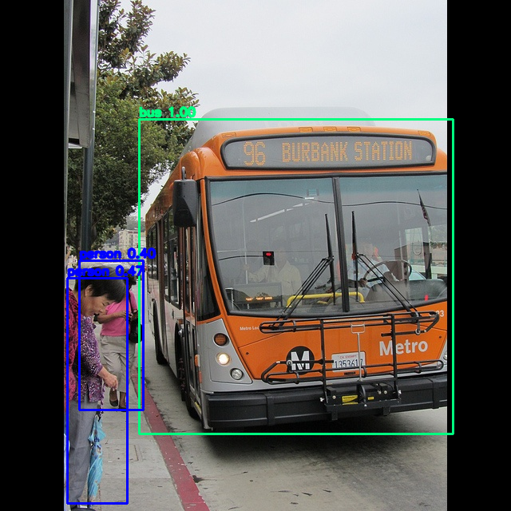

# SSD-MobileNet Object Detector

## Metadata

| Field | Value |
| --- | --- |
| Category | object-detection |
| Difficulty | Intermediate |
| Tags | ssd, mobilenet, object-detection, folder-input, coco |
| Languages | C++, Python |
| Status | stable |
| Binary Name | ssd-mobilenet-object-detector |
| Model | SSD-MobileNet V1/V2 |

## Concept

Detects objects in a folder of images with SSD-MobileNet, saves annotated PNGs, and can write every detection to a JSON report.

```text
How does an image move through ssd-mobilenet-object-detector?

   ┌────────────────────────────────────────┐
   │ Image folder, input.source             │
   └────────────────────────────────────────┘
        │ one BGR image at a time, runner.run
╭┄┄┄┄┄┄┄│┄┄┄┄┄┄┄┄┄┄┄┄┄┄┄┄┄┄┄┄┄┄┄┄┄┄┄┄┄┄┄┄┄┄┄┄┄┄┄┄┄┄┄┄┄┄┄┄╮
┆ RUN   ▼ from model.build                               ┆
┆  ┌────────────────────────────────────────┐            ┆
┆  │ SSD-MobileNet Model                    │            ┆
┆  │ stretch, normalize, MLA, SSD decode    │            ┆
┆  └────────────────────────────────────────┘            ┆
╰┄┄┄┄┄┄┄│┄┄┄┄┄┄┄┄┄┄┄┄┄┄┄┄┄┄┄┄┄┄┄┄┄┄┄┄┄┄┄┄┄┄┄┄┄┄┄┄┄┄┄┄┄┄┄┄╯
        ▼ BBOX tensor, decode_bbox_tensor
   ┌────────────────────────────────────────┐
   │ annotate                               │
   └────────────────────────────────────────┘
        │ boxes drawn          │ every box
        ▼                      ▼
   ┌─────────────────┐   ┌──────────────────────┐
   │ output.dir      │   │ app.detections_json  │
   │ PNG per image   │   │ one JSON report      │
   └─────────────────┘   └──────────────────────┘
```

The application reads the images one at a time with OpenCV and sends each through `runner.run`, the run that `model.build` creates from the first image. Neat stretches the image to the model's input size, normalizes it, runs the model, and decodes the boxes with `BoxDecodeType::Ssd`, which owns the SSD priors, class scoring, and non-maximum suppression. The application draws each image's boxes on a copy, saves it as a PNG under `output.dir`, and adds its boxes to the report at `app.detections_json` when that key names a path.

The application supports TensorFlow's 300×300 SSD-MobileNet V1 and V2 models and normalizes each image as they were trained, to -1 to 1. A model trained with other statistics needs `normalize.mean` and `normalize.stddev` changed in `model_options`.

## Preview



## Prerequisites

- `sima-cli` ([documentation](https://developer.sima.ai/software/tools/sima-cli/)) on the Modalix DevKit, or in a Neat SDK container paired with it.

## Install Apps

Install on the Modalix DevKit, or under `/workspace` in a Neat SDK container paired with it. Only the example itself must run on the DevKit. `sima-cli neat install apps` also offers to install the compatible Neat Library and Insight, and skips them when they are up to date. To keep the Neat Library and Insight you have without being asked, run the install as `NEAT_APPS_SKIP_DEPENDENCIES=1 sima-cli neat install apps`. See [Install Apps](https://github.com/sima-neat/apps/blob/main/README.md#install-apps).

Install the latest Neat Apps runtime and enter the installed bundle:

```bash
sima-cli neat install apps
cd prebuilt-apps
APP_DIR=examples/object-detection/ssd-mobilenet-object-detector
```

Run the remaining commands from `prebuilt-apps/`.

## Prepare the Model

The tested model is SSD-MobileNetV2 INT8 with tessellation inside the MLA. Download it:

```bash
export MODELZOO_VERSION="3.0.0"
mkdir -p models
cd models
sima-cli download \
  "https://docs.sima.ai/pkg_downloads/SDK${MODELZOO_VERSION}/models/modalix/ssd_mobilenet_v2_modalix_int8_tess_mla_mpk.tar.gz"
cd ..
```

The packaged config reads
`models/ssd_mobilenet_v2_modalix_int8_tess_mla_mpk.tar.gz`.

## Configure

Open `${APP_DIR}/src/common/config.yaml`. It reads the downloaded model from `models/`. Set:

- `input.source`: the folder of images. The application processes every `.jpg`, `.jpeg`, `.png`, and `.bmp` file directly inside it, in file-name order, and does not search subfolders. The packaged `assets/datasets/coco` folder holds 21 images.
- `output.dir`: the folder for the annotated PNGs, one per input image. Keep it apart from `input.source`.
- `app.detections_json`: the path of a JSON report with the class, label, score, and box of every detection, such as `sandbox/ssd-mobilenet-object-detector.json`. The default `""` writes no report.

## Run

### C++

```bash
./${APP_DIR}/src/cpp/pre-built/ssd-mobilenet-object-detector \
  --config ${APP_DIR}/src/common/config.yaml
```

### Python

```bash
source ~/pyneat/bin/activate
pip install -r ${APP_DIR}/src/python/requirements.txt
python3 ${APP_DIR}/src/python/main.py \
  --config ${APP_DIR}/src/common/config.yaml
```

## Expected Result

The application prints one line per image with the file it wrote and the number
of objects found, then how many images it processed:

```text
[1/21] 000000081061.jpg -> 000000081061_jpg.png (3 detections)
[2/21] 000000116439.jpg -> 000000116439_jpg.png (2 detections)
[3/21] 000000129492.jpg -> 000000129492_jpg.png (3 detections)
...
Done: 21 images processed
```

`output.dir` then holds one annotated PNG per input image: 21 files for the
packaged `assets/datasets/coco` folder. Both implementations print this format. With
`app.detections_json` set to a path, the report is written there and the last line ends with
`, detections in <path>`.

## Troubleshooting

- `image folder does not exist`: set `input.source` to an existing folder; a relative path starts at the working directory.
- `no .jpg, .jpeg, .png, or .bmp files in <folder>`: point `input.source` at a folder that holds images directly, not in subfolders.
- If boxes look vertically squished or shifted toward the image center, the resize mode is wrong. SSD models need a stretch resize, which the example sets.
- If detections are missing but the application runs, lower `inference.min_score`: INT8 quantization can lower the scores of weak detections.
- If the model fails to load, check that `model.path` points to the downloaded `_mpk.tar.gz` file; a relative path starts at the config file.

## Source Files

- C++ reference source: `src/cpp/main.cpp`, and `src/cpp/utils/annotate.h` for the annotated images and the report
- Python source: `src/python/main.py`, and `src/python/utils/annotate.py`
- Shared config: `src/common/config.yaml`
- Class labels: `support/labels/coco91.txt`, shared with the DETR examples
- Helpers the examples share: `support/python/sima_examples/` at the root of the installed bundle, which `main.py` finds in a folder above itself, and their C++ reference source in `support/cpp/sima_examples/`

The packaged C++ source is an implementation reference. Run the executable under `src/cpp/pre-built/`; the installed bundle does not include CMake files.

## Development From Source

To modify, compile, or test this example, use the [Apps contributor workflow](https://github.com/sima-neat/apps/blob/main/CONTRIBUTING.md).
