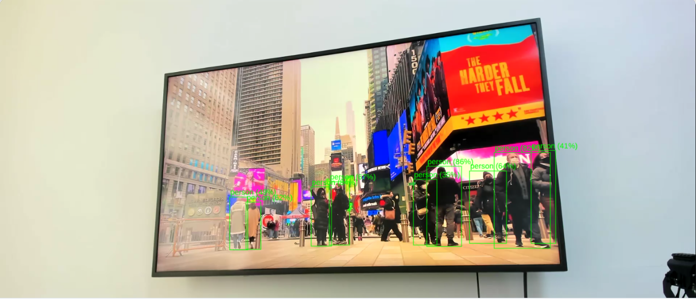

# USB Camera Object Detector

## Metadata

| Field | Value |
| --- | --- |
| Category | object-detection |
| Difficulty | Intermediate |
| Tags | object-detection, yolo26, usb-camera, uvc, v4l2, insight |
| Languages | C++, Python |
| Status | stable |
| Binary Name | usb-camera-object-detector |
| Model | yolo26n-det-bf16-mla_tess-b1 |

## Concept

Captures video from a USB camera, detects objects with YOLO26, and streams the camera's own MJPEG with detection overlays to Insight.

## Preview



## Prerequisites

- A supported Modalix or DevKit target with [sima-cli](https://developer.sima.ai/software/tools/sima-cli/).
- A USB camera that supports MJPEG (`MJPG`) and `v4l2-ctl` for checking its modes.
- A reachable [Insight](https://developer.sima.ai/software/tools/insight/) receiver whose viewer shows MJPEG (RTP/JPEG) streams.

## Install Apps

Run on the target:

```bash
sima-cli neat install apps
cd prebuilt-apps
APP_DIR=examples/object-detection/usb-camera-object-detector
```

Run the remaining commands from `prebuilt-apps/`.

## Prepare the Model

Start with YOLO26n:

```bash
export MODELZOO_VERSION="3.0.0"
mkdir -p models
cd models
sima-cli download "https://docs.sima.ai/pkg_downloads/SDK${MODELZOO_VERSION}/models/modalix/yolo26-detection/yolo26n-det-bf16-mla_tess-b1.tar.gz"
cd ..
```

The downloaded model is `models/yolo26n-det-bf16-mla_tess-b1.tar.gz`. Use this path in the config.
Model Zoo version `3.0.0` comes from the Apps dependency manifest.

<details>
<summary>Other supported YOLO26 detection models</summary>

| Model | Role | Source |
| --- | --- | --- |
| `yolo26m-det-bf16-mla_tess-b1.tar.gz` | Supported | Direct artifact |
| `yolo26s-det-bf16-mla_tess-b1.tar.gz` | Supported | Direct artifact |
| `yolo26l-det-bf16-mla_tess-b1.tar.gz` | Supported | Direct artifact |
| `yolo26x-det-bf16-mla_tess-b1.tar.gz` | Supported | Direct artifact |
| `yolo26m-det-bf16-b1.tar.gz` | Supported | Direct artifact |
| `yolo26m-det-int8-b1.tar.gz` | Supported | Direct artifact |

For these direct artifacts, replace `<model-file>` with a filename from the table:

```bash
export MODELZOO_VERSION="3.0.0"
mkdir -p models
cd models
sima-cli download "https://docs.sima.ai/pkg_downloads/SDK${MODELZOO_VERSION}/models/modalix/yolo26-detection/<model-file>"
cd ..
```

For example, the medium bf16 and int8 download commands, run from `models/`, are:

```bash
sima-cli download "https://docs.sima.ai/pkg_downloads/SDK${MODELZOO_VERSION}/models/modalix/yolo26-detection/yolo26m-det-bf16-mla_tess-b1.tar.gz"
sima-cli download "https://docs.sima.ai/pkg_downloads/SDK${MODELZOO_VERSION}/models/modalix/yolo26-detection/yolo26m-det-int8-b1.tar.gz"
```

Set `model.path` to the package you downloaded. For `yolo26m-det-int8-b1.tar.gz`,
start with `inference.min_score: 0.15` because its confidence scores are lower.
Classification and segmentation models are not supported.

</details>

## Configure

**1. Find your camera.** Plug it in and run:

```bash
v4l2-ctl --list-devices
```

Find your USB camera by name. Copy a device path listed beneath it, then replace
`<camera-device>` in this command:

```bash
v4l2-ctl --device "<camera-device>" --list-formats-ext
```

Use a node whose output includes `MJPG` (MJPEG). If it lists no image formats,
try the next node under the same camera. Choose a **width, height, and FPS listed
under `MJPG`** whose width and height are multiples of 8 and at most 2040 (RTP/JPEG
cannot carry 4K). Device numbers can change after reconnecting the camera.

**2. Edit `${APP_DIR}/src/common/config.yaml`.** Set these values:

| Setting | Value to use |
| --- | --- |
| `model.path` | `models/yolo26n-det-bf16-mla_tess-b1.tar.gz` |
| `source.device` | The camera device you found above |
| `source.width`, `source.height`, `source.fps` | One MJPEG mode supported by your camera |
| `output.insight.host` | IP address of your Insight receiver |
| `output.insight.video_port` | Insight's video UDP port (default `9000`); it receives the camera's MJPEG |
| `output.insight.metadata_port` | Insight's metadata UDP port (default `9100`) |

The shipped `1920 × 1080 @ 30` values are only defaults. Change all three camera
settings to match your device; 1080p and 90 FPS are not requirements. The app
checks the requested mode at startup and reports an error if it is unsupported.

Keep the other settings unchanged to start. For an upside-down or mirrored camera,
set **Orientation** in the Insight viewer settings; it turns the video and the overlays together.

## Run

Run one implementation at a time. Both use the same config.

### C++

```bash
./${APP_DIR}/src/cpp/pre-built/usb-camera-object-detector \
  --config ${APP_DIR}/src/common/config.yaml
```

### Python

```bash
source ~/pyneat/bin/activate
pip install -r ${APP_DIR}/src/python/requirements.txt
python3 ${APP_DIR}/src/python/main.py \
  --config ${APP_DIR}/src/common/config.yaml
```

Open Insight to view the video and detection overlays. The first run may take
longer while the model is unpacked. Press **Ctrl+C** to stop.

## Troubleshooting

- **Camera cannot open or mode is unsupported:** repeat camera discovery and select an `MJPG` mode shown by `--list-formats-ext`.
- **No video or overlays in Insight:** check the receiver IP address and both UDP ports.
- **Low frame rate or incomplete JPEG errors:** try a lower resolution or FPS supported by the camera. Set `runtime.profile: true` to see the achieved output rate.

Add `--validate-config-only` to either run command to check config values without
opening the camera or loading the model. It does not check camera capabilities.

## Source Files

- C++ reference source: `src/cpp/main.cpp`
- Python source: `src/python/main.py`
- Shared config and labels: `src/common/`

The packaged C++ source is an implementation reference. Run the executable under
`src/cpp/pre-built/`; the installed bundle does not include CMake files.

## Development From Source

To modify, compile, or test this example, use the [Apps contributor workflow](https://github.com/sima-neat/apps/blob/main/CONTRIBUTING.md).

Both implementations branch each camera JPEG: `VideoSender` forwards it unchanged to
Insight as RTP/JPEG, and `JpegParse` and `SimaDecode` decode it once on the hardware for
the model. The app reads the camera's first frame to choose the decoder format, NV12 for
4:2:0 or NV16 for 4:2:2, and the model preprocessing reads that format directly, so no
conversion stage or encoder runs and no camera-specific setting is needed.
`source.override_fragment` is an optional diagnostic GStreamer source that must produce
MJPEG at the configured width, height, and FPS; set `source.override_format` to its
decoded format (NV12 or NV16). Leave the override empty for USB capture. End-to-end tests
encode a fixed image as 4:2:2 and 4:2:0 MJPEG and check that the received RTP/JPEG
stream reassembles into complete frames of the configured size without packet loss,
alongside detection metadata.
