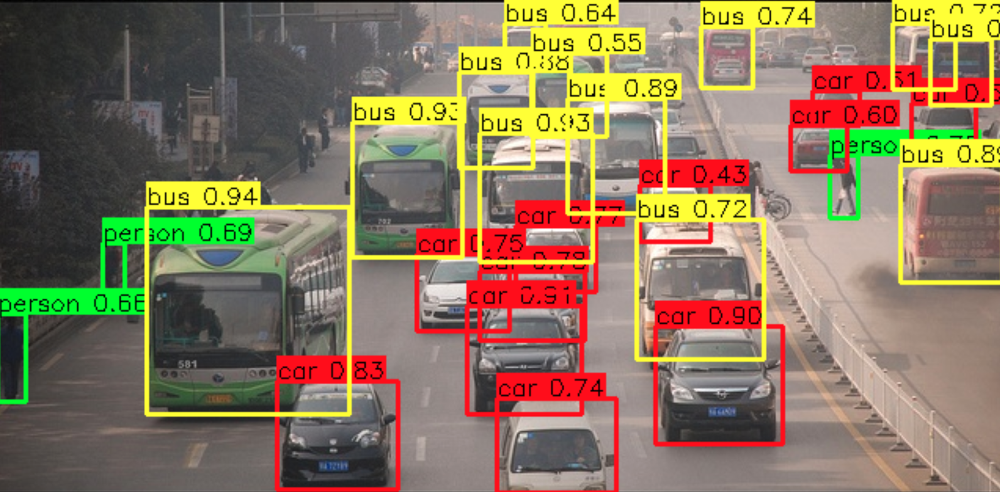

# YOLO26 Object Detector

## Metadata

| Field | Value |
| --- | --- |
| Category | object-detection |
| Difficulty | Beginner |
| Tags | object-detection, yolo26, folder-inference |
| Languages | C++, Python |
| Status | stable |
| Binary Name | yolo26-object-detector |
| Model | yolo26m (w16a16) |

## Concept

Detects objects in a folder of images with YOLO26 and saves copies annotated with boxes, labels, and confidence scores.

```text
How does an image move through yolo26-object-detector?

   ┌──────────────────────────────────────────────┐
   │ Image folder, input.source                   │
   └──────────────────────────────────────────────┘
        │ one BGR image at a time, runner.run
╭┄┄┄┄┄┄┄│┄┄┄┄┄┄┄┄┄┄┄┄┄┄┄┄┄┄┄┄┄┄┄┄┄┄┄┄┄┄┄┄┄┄┄┄┄┄┄┄┄┄┄┄┄┄╮
┆ RUN   ▼ from model.build                             ┆
┆  ┌──────────────────────────────────────────────┐    ┆
┆  │ YOLO26 Model                                 │    ┆
┆  │ letterbox, COCO_YOLO, MLA, YOLO26 box decode │    ┆
┆  └──────────────────────────────────────────────┘    ┆
╰┄┄┄┄┄┄┄│┄┄┄┄┄┄┄┄┄┄┄┄┄┄┄┄┄┄┄┄┄┄┄┄┄┄┄┄┄┄┄┄┄┄┄┄┄┄┄┄┄┄┄┄┄┄╯
        ▼ BBOX tensor, decode_bbox_tensor
   ┌──────────────────────────────────────────────┐
   │ annotate.draw_detections (utils/)            │
   └──────────────────────────────────────────────┘
        │ boxes drawn
        ▼
   ┌──────────────────────────────────────────────┐
   │ output.dir, one <image>_yolo26.png per image │
   └──────────────────────────────────────────────┘
```

- The application reads the images one at a time with OpenCV and sends each through `runner.run`, the run that `model.build` creates from the first image. The run accepts images up to Neat's default input limit of 1920x1080.
- Neat letterboxes each image to the model's 640x640 input on the EV74 and scales the pixels to 0 to 1 (`COCO_YOLO`).
- Neat's YOLO26 decoder turns the model's heads into boxes in the image's pixels, keeps those above `inference.min_score`, removes overlapping boxes of the same class above `inference.nms_iou`, and returns at most `inference.max_detections`.
- The application draws each image's boxes with their labels from `model.labels` and saves the result under `output.dir`.

## Preview



## Prerequisites

- `sima-cli` ([documentation](https://developer.sima.ai/software/tools/sima-cli/)) on the Modalix DevKit, or in a Neat SDK container paired with it.

## Install Apps

Install on the Modalix DevKit, or under `/workspace` in a Neat SDK container paired with it. Only the example itself must run on the DevKit. `sima-cli neat install apps` also offers to install the compatible Neat Library and Insight, and skips them when they are up to date. To keep the Neat Library and Insight you have without being asked, run the install as `NEAT_APPS_SKIP_DEPENDENCIES=1 sima-cli neat install apps`. See [Install Apps](https://github.com/sima-neat/apps/blob/main/README.md#install-apps).

Install the latest Neat Apps runtime and enter the installed bundle:

```bash
sima-cli neat install apps
cd prebuilt-apps
APP_DIR=examples/object-detection/yolo26-object-detector
```

Run the remaining commands from `prebuilt-apps/`.

## Prepare the Model

The [model browser](https://developer.sima.ai/models/) has the YOLO26 detection models in five sizes, from n (nano) to x (extra large). The default is `yolo26m` with the `w16a16` variant, the BF16 build of the model. Download it and unpack it with `sima-cli` 2.1.20 or newer:

```bash
sima-cli models download --id yolo26m --variant w16a16
unzip -o models/yolo26m/w16a16/yolo26m_w16a16_default.zip -d models/yolo26m/w16a16
```

The download is a ZIP file with the model package and its license. `unzip` puts the model package, `models/yolo26m/w16a16/yolo26m_w16a16_mpk.tar.gz`, next to the ZIP file. The packaged config reads that `.tar.gz` file; Neat cannot load the ZIP itself.

| ID | Variants | Role |
| --- | --- | --- |
| `yolo26m` | `w8a8`, `w8a16`, `w16a16` | Default (`w16a16`) |
| `yolo26n` | `w8a8`, `w8a16`, `w16a16` | Supported |
| `yolo26s` | `w8a8`, `w8a16`, `w16a16` | Supported |
| `yolo26l` | `w8a16`, `w16a16` | Supported |
| `yolo26x` | `w8a8`, `w8a16`, `w16a16` | Supported |

To use another model, replace `yolo26m` and `w16a16` in both commands and in `model.path`. The variant is the number format the model was compiled with: `w8a8` stores weights and activations as 8-bit integers, `w8a16` keeps 8-bit integer weights and stores activations in BF16, a 16-bit float format, and `w16a16` uses BF16 for both. See the model browser for the measured accuracy and performance of each size and variant.

## Configure

Open `${APP_DIR}/src/common/config.yaml`. It reads the downloaded default model from `models/`. Set:

- `input.source`: the folder of images. The application processes every `.jpg`, `.jpeg`, `.png`, and `.bmp` file directly inside it, in file-name order, and does not search subfolders. The packaged `assets/datasets/coco` folder holds 21 images.
- `output.dir`: the folder for the annotated PNGs, one per input image. Keep it apart from `input.source`.
- `model.path`: only for another model from the table above; a relative path starts at the config file.
- `inference.min_score` and `inference.nms_iou`: only to show more or fewer detections.

## Run

### C++

```bash
./${APP_DIR}/src/cpp/pre-built/yolo26-object-detector \
  --config ${APP_DIR}/src/common/config.yaml
```

### Python

```bash
source ~/pyneat/bin/activate
pip install -r ${APP_DIR}/src/python/requirements.txt
python3 ${APP_DIR}/src/python/main.py \
  --config ${APP_DIR}/src/common/config.yaml
```

## Expected Result

The application prints one line per image with its detection count and output
file, then the number of images it processed:

```text
[1/21] 000000081061.jpg: 3 detections -> 000000081061_yolo26.png
...
Done: 21 images processed
```

`output.dir` (default `sandbox/yolo26-object-detector`) then holds one annotated
PNG per input image: 21 files for the packaged `assets/datasets/coco` folder.
Detection counts vary by image, model, and variant. Both implementations print
this format. A run that writes every file with `0 detections` usually means
`inference.min_score` is too high for the content.

## Troubleshooting

- `input.source has no .jpg, .jpeg, .png, or .bmp files`: point `input.source` at a folder that holds images directly, not in subfolders.
- If the model fails to load with `model archive must use .tar.gz`, `model.path` points to the downloaded ZIP file. Set it to the `_mpk.tar.gz` file unpacked from it; a relative path starts at the config file.
- An image larger than 1920x1080 fails with Neat's input-size error. Resize it first.
- Lower `inference.min_score` if expected objects are missing. Lower `inference.nms_iou` if one object gets two boxes.

## Source Files

- C++ reference source: `src/cpp/main.cpp`, with `src/cpp/utils/images.h` for the image folder and `src/cpp/utils/annotate.h` for the annotated images
- Python source: `src/python/main.py`, with `src/python/utils/images.py` and `src/python/utils/annotate.py`
- Shared config and labels: `src/common/`
- Helpers the examples share: `support/python/sima_examples/` at the root of the installed bundle, which `main.py` finds in a folder above itself, and their C++ reference source in `support/cpp/sima_examples/`

The packaged C++ source is an implementation reference. Run the executable under `src/cpp/pre-built/`; the installed bundle does not include CMake files.

## Development From Source

To modify, compile, or test this example, use the [Apps contributor workflow](https://github.com/sima-neat/apps/blob/main/CONTRIBUTING.md).
