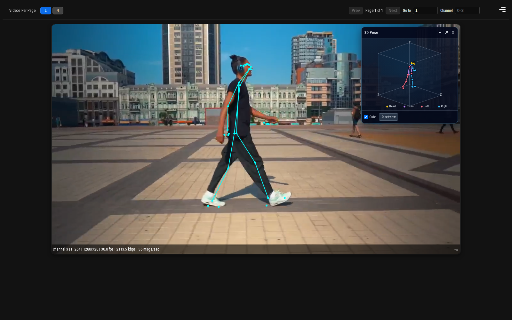

# Multi-Stream BlazePose 3D

## Metadata

| Field | Value |
| --- | --- |
| Category | pose-estimation |
| Difficulty | Advanced |
| Tags | blazepose, yolo26, keypoints, rtsp, multistream, insight |
| Languages | C++, Python |
| Status | stable |
| Binary Name | multi-stream-blazepose3d |
| Model | YOLO26 detection and BlazePose Heavy 3D |

## Concept

Tracks people in up to four RTSP streams with YOLO26 and BlazePose Heavy, then sends 2D landmarks and 3D world landmarks for each frame to Insight.

Each camera runs independently, so a disconnected camera does not stall the others. The C++ and Python versions use the same configuration and produce the same output.

## Preview



## Prerequisites

- `sima-cli` ([documentation](https://developer.sima.ai/software/tools/sima-cli/)) on a supported Modalix or DevKit target.
- H.264 or H.265 RTSP sources and an [Insight](https://developer.sima.ai/software/tools/insight/) host reachable from the target.

## Install Apps

Install the latest Neat Apps runtime and enter the installed bundle:

```bash
sima-cli neat install apps
cd prebuilt-apps
export APP_DIR=examples/pose-estimation/multi-stream-blazepose3d
```

Run the remaining commands from `prebuilt-apps/`.

## Prepare the Model

| Model file | Role |
| --- | --- |
| `yolo26m-det-int8-b1.tar.gz` | Person detector (`models.detector_path`) |
| `blazepose_ghum_heavy_w16a16_mpk.tar.gz` | 2D and 3D landmarks (`models.pose_path`) |

Both packages are direct downloads from the Model Zoo release below, which can differ from the installed platform version:

```bash
export MODELZOO_VERSION="3.0.0"
mkdir -p models
cd models
sima-cli download "https://docs.sima.ai/pkg_downloads/SDK${MODELZOO_VERSION}/models/modalix/yolo26-detection/yolo26m-det-int8-b1.tar.gz"
sima-cli download "https://docs.sima.ai/pkg_downloads/SDK${MODELZOO_VERSION}/models/modalix/blazepose_ghum_heavy_w16a16_mpk.tar.gz"
cd ..
```

## Prepare Insight

In the Insight Web UI, install videos from the Insight catalog or through its YouTube support, start one stream per camera, and copy their RTSP URLs. Insight must include the `blazepose-3d` renderer for the 3D Pose panel.

## Configure

Open `${APP_DIR}/src/common/config.yaml` and set:

- `models.detector_path`: `models/yolo26m-det-int8-b1.tar.gz`
- `models.pose_path`: `models/blazepose_ghum_heavy_w16a16_mpk.tar.gz`
- one `streams` entry per camera, one to four in total. Use the RTSP URLs from Insight or your cameras. Give each stream a unique `id` and `insight_channel`, its `codec`, and its actual `width`, `height`, and `fps`.
- `output.insight.host`: the host running Insight.

Restart the application after changing streams. The other settings work as shipped. Two you may want to change:

- `pose.max_people_per_frame` (default 1, maximum 10): how many people are tracked per stream. Each person costs one BlazePose inference per frame.
- `pose.temporal_filter_enabled` (default `true`): smooths landmarks between frames. Set it to `false` for raw model output.

Stream `N` sends video to `output.insight.video_port_base + N` and metadata to `output.insight.metadata_port_base + N`. If you use large channel numbers, keep the two port ranges from overlapping.

## Run

### C++

```bash
"${APP_DIR}/src/cpp/pre-built/multi-stream-blazepose3d" \
  --config "${APP_DIR}/src/common/config.yaml"
```

### Python

```bash
source ~/pyneat/bin/activate
pip install -r "${APP_DIR}/src/python/requirements.txt"
python3 "${APP_DIR}/src/python/main.py" \
  --config "${APP_DIR}/src/common/config.yaml"
```

## Expected Result

Insight shows each stream's video with a 2D skeleton overlay, and a separate 3D Pose panel with the world landmarks. Stop the application with Ctrl+C. It prints one summary line per stream:

```text
[summary stream=camera0] frames_in=<count> frames_out=<count>
```

`frames_in` counts source frames received, and `frames_out` counts frames whose two metadata messages were both queued for Insight. `frames_out` is lower when the application drops frames to keep up.

## Output Metadata

For every frame, each stream sends two metadata messages with the same timestamp and frame ID. A frame with nobody in it sends empty messages, which clears the overlay.

`pose-estimation` carries each person's box and 33 named landmarks, in source-frame pixels (`keypoints`) and in 3D world coordinates (`world_keypoints`). `bbox` is `[x, y, width, height]` in pixels. `confidence` is the person-detection score, `presence` is BlazePose's probability that the crop contains a person, and each landmark `confidence` is the probability that the landmark is present and visible:

```json
{
  "stream_id": "camera0",
  "poses": [
    {
      "id": "pose_1",
      "label": "person",
      "presence": 0.99,
      "confidence": 0.91,
      "bbox": [120, 80, 240, 520],
      "keypoints": [
        {"name": "nose", "x": 242, "y": 135, "confidence": 0.98}
      ],
      "world_keypoints": [
        {"name": "nose", "x": 0.01, "y": -0.42, "z": -0.08, "confidence": 0.98}
      ]
    }
  ]
}
```

`auxiliary-visualization` repeats the world landmarks for Insight's 3D Pose panel:

```json
{
  "schema_version": 1,
  "id": "world-pose",
  "renderer": "blazepose-3d",
  "title": "3D Pose",
  "stream_id": "camera0",
  "payload": {
    "poses": [
      {
        "id": "pose_1",
        "presence": 0.99,
        "keypoints": [
          {"name": "nose", "x": 0.01, "y": -0.42, "z": -0.08, "confidence": 0.98}
        ]
      }
    ]
  }
}
```

## Performance

Measured on a Modalix DevKit with Platform 3.0.0, the C++ application from the `apps@develop` package, and no other workload on the board. The configuration is the default, including `pose.max_people_per_frame: 1`, except for the detector and the input streams. Each run uses four streams of people in public spaces, at 120 FPS for 720p H.264, 180 FPS for 720p H.265, 60 FPS for 1080p H.264, and 90 FPS for 1080p H.265. Each figure is the per-stream rate, in FPS, of frames whose two metadata messages Insight received, averaged over 20 seconds after a 5-second warm-up.

| Input resolution | Codec | Default `yolo26m-det-int8-b1` | `yolo26n-det-int8-b1` |
| --- | --- | ---: | ---: |
| 720p | H.264 | 55 | 60 |
| 720p | H.265 | 55 | 60 |
| 1080p | H.264 | 56 | 59\* |
| 1080p | H.265 | 55 | 60 |

The Nano detector raises the rate by only about 5 FPS per stream. The Python application measured 16 FPS per stream with the default detector at 1080p H.264, using about seven CPU cores.

\* Limited by the 60 FPS input.

## Troubleshooting

- Replace all placeholders in the config and check both model paths.
- Throughput drops as `pose.max_people_per_frame` rises, because every person adds BlazePose inferences.
- H.265 streams need an Insight viewer that can decode HEVC.
- `[ERR] YOLO26 inference stalled` or `[ERR] BlazePose inference stalled` means a model returned no output for 5 s; the application exits with code 1.

## Source Files

- C++ reference source: `src/cpp/main.cpp`
- Python source: `src/python/main.py`
- Shared configuration: `src/common/config.yaml`

The packaged C++ source is an implementation reference. Run the executable under `src/cpp/pre-built/`; the installed bundle does not include CMake files.

## Development From Source

To modify, compile, or test this example, use the [Apps contributor workflow](https://github.com/sima-neat/apps/blob/main/CONTRIBUTING.md).
