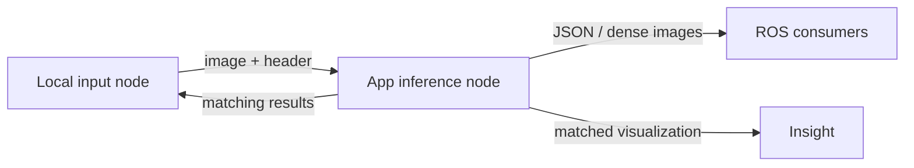

# ROS node development guide

Each example under `examples/ros2/<category>/<example>` builds independently.
Start with the nearest example and its local `launch/app.launch.py`.

## 1. Nodes and launch path



The local `launch/app.launch.py` starts the app's executable scripts. With
`source:=none`, it starts inference and waits for an existing image topic.
High-density's live graph instead keeps decoding and inference together.
BlazePose retains its local detector/pose scheduler. Studio uses bounded HTTP
requests to its backend; the benchmark publishes a synthetic model report.

## 2. Configuration and launch arguments

`src/common/config.yaml` contains startup settings. `config` selects the file,
`namespace` scopes relative topics, and `source` chooses the app's supported
input mode. Multi-camera apps expose `stream_index`. There is no `apps_root`
lookup or runtime app selection. Read the app's launch file for exact choices.

Model/input paths are relative to the process working directory unless the
app documents config-relative resolution. Use absolute paths when moving
configs. Colcon does not download models, datasets or configure cameras.

| Setting | Meaning |
| --- | --- |
| `ros.image_topic`, `results_topic` | Input images and matching results |
| `ros.input_policy` | `complete` backpressure or `latest` freshness |
| `ros.pending_frames`, `inflight_frames` | Queued and admitted work bounds |
| `ros.source_window` | Outstanding source frames per camera in complete mode |
| `ros.source_encoding` | Source output format where configurable |
| `ros.result_timeout_seconds` | Bound waits for results/subscribers |
| `ros.visualization` | Optional save/Insight output |

Specialized schedulers document their own admission settings. In complete mode,
size pending capacity for all source windows. An external camera must honor the
chosen delivery contract; reliable DDS alone does not pace it.

## 3. Topics, messages and clocks

The default namespace is `/neat`. Image nodes subscribe to `image` and publish
`results` as `std_msgs/msg/String` JSON. The result envelope contains
`schema_version`, `sequence`, `header` and app-specific `data`. Dense float maps
use `sensor_msgs/msg/Image` (`32FC1`), with the same source header.

Each admitted image retains its pixels/tensors until completion. Before decoding,
the node checks returned request ID and timestamp against its retained context.
Unknown/duplicate/mismatched results fail visibly. Latest-mode drops apply only
to unadmitted work. Source timestamps are not reconstructed from result order.

Input/result QoS is reliable. Match external publishers accordingly. Packed
NV12/NV16 is an explicit app transport convention; standard viewers often expect
RGB/BGR. The local `image_transport.py` defines the layout and ownership copies.

## 4. Read an inference node

Open [the face detector](face-detection/face-detector/src/python/detection_node.py):

1. `__init__()` declares subscriptions/publishers, bounded state and workers.
2. `initialize_model()` configures the model. Geometry-dependent setup can occur
   on the first image in `prepare_input()`.
3. `prepare_input()` performs the native preprocessing and owns input storage.
4. `build_runner()` constructs the public Neat graph and run options.
5. `submit_images()` calls `runner.push()`; `receive_results()` calls
   `runner.pull()` on another worker so admission/completion overlap.
6. `decode_result()` maps model outputs to source coordinates. The result worker
   publishes numerical data, dense images and optional matching visualization.
7. `close()` releases blocked native work and joins workers before ROS teardown.

There is no parent inference framework to trace. `model_support.py` contains local
numerical/configuration helpers; multi-stage app-specific runner classes remain
beside the node using them. Keep the async flow and bounds when changing models.

## 5. Create your own application

Copy the nearest example folder. Change the package name in `package.xml`,
`CMakeLists.txt`, and the local launch's package references. Where helpers resolve
installed assets through `get_package_share_directory`, update that name too.

Implement your model's initialization, preparation and decode methods directly
in its node file. Preserve explicit source headers and bounded ownership. Add
publishers/subscriptions in the node, and document their types, encodings and QoS.
Register executable scripts in `CMakeLists.txt`; install local helpers and assets
with them. Declare ROS/Python dependencies in `package.xml`. Avoid copying an
unrelated scheduler or introducing an app-name dispatch table.

From the copied directory on Modalix:

```bash
source /usr/local/ros2/setup.bash
source ~/pyneat/bin/activate
colcon build
source install/setup.bash
```

Use `sima-cli neat install ros2@v3.0.0` for ROS installation. After configuring the
models/source, run `ros2 launch <your_package> app.launch.py config:="$PWD/src/common/config.yaml"`.

## 6. Inspect and validate

```bash
ros2 node list
ros2 topic list -t
ros2 topic info /neat/image --verbose
ros2 topic echo /neat/results
```

Use the local `result_sink.py` when you need recorded sequences and header checks.
Its `--image-topic` option also records dense image values. It does not visualize.
Test both source modes, shutdown, input errors and result identity. Compare
numerical outputs and repeated completed-output throughput with native Python,
using identical artifacts/settings/workloads. Keep physical-camera and runtime
limitations explicit; a successful build/import is not performance evidence.

## 7. Saved images and Insight

`ros.visualization.save` selects a directory and sampling cadence. Each run gets
its own folder with PNGs and a header manifest. `ros.visualization.insight`
selects host, video port, channel(s), maximum visible streams, bitrate and FPS.
The node renders against the exact matched input, then uses Neat's video sender.
Insight uses a fixed even-sized canvas based on the first frame and letterboxes
later images to fit it. Saved PNGs keep the original image size. Both outputs are
opt-in. Disable them for inference-throughput comparisons.

High-density graph mode retains encoded video plus a local metadata sink, using
`output.insight`. Detection-to-VLM adds the exact accepted VLM input on a second
channel. Studio uses Insight's GenAI tab. See each app's README for these paths.
