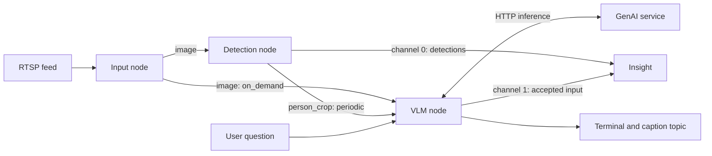

# Detection-to-VLM Assistant — ROS 2

This app has three ROS nodes: **input**, **detection**, and **VLM**. It is a
standalone ROS package, `neat_detection_vlm`, with source, launch, config,
labels and build files together in this folder.

| Mode (`genai.mode`) | Image sent to the VLM | Trigger |
| --- | --- | --- |
| `on_demand` | **Latest full camera image, without cropping** | Your question on `/neat/question` |
| `periodic` | **Highest-confidence person crop** from the detector | Timer with the configured prompt |



## Find the implementation

```text
detection-to-vlm-assistant/
├── package.xml                 ROS package name and dependencies
├── CMakeLists.txt              Install nodes, config and launch
├── launch/app.launch.py        App wiring
└── src/
    ├── common/
    │   ├── config.yaml         Startup settings
    │   └── coco_label.txt      Detector labels
    └── python/
        ├── input_node.py      RTSP decoding and image publication
        ├── detection_node.py  YOLO26 setup, inference and result publication
        ├── vlm_node.py        Image selection, prompts and VLM requests
        ├── genai_server.py    Load the VLM and serve its inference endpoint
        ├── box_decode.py      Decode the native BBOX output format
        ├── app_config.py      Read YAML and convert images to RGB
        ├── image_transport.py ROS image packing and Neat tensor conversion
        └── visual_output.py   Draw boxes, save images and send Insight video
```

There is no `ros_node.py` dispatcher or `Pipeline`/`ImageNode` wrapper.
Each node declares its publishers and subscriptions in `__init__()`.

| File | Initialization and inference |
| --- | --- |
| [input_node.py](src/python/input_node.py) | `open_camera()` builds the decoder; `publish_next()` pulls and publishes images |
| [detection_node.py](src/python/detection_node.py) | `initialize_model()` explicitly configures/builds YOLO26 on the first image; `submit_images()` calls `runner.push()`; `receive_results()` calls `runner.pull()` and publishes matching results |
| [vlm_node.py](src/python/vlm_node.py) | `on_question()` / `on_periodic()` select work; `infer_requests()` runs it outside the ROS callback; `infer()` sends the image and prompt to the service |
| [genai_server.py](src/python/genai_server.py) | `start_genai_server()` creates the service and calls `add_model()` to load the VLM |

Two bounded detector workers overlap submission and completion. The VLM handles
**one request at a time**, reporting busy instead of accumulating questions.
Image/tensor conversion, decoder plane packing and visual output are local
helpers in this package. It neither builds nor imports `neat_apps`, and it does
not import the original native example. ROS 2 and the Neat Python runtime are
still required.

## Prepare and configure

Install ROS 2 with `sima-cli neat install ros2@v3.0.0`. Use the matching Neat
Python environment and ensure `colcon` is available; see the
[shared setup guide](../../../../ROS2.md#install-and-build).
Obtain the detector and VLM using the native
[model preparation guide](../../../genai/detection-to-vlm-assistant/README.md#prepare-the-model).

Edit [src/common/config.yaml](src/common/config.yaml):

| Setting | Purpose |
| --- | --- |
| `source.rtsp_url` | Camera or replay RTSP URL |
| `model.path` | Detector package; an absolute path is easiest |
| `model.labels` | Label file relative to the config; shipped as `coco_label.txt` |
| `inference.min_score`, `.nms_iou`, `.max_detections` | Detector thresholds and output limit |
| `genai_server.model.name`, `.path` | VLM loaded by the local service |
| `genai.host`, `.port` | Service address |
| `genai.mode` | `on_demand` or `periodic` |
| `genai.user_prompt`, `.interval_seconds` | Periodic question and interval |
| `genai.system_prompt` | Instructions used in both modes |
| `genai.image_max_age_seconds` | Maximum age since receiving an image/crop |
| `genai.max_tokens`, `.timeout_seconds` | Answer length and HTTP timeout |
| `ros.crop_interval_seconds` | At most one crop publication per interval; default 1 second |
| `ros.visualization.insight.enabled`, `.host` | Enable both video channels and choose the Insight host |

These are startup YAML settings, not dynamic ROS parameters. Restart after
edits. Relative model/output paths use the working directory. Keep the image
age limit longer than the crop publication interval.

## Build on Modalix

Enter this example directory from the Apps repository checkout
root. All subsequent commands run **inside this example**:

```bash
cd examples/ros2/genai/detection-to-vlm-assistant
source /usr/local/ros2/setup.bash
source ~/pyneat/bin/activate
colcon build
source install/setup.bash
```

Only `neat_detection_vlm` is built. The `build/`, `install/` and `log/` directories
are created here and ignored by Git. You can also copy this entire example folder
to its own directory on Modalix and run the same commands starting with `source`.
Only this example package needs to be built.

Rebuild after Python or launch edits. Source ROS, activate Neat and source this
installation in each new terminal. The run command uses the editable source
config; YAML edits need only a restart. Omitting `config` uses the installed copy.
Set model paths to absolute paths, or paths relative to this example directory.

## Run and ask a question

From this example directory:

```bash
ros2 launch neat_detection_vlm app.launch.py \
  config:="$PWD/src/common/config.yaml"
```

This starts all three ROS nodes **and the local GenAI service**. Wait for its
serving message and the detector's initialized message. The GenAI service is a
process, not a ROS node. To use an existing service, add `server:=false` and set
`genai.host`, `.port` and optionally `.model`; do not start another on that port.

For **on-demand mode**, set `genai.mode: on_demand` and launch. In another sourced
terminal, ask about the **full scene**:

```bash
ros2 topic pub --once /neat/question std_msgs/msg/String \
  "{data: 'Describe the full scene. What objects are visible?'}"
```

The VLM snapshots the latest full image when it accepts the question. It does
not select a person or wait for detections. Receiving images alone never starts
VLM inference. Missing/stale images, empty questions and busy requests produce
explicit errors in the launch terminal and caption topic.

For **periodic mode**, set `genai.mode: periodic`, edit `genai.user_prompt` and
`genai.interval_seconds`, then restart. The timer uses a fresh person crop when
the request slot is free. No-person/stale/busy ticks are skipped. Manual
questions require on-demand mode.

Other startup choices:

- `source:=none`: omit the input node and use an external publisher on
  `ros.image_topic`. The detector requires packed NV12 and compatible reliable
  QoS. The VLM also accepts RGB/BGR when run independently.
- `namespace:=demo`: use `/demo` instead of `/neat` for relative topics.
- `genai.enabled: false` in YAML: run input and detection only.

Ctrl+C stops the launch, including a service it started. An active HTTP request
is allowed time to finish or time out. Unstarted work is cancelled. A component
exit stops the app; use a continuous feed for interactive questions.

## See exactly what the VLM receives

Enable `ros.visualization.insight.enabled`, set `host`, and show **two channels**
in your running Insight service's video viewer:

- **Channel 0:** current camera image with detector boxes.
- **Channel 1:** the image accepted for the latest VLM request: **full image in
  on-demand mode**, **selected person crop in periodic mode**. It stays visible
  until another request is accepted. Before the first request there is no video.

`channel_base` changes the detection channel; the VLM preview uses the next
channel. Inputs are fitted into a 640×480 preview canvas without changing their
aspect ratio. Preview refreshes never trigger additional VLM inference.

Periodic selection uses the **highest-confidence person among the decoded
boxes on that frame**. Its bounding box crops the exact matching source image,
clipped to image boundaries. Other people are not sent. Selection can change
between frames; this is not person tracking. The last crop can remain eligible
until its age limit after someone leaves view. Freshness uses monotonic time
since receipt; the original source timestamp is preserved.

`/neat/vlm_input` retains the **unresized RGB pixels** accepted for the latest
request, before JPEG encoding for the service. Use it to inspect or record the
actual input. Captions contain `input_kind`, the original `header`, input
`width`/`height`, `prompt`, `request_id`, `text` and `error`. Match headers to
associate a caption with its input.

Answers appear in the launch terminal. Inspect structured replies with:

```bash
ros2 topic echo /neat/captions
```

| Default topic | Type | Purpose |
| --- | --- | --- |
| `/neat/image` | `sensor_msgs/msg/Image`, packed NV12 | Full image to detection and on-demand VLM |
| `/neat/results` | `std_msgs/msg/String`, JSON | Detections with header; also acknowledges source images |
| `/neat/person_crop` | `sensor_msgs/msg/Image`, RGB8 | Selected crop to periodic VLM |
| `/neat/question` | `std_msgs/msg/String`, plain text | On-demand question |
| `/neat/vlm_input` | `sensor_msgs/msg/Image`, RGB8 | Exact last accepted input; transient-local, depth 1 |
| `/neat/captions` | `std_msgs/msg/String`, JSON | Caption or error |
| `/neat/detection/statistics` | `std_msgs/msg/String`, JSON | Completed FPS and received/completed/dropped counts |

Names are configurable under `ros:`. All subscriptions use reliable QoS. Only
`vlm_input` is retained for late joiners; other topics are volatile. Start an
observer before asking to capture replies. Rejected requests have no image
header. Request IDs are local to each VLM node run.

`ros.visualization.save.enabled` saves **detector overlays** and their source
headers in a new run directory. Inspect VLM inputs through Insight or the
retained topic. Disable visualization when measuring inference throughput.

## Extend the app

Change capture in `input_node.py`, model initialization/postprocessing in
`detection_node.py`, or prompt/input selection in `vlm_node.py`. Register new
executables in this folder's `CMakeLists.txt` and dependencies in `package.xml`.
The [local launch](launch/app.launch.py) contains the complete app wiring.
The local [image transport](src/python/image_transport.py) and
[visual output](src/python/visual_output.py) helpers handle pixel conversion and
optional output; neither contains model inference.

## Validation scope

Built on Modalix with plain `colcon build` inside a copy of this example folder:
exactly one package, with no `neat_apps` installation or original native examples
in its runtime workspace. A 640×480 RTSP replay, YOLO26m BF16 and Gemma3-SigLIP448-GPTQ-a16w4 exercised both modes with
real VLM answers and automatic service startup/shutdown. Full-image request
pixels matched the source, and periodic request pixels matched the published
person crop. Native Python detector/crop parity was checked before relocating
the helpers into this package. Focused ROS tests cover
mode isolation, preview sizing, request ownership, stale/busy/error paths,
detector frame matching and shutdown.

The default Qwen VLM, physical cameras and full-throughput FPS parity are not
established by this validation. Set the model configuration to what you serve.
