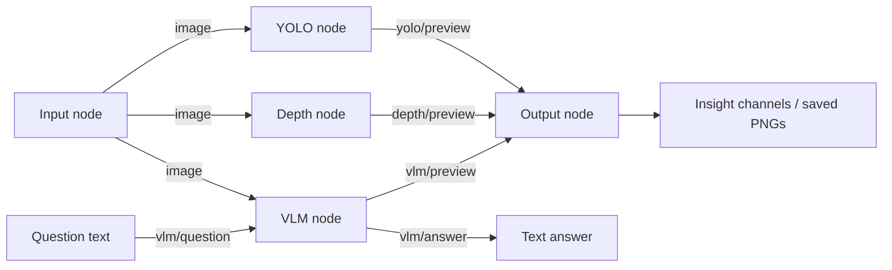

# Perception Switchboard — ROS 2

Explore one image through **YOLO detection and segmentation**, **relative depth**,
and an **on-demand VLM**. Switch inference on or off with ROS parameters without
restarting the application. This is a standalone, Python-only teaching package:
build it from this directory; every node and helper is local.

## Start with the five nodes



| Node / file | What is inside it |
| --- | --- |
| [input_node.py](src/python/input_node.py) | Folder replay or Neat RTSP decoding; publishes full BGR images with unique timestamps. Keeps running when the models are on standby. |
| [yolo_node.py](src/python/yolo_node.py) | One YOLO26 segmentation model, model options, asynchronous submission/completion, box/mask decoding, parameter callbacks, matched overlays. |
| [depth_node.py](src/python/depth_node.py) | Depth Anything V2, hardware bicubic resize, asynchronous inference, relative float depth and a configurable depth preview. |
| [vlm_node.py](src/python/vlm_node.py) | Latest full frame, question admission, one snapshot per request, HTTP inference, answer/error publication; optional local Neat GenAI service. |
| [output_node.py](src/python/output_node.py) | Receives already-rendered previews and sends them to separate Insight channels or saves PNGs. No models or inference. |

Each vision node owns its model. There is no dispatcher, shared inference base
class or import of another app. YOLO segmentation already returns boxes and
masks: selecting a detection overlay does **not** load a second detector or
change the predictions. Depth is relative depth, not calibrated distance in metres. This example uses one
image stream with a stable `header.frame_id`.

## Prepare

On Modalix, install ROS and use the matching Neat Python environment:

```bash
sima-cli neat install ros2@v3.0.0
source /usr/local/ros2/setup.bash
source ~/pyneat/bin/activate
python -c "import rclpy, pyneat, cv2"
```

Colcon build tools must also be installed. Use an Apps repository checkout;
these ROS packages are not built by the native `build.sh` runtime bundle.

Prepare these models, then set their paths in [src/common/config.yaml](src/common/config.yaml):

| Model | Preparation | Parameter |
| --- | --- | --- |
| YOLO26 medium segmentation, `w16a16` | [Native segmentation model guide](../../../segmentation/single-stream-instance-segmenter/README.md#prepare-the-model) | `/**/yolo.ros__parameters.model_path` |
| Depth Anything V2 ViT-S | [Native depth model guide](../../../depth-estimation/depth-estimator/README.md#prepare-the-model) | `/**/depth.ros__parameters.model_path` |
| Prepared Qwen3-VL model, or an existing compatible VLM service | [VLM setup guide](../../genai/detection-to-vlm-assistant/README.md#prepare-and-configure); set `model` to your actual served name | `/**/vlm.ros__parameters.model_path` or `endpoint` |

For the default YOLO model:

```bash
sima-cli models download --id yolo26m_seg --variant w16a16
unzip -o models/yolo26m_seg/w16a16/yolo26m_seg_w16a16_default.zip -d models/yolo26m_seg/w16a16
```

Use the resulting `.tar.gz` model package, not the ZIP. Set absolute model paths
for clarity. Launch resolves relative file/directory paths against the selected
config file; the bundled `labels_path: coco_label.txt` already resolves correctly.

For Depth Anything V2 ViT-S, download the Model Zoo package:

```bash
export MODELZOO_VERSION="3.0.0"
mkdir -p models
sima-cli download \
  "https://docs.sima.ai/pkg_downloads/SDK${MODELZOO_VERSION}/models/modalix/depth_anything_v2_vits_mpk.tar.gz" \
  --dest models
```

Set `/**/depth.ros__parameters.model_path` in `src/common/config.yaml` to the
absolute path of `models/depth_anything_v2_vits_mpk.tar.gz`. The Model Zoo version
matches this repository's `deps/manifest.json` and can differ from the installed
platform version. Keep the downloaded `.tar.gz` intact for Neat to load.

For VLM, choose either:

- `start_server: false`: use an existing service at `endpoint`, with its served
  `model` name. No backend is started by this app.
- `start_server: true`: set `model_path` to a prepared VLM directory and `model`
  to its served name. The VLM node starts Neat's local service on `server_port`
  **at launch, in its worker thread**. Wait for `Local VLM ready` in the launch
  log or `ready` on `vlm/status`. Loading does not run inference. The loaded
  service remains available until shutdown; a question received during loading
  waits with its original snapshot.

The sample name is `Qwen3-VL-2B-Instruct-GPTQ-a16w4`; the model directory is
user-provided. No model or system installation happens inside a node.

## Build and run

From `apps/examples/ros2/multi-model/perception-switchboard`:

```bash
source /usr/local/ros2/setup.bash
source ~/pyneat/bin/activate
colcon build
source install/setup.bash
ros2 launch neat_perception_switchboard app.launch.py config:="$PWD/src/common/config.yaml"
```

Before launching, set `/**/input.ros__parameters.path` to an image directory or
single image, and the model paths. Folder replay loops at the configured `fps`
so you can experiment with parameters and ask questions. With `loop: false`,
the source finishes the folder and the nodes remain available for inspection.

For H.264 RTSP set input `kind: rtsp` and `rtsp_url`. The decoder uses the
stream's discovered frame rate. Set `width`/`height` to the source resolution;
these configure decoder geometry, not a resize. `fps` only limits ROS image
publication: a 25 FPS stream with `fps: 30.0` publishes at up to 25 FPS,
without duplicating frames.

Changing the video in an RTSP publisher can disconnect existing clients. Start
the new stream first, then restart this launch; automatic reconnection is not
implemented. After 30 seconds without decoded frames the input node stops the
app. `No recent image` from VLM means the camera topic is stale, so resolve the
source issue rather than increasing the VLM image-age limit.

For an existing camera topic, launch with `source:=none` and set each model's
`image_topic` to that topic. The default topic is `/neat/image`; `namespace:=demo`
changes the namespace. BGR8 is the default contract; the local image conversion
also accepts RGB8 and packed NV12/NV16. Input subscriptions use sensor-data QoS,
so both best-effort and reliable cameras can connect.

In each new terminal, source ROS, activate Neat and source this package's
`install/setup.bash`. Ctrl+C stops the launch and its owned local VLM service.
A failed inference/source/output node stops the launch. VLM request failures
are returned on `vlm/answer` so vision can continue and the user can retry.

## Change what runs

These are **real dynamic ROS parameters**, not settings that require a restart.
Defaults are YOLO active and depth on standby.

```bash
# YOLO only:
ros2 param set /neat/depth enabled false
ros2 param set /neat/yolo enabled true

# Depth only:
ros2 param set /neat/yolo enabled false
ros2 param set /neat/depth enabled true

# Both simultaneously:
ros2 param set /neat/yolo enabled true
ros2 param set /neat/depth enabled true

# Both on standby; input and on-demand VLM still work:
ros2 param set /neat/yolo enabled false
ros2 param set /neat/depth enabled false
```

The two nodes have independent parameter services; two commands are two separate
updates. To avoid a brief overlap when switching, disable the old node first.

Choose the YOLO overlay independently:

```bash
ros2 param set /neat/yolo overlay_mode detection
ros2 param set /neat/yolo overlay_mode segmentation
ros2 param set /neat/yolo overlay_mode both
```

| Dynamic parameter | Effect |
| --- | --- |
| `/neat/yolo enabled` | Start/stop accepting images for YOLO inference |
| `/neat/depth enabled` | Start/stop accepting images for depth inference |
| `/neat/yolo overlay_mode` | Boxes/labels, mask silhouettes, or both; numerical results stay unchanged |

Model paths, thresholds, topics, geometry, queue bounds and output settings are
**read-only ROS parameters after startup**. Edit the config and restart to change
them. Use `ros2 param list /neat/yolo` or `ros2 param dump /neat/yolo` to inspect
the actual live values. Unsupported overlay modes and invalid atomic parameter
updates are rejected without partially changing the node.

An initially disabled node does not load its model until its first enabled
image. Disabling clears the pending image and stops admission. Already-admitted
work drains; its results are discarded if the enable state changed. The status
moves through `draining` to `standby`. Re-enabling reuses the loaded model and
starts with fresh images. No predictions from an older enable cycle are published.
An overlay change applies to subsequently admitted frames; existing requests
finish with the overlay mode they captured.

## Ask the VLM

Source ROS, Neat and this app's `install/setup.bash` in both terminals, using
the same `ROS_DOMAIN_ID` as the launch. Read the answer with:

```bash
ros2 topic echo /neat/vlm/answer --qos-durability transient_local --full-length
```

To see the response as it is generated, subscribe **before sending the question**:

```bash
ros2 topic echo /neat/vlm/chunks --field data --full-length
```

Each `std_msgs/msg/String` contains JSON with `request_id`, `text` (only the new
fragment, including any spaces), and `elapsed_seconds` since the node accepted
the question. The first chunk shows time to first text; later chunks show
progress without waiting for the complete answer. This includes model loading
and queueing if applicable, but excludes transport time before question receipt
and after chunk publication. It is not accelerator-only latency.

Chunks use reliable, volatile QoS with a bounded history of 128 messages; late
subscribers do not receive past chunks. Concatenate `text` for the same
`request_id`; the complete answer on `vlm/answer` trims surrounding whitespace.
Completion or failure is reported on `vlm/answer`, including errors after a
partial stream. A rejected second question has its own ID and does not interrupt
the active stream. Chunking exposes progress; it does not speed up inference.

In another terminal:

```bash
ros2 topic pub --once /neat/vlm/question std_msgs/msg/String "{data: 'What is happening in this image?'}"
```

The VLM snapshots the **full image present when the question arrives**. It does
not receive detector crops and does not depend on either vision node being
active. `vlm/input` retains that exact BGR snapshot for late subscribers. The
answer contains `request_id`, `prompt`, source `header`, `text` and `error`.
The HTTP request uses a JPEG encoding of this snapshot. The latest answer or
rejection is retained, so the command above also works after the answer was
published. `--full-length` prevents the ROS CLI from truncating the JSON before
the answer text (its default string limit is 128 characters). Answers appear on the ROS topic, not in Insight's video viewer.

If no answer arrives, check readiness and topic connections:

```bash
ros2 topic echo /neat/vlm/status --qos-durability transient_local
ros2 topic info /neat/vlm/question --verbose
```

`vlm/status` reports `loading`, `ready`, `answering`, `external` (an external
service configured but not probed), or `error` with its reason. Launch logs also
report accepted/completed request IDs and errors. Local startup failures leave
vision running; the next question retries loading.

Only one request is accepted at a time; a second question receives a busy error.
Empty questions and missing/stale images also receive explicit errors. Image
age uses monotonic time since receipt and `image_max_age_seconds`. New camera
images cannot replace an accepted request's snapshot. No incoming frame or
preview refresh triggers VLM inference by itself.

All enabled pipelines remain concurrent when a VLM question arrives. In a
diagnostic before the depth normalization correction, with one fixed 1280 × 720
image and prompt, direct requests to the same local VLM returned the
same text in 1.1 s with vision on standby, 2.3 s with YOLO only, 2.2 s with depth
only, and 120 s with both pipelines active. These are single-request diagnostics,
not latency guarantees. A later live ROS test with corrected depth and both
vision models active returned an answer in 10.5 s; timing depends on scene,
answer length and resource scheduling. The severe slowdown also occurred without the ROS question
transport. These measurements used the original full-resolution frame; reducing
image resolution was not needed for the fast standby/one-model cases.

Optional latency tradeoff: explicitly keep YOLO active and pause depth before asking:

```bash
ros2 param set /neat/depth enabled false
```

Wait for `standby` on `/neat/depth/status`, send the question as above, and restore
depth with `ros2 param set /neat/depth enabled true` after the answer. The VLM does
not silently change other nodes' parameters. `timeout_seconds` bounds the active
HTTP request and defaults to 180 seconds to accommodate the measured concurrent
case. Increasing it allows a longer wait but does not fix contention.

## View the results

Set `/**/output.ros__parameters.insight.enabled: true` and `insight.host` to your
Insight host, then restart. In Insight's video viewer:

| Channel (relative to `insight.channel_base`) | View |
| --- | --- |
| 0 | YOLO overlay chosen by `overlay_mode` |
| 1 | Depth colormap at the source aspect ratio (`preview_mode: depth`) |
| 2 | The accepted VLM snapshot, emitted when a question is accepted |

Depth uses RGB with ImageNet normalization, followed by the compiled model's
quantization. This corrects a missing normalization in the native example used
as the initial reference. The normalization follows the [Depth Anything V2
implementation](https://github.com/DepthAnything/Depth-Anything-V2/blob/main/depth_anything_v2/dpt.py).
The map is **relative depth, not distance in metres**; bright colors represent
nearer regions, dark colors farther regions, with normalization per frame.
Its numerical resolution remains 518 × 518; resizing the preview adds no detail.
Low light and the quantized model still limit scene quality.

Set `/**/depth.ros__parameters.preview_mode` to `depth` (default) for depth only,
or `side_by_side` to compare the source and depth with each panel preserving
the camera aspect ratio. Restart after changing this display setting.

Select **channel 1** to see depth, or enable channels **0 and 1** together.
Disabling YOLO does not move depth to channel 0; channel 0 stops updating.
The output node prints the channel mapping at launch.

`insight.fps` is a per-channel video output cap, independent of input and
inference FPS. Set it to `30` for a 30 FPS source, then restart the launch.
A value of `15` limits displayed output even when inference is faster. Actual
output may be lower under load; use `yolo/status` and `depth/status` completed
counts over elapsed time to measure inference throughput.

Each preview is generated from that result's exact source frame. Separate
channels intentionally allow the models to complete at different rates; no
arbitrary latest depth map is painted over a newer YOLO image. A channel can
retain its last frame while its node is on standby; inspect the status topic
for the current state. `vlm/input` is the retained snapshot independent of video.

Set `save.directory` to a writable directory to save matched PNGs and source-header
manifests under `yolo/`, `depth/` and `vlm/`. Empty disables saving. The output node
keeps at most one pending preview per stream; slow disk/video output can replace
previews without blocking inference. Numerical result topics are separate.

```bash
ros2 topic echo /neat/yolo/results
ros2 topic echo /neat/yolo/status
ros2 topic echo /neat/depth/status
ros2 topic hz /neat/depth/image
```

| Topic (under `/neat`) | Type and contents |
| --- | --- |
| `image` | `sensor_msgs/msg/Image`, shared full input |
| `yolo/results` | `std_msgs/msg/String` JSON: header, enable generation, overlay mode, objects with class, score, box and polygon |
| `depth/image` | `sensor_msgs/msg/Image`, `32FC1` relative depth with the input header |
| `yolo/preview`, `depth/preview`, `vlm/preview` | BGR8 images rendered/snapshotted before the output node |
| `yolo/status`, `depth/status` | JSON: active/draining/standby, model-loaded flag, completed/published/discarded counts and queue occupancy |
| `vlm/question`, `vlm/answer` | Plain-text question / JSON answer as `std_msgs/msg/String` |
| `vlm/chunks` | Live JSON text fragments: request ID, text delta, elapsed seconds since acceptance; reliable volatile QoS, depth 128 |
| `vlm/status` | Retained JSON backend/request state and error; see above |
| `vlm/input` | Exact accepted BGR8 image, reliable transient-local QoS, depth 1 |

Results/previews use reliable QoS. Vision uses one latest pending image and a
bounded number of admitted requests (`inflight_frames`, default 2). Superseded
pending images are counted; this interactive example is not a lossless dataset
processor. Both models and the VLM share the accelerator and memory bandwidth;
concurrent operation can reduce each model's throughput. Standby retains model
memory. Disable previews/saving/Insight for inference-throughput measurements.

## Read and extend the code

```text
perception-switchboard/
├── package.xml
├── CMakeLists.txt
├── launch/app.launch.py
├── src/common/config.yaml
├── src/common/coco_label.txt
├── src/python/
│   ├── input_node.py, yolo_node.py, depth_node.py, vlm_node.py, output_node.py
│   ├── image_transport.py, camera_image.py
│   ├── yolo_masks.py, overlays.py, visual_output.py
│   └── node_tools.py
└── tests/python/
```

Start at each node's `__init__`: parameters, subscriptions and publishers are
all declared there. In the vision nodes, `prepare_input` owns the model input,
`initialize_model` constructs the Neat model and runner, `submit_frames` calls
`runner.push`, and `receive_results` calls `runner.pull`, checks identity, decodes
and publishes. The small amount of worker logic is repeated in both nodes to
keep each one independently readable. `node_tools.py` only handles ROS startup
and shutdown; it contains no model or inference machinery.

`yolo_masks.py` holds native YOLO26 payload/mask geometry functions, `overlays.py`
only draws, and `image_transport.py` owns message packing. To add a model, copy
the nearer vision node, change its model preparation/decoding and result topics,
add it to CMake/launch/config, and preserve the bounded admission and header checks.
See [NODE_DEVELOPMENT.md](../../NODE_DEVELOPMENT.md) and [ROS2.md](../../../../ROS2.md).

## Validation

Tested on Modalix with Neat 0.6.2, YOLO26 medium segmentation w16a16,
Depth Anything V2 ViT-S and Qwen3-VL-2B-Instruct-GPTQ-a16w4:

- Independent `colcon build` and installed five-node launch.
- YOLO-only, depth-only, simultaneous operation, both on standby, and resume;
  all three overlay modes rendered the matching source/results.
- A real VLM answer while both vision nodes were on standby, plus busy rejection
  and exact accepted-frame header retention. All launched processes exited cleanly.
- Captured YOLO output matched direct Neat execution on the same BGR input.
  The initial depth-to-native equality check was insufficient: both paths omitted
  ImageNet normalization. The corrected route explicitly enables that preset.
  On a captured RTSP frame, it agreed closely with a separately computed CPU
  RGB/ImageNet input reference (depth-map correlation 0.9996); the CPU and EV74
  bicubic implementations are not numerically identical. This is a preprocessing
  check, not a ground-truth depth-accuracy measurement.
- Folder replay, Neat RTSP decoding, saved previews, and encoded Insight video
  datagrams for the YOLO and depth channels. The Insight GUI was not inspected.

Before the normalization correction, with a requested 30 FPS folder source
and previews/saving/Insight disabled, 10-second steady measurement windows gave:

| Active models | YOLO result FPS | Depth result FPS |
| --- | --- | --- |
| YOLO only | 29.83 | 0 |
| Depth only | 0 | 29.82 |
| Both | 27.40 | 27.41 |

These are short source-driven measurements, not maximum-throughput benchmarks or
a claim that two models can sustain their individual rates simultaneously.
Numerical checks cover the captured inputs, not a labelled accuracy evaluation
or every supported model variant. The VLM snapshot was saved; live video delivery
was checked for the two continuous vision channels.

Host drawing/config checks:

```bash
python -m pytest -q tests/python/test_unit.py
```

After building and sourcing the package on Modalix, run the ROS lifecycle tests:

```bash
python -m pytest -q tests/python/test_ros.py
```

These use real ROS interfaces with controlled model runners to test standby,
drain/resume, rejected atomic updates, queue bounds, timeouts, shutdown and VLM
snapshot/busy/error behavior. They do not substitute for real model validation.
Python-only is intentional: this example teaches ROS composition and dynamic
parameters using the native Python model routes.

Dedicated ROS CI, physical MIPI/USB inputs and Docker remain TODO. External
cameras can publish the documented image contract without changing model nodes.
