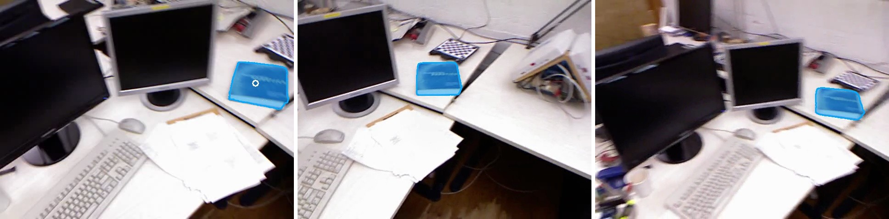

# EdgeTAM Video Object Segmenter

## Metadata

| Field | Value |
| --- | --- |
| Category | segmentation |
| Difficulty | Intermediate |
| Tags | segmentation, edgetam, sam2, video-object-segmentation, tracking, promptable-segmentation, offline |
| Languages | C++, Python |
| Status | stable |
| Binary Name | edgetam-video-object-segmenter |
| Model | edgetam |

## Concept

Follows one object through a video file with EdgeTAM, from a single point on the first frame, and saves the object's mask and position for every frame.

You name the object once, by its position on the first frame, as two numbers in the config. The application needs no click and no display. For every frame it runs EdgeTAM's four models on the DevKit and keeps a memory of earlier frames on the CPU, which is how the model finds the object again after it moves, turns, or leaves the view. The first frame takes the prompt point and skips the memory attention:

```
video file --> image encoder --> memory attention --> mask decoder --> mask --> results.json, overlay images
                                        ^                  ^             |
                                   memory bank        prompt point       v
                                        ^            (first frame)  memory encoder
                                        |                                |
                                        +--------------------------------+
```

The mask decoder returns the object's mask and a score that says whether the object is in the frame. When the score says it is not, the application reports no object for that frame and keeps looking in the next one.

## Preview



## Prerequisites

- `sima-cli` ([documentation](https://developer.sima.ai/software/tools/sima-cli/)) on the Modalix DevKit, or in a Neat SDK container paired with it.

## Install Apps

Install on the Modalix DevKit, or under `/workspace` in a Neat SDK container paired with it. Only the example itself must run on the DevKit. `sima-cli neat install apps` also offers to install the compatible Neat Library and Insight, and skips them when they are up to date. To keep the Neat Library and Insight you have without being asked, run the install as `NEAT_APPS_SKIP_DEPENDENCIES=1 sima-cli neat install apps`. See [Install Apps](https://github.com/sima-neat/apps/blob/main/README.md#install-apps).

Install the latest Neat Apps runtime and enter the installed bundle:

```bash
sima-cli neat install apps
cd prebuilt-apps
APP_DIR=examples/segmentation/edgetam-video-object-segmenter
```

Run the remaining commands from `prebuilt-apps/`.

## Prepare the Model

The application uses the EdgeTAM package `edgetam`, variant `w16a16_w8a16_w16a16_w8a8`, from the [Model Registry](https://developer.sima.ai/models/). Download and extract it:

```bash
sima-cli models download --id edgetam --variant w16a16_w8a16_w16a16_w8a8 -o models
unzip models/edgetam/w16a16_w8a16_w16a16_w8a8/edgetam_w16a16_w8a16_w16a16_w8a8_default.zip -d models/edgetam/w16a16_w8a16_w16a16_w8a8
```

The package lands in `models/edgetam/w16a16_w8a16_w16a16_w8a8/` with four model files:

| File | Role |
| --- | --- |
| `edgetam_w16a16_w8a16_w16a16_w8a8_image_encoder_mpk.tar.gz` | Image encoder, turns each frame into features |
| `edgetam_w16a16_w8a16_w16a16_w8a8_memory_attention_mpk.tar.gz` | Memory attention, recalls the earlier frames on every frame after the first |
| `edgetam_w16a16_w8a16_w16a16_w8a8_mask_decoder_mpk.tar.gz` | Mask decoder, returns the object's mask |
| `edgetam_w16a16_w8a16_w16a16_w8a8_memory_encoder_mpk.tar.gz` | Memory encoder, remembers the frame and its mask |

The packaged config already points `model.image_encoder`, `model.memory_attention`, `model.mask_decoder`, and `model.memory_encoder` at these files.

EdgeTAM is Meta's on-device video object segmentation model ([facebook/EdgeTAM](https://huggingface.co/facebook/EdgeTAM)), released under the Apache-2.0 license.

## Configure

The packaged config, `${APP_DIR}/src/common/config.yaml`, runs as it is: it follows a blue book through the first 150 frames of the shipped desk video.

To follow another object, or to use your own video, set:

- `source.video_path` to the video file.
- `prompt.x` and `prompt.y` to a point on the object in the first frame, as fractions of the frame width and height. `0.5` and `0.5` is the centre of the frame.
- `inference.frames` to the number of frames to read, or `0` for the whole video.

The first saved image, `frame_000000.jpg`, draws a white ring at the prompt point, so you can check that the point is on the object.

## Run

### C++

```bash
./${APP_DIR}/src/cpp/pre-built/edgetam-video-object-segmenter \
  --config ${APP_DIR}/src/common/config.yaml
```

### Python

```bash
source ~/pyneat/bin/activate
pip install -r ${APP_DIR}/src/python/requirements.txt
python3 ${APP_DIR}/src/python/main.py \
  --config ${APP_DIR}/src/common/config.yaml
```

## Expected Result

The application prints the video, one line for each saved image, and a summary:

```text
video=assets/datasets/tum-rgbd/freiburg1-desk.mp4 frame=640x480 prompt=(0.87, 0.38)
frame 0: object at (0.89, 0.39), 3.5% of the frame -> sandbox/edgetam-video-object-segmenter/frame_000000.jpg
frame 10: object at (0.68, 0.35), 2.8% of the frame -> sandbox/edgetam-video-object-segmenter/frame_000010.jpg
...
frame 50: no object -> sandbox/edgetam-video-object-segmenter/frame_000050.jpg
...
tracked 150 frames in <s> s (<fps> frames/s), object visible in 61; results in sandbox/edgetam-video-object-segmenter/results.json
```

The camera pans across the desk, so the book moves through the frame and leaves it at frame 48. The model reports it again at the right edge for a few frames from frame 108.

`output.dir` holds two kinds of files:

- `frame_<index>.jpg`, every `output.save_every` frames: the frame with the object tinted and outlined in blue.
- `results.json`: one entry for every frame. `area` is the share of the frame the mask covers, and `center_x` and `center_y` are the mask's centre as fractions of the frame width and height. A frame without the object has `visible` false and no centre:

```json
{
  "frames": [
    {
      "frame": 0,
      "visible": true,
      "area": 0.0345,
      "center_x": 0.8851,
      "center_y": 0.388
    },
    {
      "frame": 50,
      "visible": false,
      "area": 0.0,
      "center_x": null,
      "center_y": null
    }
  ]
}
```

The C++ and Python applications decode the video with different OpenCV versions, so their numbers can differ in the third decimal.

## Limitations

- One object per run, named by one point. The model also accepts a second point and a box, which this application does not use.
- A video file only. The application reads frames as fast as the model processes them, which is slower than a 30 FPS camera delivers them.
- Each frame is stretched to the model's 1024x1024 input, so a wide frame looks narrower to the model.
- The mask follows what the point selects on the first frame. A point on a part of an object, such as a window of a bus, can follow that part only.

## Troubleshooting

- If startup reports that a model package does not exist, run the download and extract commands from `prebuilt-apps/` and check the four `model` paths.
- If the mask is on the wrong object, open `frame_000000.jpg` and move `prompt.x` and `prompt.y` until the ring is on the object.

## Source Files

- C++ reference source: `src/cpp/main.cpp` and the tracking steps `src/cpp/utils/tracker.cpp`
- Python source: `src/python/main.py` and the tracking steps `src/python/utils/tracker.py`
- Shared config: `src/common/config.yaml`

The packaged C++ source is an implementation reference. Run the executable under `src/cpp/pre-built/`. The installed bundle does not include CMake files.

## Development From Source

To modify, compile, or test this example, use the [Apps contributor workflow](https://github.com/sima-neat/apps/blob/main/CONTRIBUTING.md).
