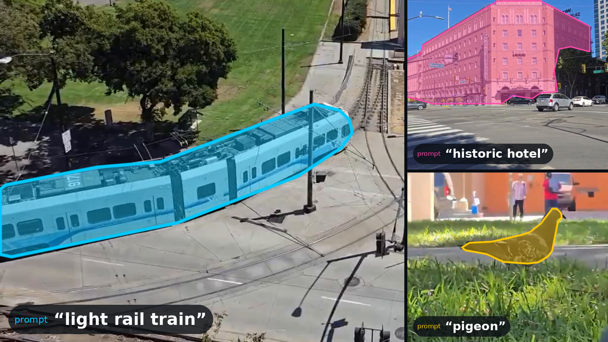

# EfficientSAM3 Promptable Segmenter

## Metadata

| Field | Value |
| --- | --- |
| Category | segmentation |
| Difficulty | Advanced |
| Tags | segmentation, efficientsam3, sam3, promptable-segmentation, open-vocabulary, rtsp, insight |
| Languages | C++, Python |
| Status | stable |
| Binary Name | efficientsam3-promptable-segmenter |
| Model | efficientsam3_mpk |

## Concept

Segments whatever a text prompt names, such as a person or a red car, in one RTSP H.264 or H.265 stream with EfficientSAM3, and sends the video and the instance outlines to Insight.

```text
How does a frame move through efficientsam3-promptable-segmenter?

   ┌──────────────────────┐
   │ CLIP tokenizer       │  app.prompt, once at startup
   └──────────────────────┘
              │ 16 token ids, one-hot
              ▼
   ┌──────────────────────┐
   │ text encoder Model   │
   └──────────────────────┘
              │ text features, kept for every frame

╭┄┄┄┄┄┄┄┄┄┄┄┄┄┄┄┄┄┄┄┄┄┄┄┄┄┄┄┄┄┄┄┄┄┄┄┄┄┄┄┄┄┄┄┄┄┄┄┄┄┄┄┄┄┄┄┄┄┄┄┄┄┄┄┄┄┄┄┄┄┄╮
┆ RUN                                                                  ┆
┆  ┌──────────────────────┐  NV12 frames       ┌──────────────────┐    ┆
┆  │ RtspDecodedInput     │───────────────────►│ VideoSender      │─────────────┐
┆  └──────────────────────┘  encoded as H.264  └──────────────────┘    ┆        │
┆             │ NV12 frames                                            ┆        │
┆             ▼                                                        ┆        │
┆  ┌──────────────────────┐                                            ┆        │
┆  │ Output "frames"      │                                            ┆        │ video
┆  └──────────────────────┘  holds 8, drops the oldest                 ┆        │
╰┄┄┄┄┄┄┄┄┄┄┄┄┄│┄┄┄┄┄┄┄┄┄┄┄┄┄┄┄┄┄┄┄┄┄┄┄┄┄┄┄┄┄┄┄┄┄┄┄┄┄┄┄┄┄┄┄┄┄┄┄┄┄┄┄┄┄┄┄┄╯        │
              ▼ pull, newest frame                                              │
   ┌──────────────────────┐                                                     │
   │ preprocess           │                                                     │
   └──────────────────────┘                                                     │
              │ 1008x1008 RGB                                                   │
╭┄┄┄┄┄┄┄┄┄┄┄┄┄│┄┄┄┄┄┄┄┄┄┄┄┄┄┄┄┄┄┄┄┄┄┄┄┄┄┄┄┄┄┄┄┄┄┄┄┄┄┄┄┄┄┄┄┄┄┄┄┄┄┄┄┄┄┄┄┄╮        │
┆ MODEL RUN, up to 3 frames at a time                                  ┆        │
┆             ▼                                                        ┆        │
┆  ┌──────────────────────┐                                            ┆        │
┆  │ EfficientSAM3 Model  │◄── text features                           ┆        │
┆  └──────────────────────┘                                            ┆        │
╰┄┄┄┄┄┄┄┄┄┄┄┄┄│┄┄┄┄┄┄┄┄┄┄┄┄┄┄┄┄┄┄┄┄┄┄┄┄┄┄┄┄┄┄┄┄┄┄┄┄┄┄┄┄┄┄┄┄┄┄┄┄┄┄┄┄┄┄┄┄╯        │
              ▼ boxes, mask logits                                              │
   ┌──────────────────────┐                                                     │
   │ segments_of          │                                                     │
   └──────────────────────┘                                                     │
              │ outlines as JSON, nearest result per frame                      │
              ▼                                                                 ▼
   ┌──────────────────────┐                                                ┌─────────┐
   │ MetadataSender       │───────────────────────────────────────────────►│ Insight │
   └──────────────────────┘                                                └─────────┘
```

- At startup the CLIP tokenizer splits `app.prompt` into tokens, and the text encoder turns them into text features once. The prompt is a short noun phrase of at most 14 tokens, about ten words.
- `RtspDecodedInput` feeds `VideoSender`, which encodes the decoded frames as H.264 for Insight, and the `frames` output. The video and the metadata carry timestamps from the same frames.
- The application pulls the newest frame, resizes it to 1008x1008 RGB, and pushes it with the text features to the EfficientSAM3 model, which holds up to three frames so the MLA stays busy while the host prepares the next one.
- The model segments only some of the frames, so every video frame is sent the result of the segmented frame nearest to it in time: the overlay follows the video while the masks refresh at the model's rate.
- Metadata is `type: "segmentation"` with one `data.segments[]` entry per instance, labelled with the prompt and outlined by its largest region as `mask_format: "polygon"` in frame pixels.

## Preview



## Prerequisites

- `sima-cli` ([documentation](https://developer.sima.ai/software/tools/sima-cli/)) on a supported Modalix or DevKit target.
- An RTSP H.264 or H.265 source and an [Insight](https://developer.sima.ai/software/tools/insight/) URL reachable from the target.

## Install Apps

Install the latest Neat Apps runtime and enter the installed bundle:

```bash
sima-cli neat install apps
cd prebuilt-apps
APP_DIR=examples/segmentation/efficientsam3-promptable-segmenter
```

Run the remaining commands from `prebuilt-apps/`.

## Prepare the Model

The application needs two model packages:

| Model package | Role | Source |
| --- | --- | --- |
| `efficientsam3_mpk.tar.gz` | Default segmentation model, runs for every segmented frame | Direct artifact |
| `efficientsam3_text_encoder_mpk.tar.gz` | Text encoder, runs once at startup | Direct artifact |

Model packages come from the Model Zoo release below, which can differ from the installed platform version.

```bash
export MODELZOO_VERSION="3.0.0"
mkdir -p models
cd models
sima-cli download "https://docs.sima.ai/pkg_downloads/SDK${MODELZOO_VERSION}/models/modalix/efficientsam3_mpk.tar.gz"
sima-cli download "https://docs.sima.ai/pkg_downloads/SDK${MODELZOO_VERSION}/models/modalix/efficientsam3_text_encoder_mpk.tar.gz"
cd ..
```

The application finds the text encoder next to the package that `model.path` names, so keep both in `models/`.

## Prepare Insight

[Insight](https://developer.sima.ai/software/tools/insight/) can host the input stream and render segmentation metadata.

In the Insight Web UI, start a stream on `src1`; its source URL is `rtsp://<insight-host-ip>:8554/src1`. From a board, replace `8554` with the published host port that `neat --json` reports. Use a host the target can reach, not `localhost`.

## Configure

Edit `${APP_DIR}/src/common/config.yaml`:

- `app.prompt`: what to segment, for example `person`, `red car`, or `traffic sign`. The application stops at startup on an empty prompt or one longer than the 14 tokens the text encoder reads.
- `input.source`: the RTSP URL, for example the Insight `src1` stream.
- `input.codec`: `h265` if the stream is H.265.
- `output.insight.host`, and `video_port_base` and `metadata_port_base` if Insight uses other ports.

`model.path` already names `models/efficientsam3_mpk.tar.gz`; a relative path starts at the config file. Leave `input.width`, `input.height`, and `input.fps` at 0 to read the frame size and rate from the stream. Raise or lower `inference.min_score` to keep fewer or more instances.

## Run

### C++

```bash
./${APP_DIR}/src/cpp/pre-built/efficientsam3-promptable-segmenter \
  --config ${APP_DIR}/src/common/config.yaml
```

### Python

```bash
source ~/pyneat/bin/activate
pip install -r ${APP_DIR}/src/python/requirements.txt
python3 ${APP_DIR}/src/python/main.py \
  --config ${APP_DIR}/src/common/config.yaml
```

## Expected Result

On startup both applications print the stream and the encoded prompt:

```text
source=rtsp://<insight-host-ip>:8554/src1 codec=h264 stream=<width>x<height>@<fps> prompt='person' tokens=<n> insight=<insight-host-ip> video=9000 metadata=9100
```

Open the Insight Video Viewer for channel 0. Instances that match the prompt are outlined and labelled with it. The application runs until Ctrl-C, or until it has segmented `inference.frames` frames when that is positive, and then prints a summary:

```text
processed=<n> video_sender=<insight-host-ip>:9000
```

## Troubleshooting

- Startup fails while loading a model: download both packages into `models/`, next to each other.
- `failed to probe RTSP frame size` or `frames output closed`: check that the stream plays and that `input.codec` matches it. From a board, use the published host port instead of the container port.
- No output in Insight: check `output.insight.host` and the UDP ports.
- Nothing outlined: lower `inference.min_score`, or use a more specific prompt.

## Source Files

- C++ reference source: `src/cpp/main.cpp`, the tokenizer `src/cpp/utils/clip_tokenizer.h`, and the pre- and postprocessing `src/cpp/utils/efficientsam3.cpp`
- Python source: `src/python/main.py`, the tokenizer `src/python/utils/clip_tokenizer.py`, and the pre- and postprocessing `src/python/utils/efficientsam3.py`
- Shared config: `src/common/config.yaml`
- Shared CLIP vocabulary: `src/common/bpe_simple_vocab_16e6.txt.gz`, under the MIT license in `src/common/LICENSE-CLIP.txt`

The packaged C++ source is an implementation reference. Run the executable under `src/cpp/pre-built/`; the installed bundle does not include CMake files.

## Development From Source

To modify, compile, or test this example, use the [Apps contributor workflow](https://github.com/sima-neat/apps/blob/main/CONTRIBUTING.md).
