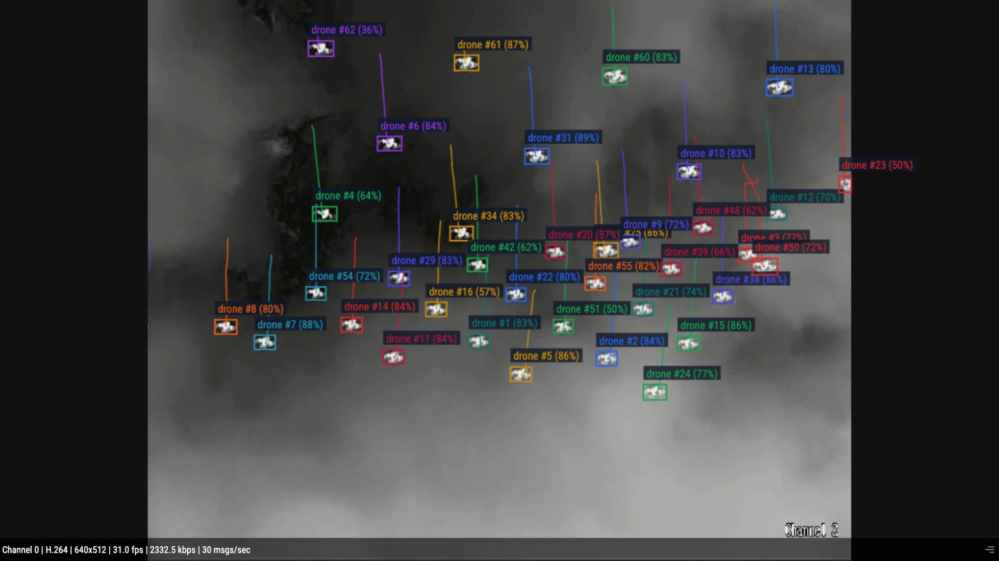

# YOLO26 Tiny-Drone Tracker

## Metadata

| Field | Value |
| --- | --- |
| Category | tracking |
| Difficulty | Advanced |
| Tags | object-detection, yolo26, rtsp, insight, tiny-drone, tracking |
| Languages | C++, Python |
| Status | stable |
| Binary Name | yolo26-tiny-drone-tracker |
| Model | yolo26n-p2-tiny-drone-int8-qat |

## Concept

Tracks tiny drones in one RTSP stream with YOLO26 and sends the video and each drone's track to Insight.

```text
How does a frame move through yolo26-tiny-drone-tracker?

╭┄┄┄┄┄┄┄┄┄┄┄┄┄┄┄┄┄┄┄┄┄┄┄┄┄┄┄┄┄┄┄┄┄┄┄┄┄┄┄┄┄┄┄┄┄┄┄┄┄┄┄┄┄┄┄┄┄┄┄┄┄┄┄┄┄┄┄┄┄╮
┆ RUN                                                                 ┆
┆  ┌──────────────────────┐  H.264 or H.265    ┌──────────────────┐   ┆
┆  │ RtspEncodedInput     │───────────────────►│ VideoSender      │───┼─────┐
┆  └──────────────────────┘  as received       └──────────────────┘   ┆     │
┆             │ encoded frames                                        ┆     │ video
┆             ▼                                                       ┆     │
┆  ┌──────────────────────┐                                           ┆     │
┆  │ SimaDecode           │                                           ┆     │
┆  └──────────────────────┘                                           ┆     │
┆             │ NV12 frames                                           ┆     │
┆             ▼                                                       ┆     │
┆  ┌──────────────────────┐                                           ┆     │
┆  │ YOLO26 Model         │                                           ┆     │
┆  └──────────────────────┘                                           ┆     │
┆             │ BBOX tensor                                           ┆     │
┆             ▼                                                       ┆     │
┆  ┌──────────────────────┐                                           ┆     │
┆  │ Output "detections"  │                                           ┆     │
┆  └──────────────────────┘                                           ┆     │
╰┄┄┄┄┄┄┄┄┄┄┄┄┄│┄┄┄┄┄┄┄┄┄┄┄┄┄┄┄┄┄┄┄┄┄┄┄┄┄┄┄┄┄┄┄┄┄┄┄┄┄┄┄┄┄┄┄┄┄┄┄┄┄┄┄┄┄┄┄╯     │
              ▼ pull, decode_bbox_tensor                                    │
   ┌──────────────────────┐                                                 │
   │ ObjectTracker        │                                                 │
   └──────────────────────┘                                                 │
              │ boxes with track IDs                                        │
              ▼                                                             ▼
   ┌──────────────────────┐   tracks as JSON                          ┌───────────┐
   │ MetadataSender       │──────────────────────────────────────────►│ Insight   │
   └──────────────────────┘                                           └───────────┘
```

The encoded stream goes to Insight as received, while the decoder feeds the model.
The application pulls each frame's boxes, and `ObjectTracker` gives every drone an ID that lasts across frames.
Each tracking message carries the frame's timestamp, so Insight draws the tracks on the frame they came from.
Insight colors each track by its ID and draws its trail.

The tracker matches boxes in two passes. First, a box at or above `app.tracking.high_score_threshold` can continue any track.
Then a box with a lower score can continue only a confirmed track.
An unmatched box at or above `app.tracking.new_track_threshold` starts a new track.
A track is confirmed after `app.tracking.min_confirmed_hits` matches, and only confirmed tracks go to Insight.
A tiny box rarely overlaps its previous position, so the tracker also matches by the distance to the position its velocity predicts.
Track IDs start at 1 and are local to the stream.

## Preview



## Prerequisites

- `sima-cli` ([documentation](https://developer.sima.ai/software/tools/sima-cli/)) on the Modalix DevKit, or in a Neat SDK container paired with it.
- An H.264 or H.265 RTSP stream that shows small drones against the sky, and an [Insight](https://developer.sima.ai/software/tools/insight/) URL reachable from the target.
  The Insight video catalog has no drone video, so you provide one.

## Install Apps

Install on the Modalix DevKit, or under `/workspace` in a Neat SDK container paired with it. Only the example itself must run on the DevKit. `sima-cli neat install apps` also offers to install the compatible Neat Library and Insight, and skips them when they are up to date. To keep the Neat Library and Insight you have without being asked, run the install as `NEAT_APPS_SKIP_DEPENDENCIES=1 sima-cli neat install apps`. See [Install Apps](https://github.com/sima-neat/apps/blob/main/README.md#install-apps).

Install the latest Neat Apps runtime and enter the installed bundle:

```bash
sima-cli neat install apps
cd prebuilt-apps
APP_DIR=examples/tracking/yolo26-tiny-drone-tracker
```

Run the remaining commands from `prebuilt-apps/`.

## Prepare the Model

The drone detector is not in the model browser yet. Download it from the Model Zoo release below:

```bash
export MODELZOO_VERSION="3.0.0"
mkdir -p models
cd models
sima-cli download \
  "https://docs.sima.ai/pkg_downloads/SDK${MODELZOO_VERSION}/models/modalix/yolo26n_p2_tiny_drone_int8_qat_b1_mpk.tar.gz"
cd ..
```

The command stores `models/yolo26n_p2_tiny_drone_int8_qat_b1_mpk.tar.gz`.
The packaged `model.path` already points to it: a relative `model.path` starts at the config file.
`../../../../../models/` from `${APP_DIR}/src/common/` is `prebuilt-apps/models/`.

## Prepare Insight

In the Insight Web UI, open Media Sources and upload a drone video.
Insight's YouTube import also works.
Then assign the video to an RTSP source, start the stream, and copy its URL into `input.source`.
Use a host and port that the target can reach, not `localhost`.
The application prints the source and its frame size on startup.

## Configure

Open `${APP_DIR}/src/common/config.yaml` and set:

- `input.source`: the RTSP URL.
- `input.codec`: `h264` or `h265`.
- `output.insight.host`, and the Insight ports `output.insight.video_port_base` and `output.insight.metadata_port_base`.

Leave `input.width`, `input.height`, and `input.fps` at 0 to read them from the stream.
Keep `inference.frames` at `0` to run until you stop the application.
The `app.tracking` keys tune the tracker, as Concept describes.

## Run

### C++

```bash
./${APP_DIR}/src/cpp/pre-built/yolo26-tiny-drone-tracker \
  --config ${APP_DIR}/src/common/config.yaml
```

### Python

```bash
source ~/pyneat/bin/activate
pip install -r ${APP_DIR}/src/python/requirements.txt
python3 ${APP_DIR}/src/python/main.py \
  --config ${APP_DIR}/src/common/config.yaml
```

## Expected Result

The application prints the source on startup.
When it stops, it prints the frames it processed and the number of tracks it started:

```text
source=rtsp://<rtsp-source-ip>:<port>/<stream-name> codec=h264 stream=1280x720@30 insight=<insight-host-ip> video=9000 metadata=9100
processed=200 tracks_started=14
```

The packaged config runs until Ctrl-C, and the `processed=` line prints when you stop it.
For a run that ends by itself, set `inference.frames` to a positive number, such as `200`.
When the network buffer was full, a last line counts the tracking messages that did not go out, such as `3 metadata messages dropped`.

Insight shows the video with a box, an ID, and a trail on every confirmed drone.

## Troubleshooting

- `failed to probe RTSP frame size: <url>` or `failed to probe RTSP frame rate: <url>`: the stream is unreachable from the board, or it does not report that value. Verify the URL from the board. For a reachable stream, set the value the message names.
- `input.codec: unknown value '<value>' (expected h264, h265)`: set `input.codec` to the stream's codec.
- `<config> is missing <key>` or `<key> must be <type>`: the config lacks a key or has a value of the wrong type. Compare it with the packaged config.
- Video without tracks: the model finds only small drones in the sky. Check that the video shows them, and check `inference.min_score`.
- No video or tracks in Insight: verify `output.insight.host` and the two ports.

## Source Files

- C++ reference source: `src/cpp/main.cpp`
- C++ tracker: `src/cpp/utils/tracker.h` and `src/cpp/utils/tracker.cpp`
- Python source: `src/python/main.py`
- Python tracker: `src/python/utils/tracker.py`
- Shared config: `src/common/config.yaml`
- Helpers the examples share: `support/python/sima_examples/` at the root of the installed bundle, which `main.py` finds above itself. Their C++ reference source is in `support/cpp/sima_examples/`.

The packaged C++ source is an implementation reference. Run the executable under `src/cpp/pre-built/`. The installed bundle does not include CMake files.

## Development From Source

To modify, compile, or test this example, use the [Apps contributor workflow](https://github.com/sima-neat/apps/blob/main/CONTRIBUTING.md).
