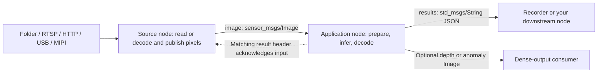
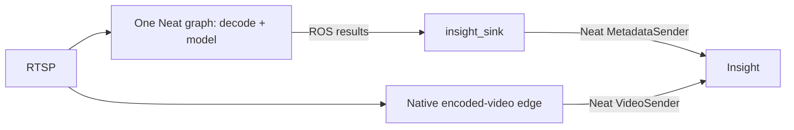
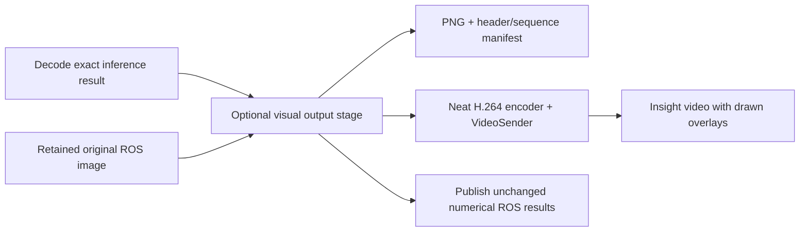

# Implementing ROS 2 applications with Neat

This guide explains the nodes shipped in the `neat_apps` package, their settings
and topics, and how to add an application. Start with the
[installation and build instructions](../../ROS2.md#install-and-build), including
`sima-cli neat install ros2@v3.0.0`. Run the commands below from the Apps root
with both ROS and the Neat Python environment sourced.

Read this guide in order for a first application:

1. [Understand the nodes and launch path](#1-nodes-and-launch-path).
2. [Configure the application](#2-configuration-and-launch-arguments).
3. [Connect topics and interpret results](#3-topics-messages-and-clocks).
4. [Follow one frame through DETR](#4-detr-walkthrough).
5. [Implement your own pipeline or node](#5-create-your-own-application).
6. [Check the application](#6-inspect-and-validate).
7. [Save images and view Insight output](#7-saved-images-and-insight).

## 1. Nodes and launch path

There is one shared ROS package, `neat_apps`. Each directory under
`examples/ros2/<category>/<example>/` holds an application's README,
`src/common/config.yaml` and `src/python/ros_node.py`; it is not a separate ROS
package. The Docker example provides container launch files instead. Original
native applications remain under `examples/<category>/<example>/`.

### Standard image-topic application



The acknowledgment is the ordinary result message, not a separate acknowledgment
topic. It controls the supplied folder source and live source in `complete` mode.
An external camera publisher must manage its own delivery rate.

| Executable / ROS node name | Implementation | Included in this node |
| --- | --- | --- |
| `image_source` / `neat_folder_source` | [source.py](neat_apps/source.py) | File discovery, one-image prefetch, BGR decoding, timestamps, bounded outstanding-image window and result acknowledgments. No model. |
| `live_source` / `neat_sources` or `neat_source_<index>` | [live_source.py](neat_apps/live_source.py) | Source selection, camera/RTSP decode, packing visible image planes, image publication and optional acknowledgment windows. One process normally handles all streams. No inference model. |
| `app_node` / example name with hyphens replaced by underscores | [app.py](neat_apps/app.py), [image_node.py](neat_apps/image_node.py), example `ros_node.py` | App selection, model setup, preprocessing, asynchronous inference, decoding, result/header association and statistics. See the custom-node exceptions below. |
| `result_sink` / `neat_result_sink` | [sink.py](neat_apps/sink.py) | JSONL recording, sequence-gap checks and optional dense image recording. No inference or visual rendering. |
| `insight_sink` / `neat_insight_sink` | [insight_sink.py](neat_apps/insight_sink.py) | ROS detection subscription, source timestamp conversion and public Neat metadata sending to Insight. It does not capture, encode or send video. Currently used with high-density `live_graph` only. |

The Python modules [images.py](neat_apps/images.py) and
[runtime.py](neat_apps/runtime.py) are helpers, not ROS nodes. They handle image
layout/tensor conversion, header serialization and loading native application
helpers. The wrappers in [scripts/](scripts/) expose these entrypoints to
`ros2 run`; [CMakeLists.txt](CMakeLists.txt) installs them, and
[package.xml](package.xml) declares the shared dependencies.

### What the launch command does

For example:

```bash
APP_DIR=examples/ros2/object-detection/detr-object-detector
ros2 launch neat_apps app.launch.py \
  app:=object-detection/detr-object-detector apps_root:="$PWD" \
  config:="$PWD/$APP_DIR/src/common/config.yaml" source:=folder
```

1. [app.launch.py](launch/app.launch.py) starts `app_node` and the selected source,
   with the Apps root as their working directory and `neat` as their namespace.
2. `app_node` resolves `examples/ros2/<app>/src/python/ros_node.py` and imports it.
3. If the module defines `main(argv)`, the dispatcher calls it. Otherwise it
   creates the shared `ImageNode` using the module's `Pipeline` class.
4. The standard `Pipeline` is created once. Its runner is built on the first
   received image, once required result subscribers have connected.
5. Source and inference run concurrently. A finite folder/live source exits after
   its configured work; the launch shuts down the other processes. Errors in
   those managed source/inference processes also end the launch. `source:=none`
   starts inference alone, so its lifecycle is controlled externally.

**DETR example:** the default node names are `/neat/neat_folder_source` and
`/neat/detr_object_detector`. The executable name `app_node` is not the graph's
ROS node name. `ros2 node list` shows the actual names.

### Applications with a different execution structure

| Application | Structure and settings that differ |
| --- | --- |
| [High-density live graph](../../examples/ros2/object-detection/high-density-multi-stream-object-detector/README.md) | `source:=live_graph` keeps RTSP decoding and inference in one Neat graph inside the application node. No ROS image subscription or common source. Native `inference.max_inflight_*` controls admission. `insight:=true` adds the metadata sink; the native graph sends encoded video. |
| [BlazePose](../../examples/ros2/pose-estimation/multi-stream-blazepose3d/README.md) | Custom node uses native detector/pose/tracking/publication workers and one latest pending image per stream. Requires `ros.input_policy: latest`; common `pending_frames`/`inflight_frames` do not control that scheduler. |
| [Multi-stream multi-model](../../examples/ros2/multi-model/multi-stream-multi-model/README.md) | `source:=live` creates a source and inference node per configured stream/model, under `/neat/stream_<index>/`. |
| [Classification explorer](../../examples/ros2/classification/image-classification-explorer/README.md) | One standard image node wraps one runner per configured model profile. Results are joined only when their frame identities match. |
| [Detection-to-VLM](../../examples/ros2/genai/detection-to-vlm-assistant/README.md) | Standard image node plus a bounded caption worker. Detection results and captions have separate publication schedules. Native GenAI service must already be running. |
| [GenAI Studio](../../examples/ros2/genai/neat-genai-studio/README.md) | Custom request/response node delegates to the native backend. Optional latest camera image; no per-image inference acknowledgment. Use `source:=none`, or a separately started live source in `latest` mode. |
| [Model benchmark](../../examples/ros2/benchmarking/model-benchmark/README.md) | Custom node runs a synthetic model benchmark in a worker, publishes a retained report and exposes a Trigger service. No image input; use `source:=none`. |
| [MIPI capture](../../examples/ros2/benchmarking/mipi-camera-capture/README.md) | Custom image subscriber records configured NV12 snapshots and capture statistics; no inference model. Physical-camera validation remains separate from replay testing. |

For high-density visualization the data paths are:



Use the relevant example README for these custom nodes. Do not assume every
standard `ImageNode` setting or statistic is implemented by a custom `main()`.

## 2. Configuration and launch arguments

There are three distinct configuration mechanisms:

| Mechanism | Examples | When it takes effect |
| --- | --- | --- |
| Launch arguments, `name:=value` | `app`, `config`, `source`, `namespace` | When the launch starts; choose processes and their namespace. |
| Application YAML passed through `--config` | `model.path`, `decode.*`, `ros.pending_frames` | Read at startup by the selected source/pipeline. Restart to apply edits. |
| ROS command-line arguments, `--ros-args` | Namespace/topic remapping; standard ROS node options | Passed through to `rclpy.init` by the node entrypoints. |

**The application YAML is not a ROS parameter file.** It does not use a
`ros__parameters` mapping. Model paths, thresholds and `ros:` queue settings are
not declared dynamic ROS parameters; `ros2 param set` does not update them.
The ordinary ROS node parameter services may still appear in introspection.

### Shared launch arguments

| Argument | Default | Meaning |
| --- | --- | --- |
| `app` | Required | Exactly `category/example`; no `ros2/` prefix. |
| `apps_root` | Required | Absolute Apps bundle/checkout root. Also the node working directory. |
| `config` | Required | Absolute path to the example's YAML. |
| `source` | `folder` | `folder`: file images; `live`: configured live/file-video source; `none`: external input or custom request node; `live_graph`: high-density combined graph. |
| `namespace` | `neat` | Namespace for all nodes in this launch. |
| `stream_index` | `all` | In live mode, select all configured sources or one numeric index. `live_graph` requires `all`; edit `streams` to choose its inputs. |
| `insight` | `auto` | Read `ros.visualization.insight.enabled`; `true`/`false` override it. Image apps send rendered video. High-density `live_graph` instead adds its metadata sink and requires `output.video_enabled: true`. |

`source:=none` launches one inference process. For multiple external cameras with
separate models, launch one instance per model with distinct namespaces and the
appropriate `--stream-index` using `ros2 run`, as opposed to relying on the live
source launch expansion.

### Standard image-node YAML settings

These are fallback defaults when a key is absent. An example's checked-in config
may override them. They apply to the shared `ImageNode` unless stated otherwise.

| Key under `ros:` | Default | Meaning / constraint |
| --- | --- | --- |
| `image_topic` | `image` | Input topic; also used by the supplied source publisher. |
| `results_topic` | `results` | Output topic; also used for source acknowledgments. |
| `input_policy` | `complete` | `complete` fails on a full pending queue. `latest` replaces the oldest unadmitted image when that queue fills. Neither replaces already admitted work. |
| `pending_frames` | `8` | Maximum unadmitted images in the shared node; integer >= 1. |
| `inflight_frames` | `4` | Maximum outstanding requests retained by the shared node; integer >= 1. This is distinct from the Neat graph's internal queue depth. |
| `result_timeout_seconds` | `30` | Positive timeout for startup subscriber readiness and stalled inference; also used for dense-output subscriber readiness. Live source acknowledgment fallback is 60 seconds when this key is absent. |
| `result_subscribers` | `0` | Minimum number of result subscribers before the first graph build. Source acknowledgment subscriptions count toward this total. This is discovery readiness, not per-result acknowledgment from every consumer. |
| `image_subscribers` | `0` | Minimum subscribers on each additional dense image output when that publisher is first created. |
| `warmup_results` | `0` | Number of initial completions excluded from reported FPS. Predictions are still published. Does not change model warmup execution. |

For one folder source plus a recorder, set `result_subscribers: 2`. For one
external image publisher plus a recorder, set it to `1`. An unreachable count
causes a startup timeout. Start the recorder before finite inference runs.

### Source YAML settings

| Key | Default / selection | Used by |
| --- | --- | --- |
| `io.input_dir`, then `io.input`, then `source.image_dir` | Required image file/directory, with classification's documented fallback exception | Folder source; extensions `.jpg`, `.jpeg`, `.png`, `.bmp` for ordinary examples. |
| `ros.source_window` | `4` outstanding images per source | Folder source and live source in `complete` mode. |
| `ros.source_repeats` | `1`; YOLO26/PCB folder loops instead inherit `runtime.num_runs` | Folder source; integer >= 1. DETR profiling `num_runs` does not repeat its normal folder source. |
| `ros.frame_id` | Folder: `camera_optical_frame`; live: `camera_<index>_optical_frame` | Source headers. Live `streams[index].id`, when present, takes precedence. Multi-stream IDs must be distinct. |
| `ros.source_encoding` | `native` | Decoded live planes retain `nv12`/`nv16`; set `bgr8` for BGR-based pipelines such as FastFlow/SuperPoint. Does not alter folder BGR output. |
| `ros.source_frames` | Falls back to `inference.frames`, then `runtime.frames`, then `0` | Live source publication limit per stream; 0 means continuous. Does not stop `live_graph`. |
| `ros.source_timeout_seconds` | `30` | Live source startup discovery and absent-frame timeout. Folder source instead uses its CLI `--timeout` (60 seconds by default). |

In complete mode, require `source_window <= pending_frames` for one source and
`number_of_sources * source_window <= pending_frames` for consolidated live
sources. For example, twenty sources with window 1 require at least 20 pending
slots. The shared folder source always waits for result acknowledgments: use
`complete` with it. For a camera that should favor freshness, use the live source
and `latest`. Live decode uses a latest-frame output, so complete mode preserves
published images, not necessarily every camera exposure.

The live source reads native-style source configuration in this order:

| YAML shape | Source chosen |
| --- | --- |
| `camera: {...}` | MIPI camera settings. |
| `model.profile` without `source` | MIPI model-profile default camera. |
| `streams: [url, ...]` or entries with `url` and optional `id` | RTSP; shared `input` settings are merged with each entry. |
| `source.rtsp_url` | RTSP with sibling settings under `source`. |
| `source.type: rtsp/http/usb` plus `source.rtsp/http/usb` mapping | Corresponding native source helper. |
| `source.type: video_file` and `source.video_path` or `source.video_file.path` | Video file; most use OpenCV BGR reading, while face recognition uses the native decoded-video path. Match the pipeline's required encoding. |

RTSP settings include `url`, `codec`, `tcp`, `latency_ms`, `width`, `height`,
`fps`, and optional decoder buffer/tuning keys. The common source uses declared
positive width/height/FPS directly; otherwise it probes. MIPI settings include
`name`, `width`, `height`, `fps_num`, `fps_den`, `format`, `queue_depth`,
`strict_zero_copy`, and `capture_buffers`. Copy the relevant example's config
rather than combining unrelated source schemas. Physical USB/MIPI verification
is still pending; configuration support is not a hardware-validation claim.

### Model and application settings

The selected pipeline owns model paths, preprocessing, decoding, thresholds and
application-specific state. There is no universal list of model keys: DETR uses
`decode.confidence_threshold`, while other detectors can use `inference.min_score`.
Unknown keys are not universally rejected; an inherited native config key can
be present without being read by the ROS pipeline. Check the example's documented
ROS settings and its `Pipeline` implementation.

The dispatcher changes directory to `apps_root`; ordinary `Path(...)` calls
therefore resolve relative paths from that root. Some native config loaders
explicitly resolve model paths against the config directory. Follow the owning
example's path rules; use absolute model paths when sharing configs outside the
Apps tree. The shared dispatcher does not rewrite paths inside YAML.

## 3. Topics, messages and clocks

Names below assume `namespace:=neat` and default topic settings. Relative names
follow the namespace; an absolute YAML topic such as `/camera/image_raw` does
not. Private names such as `~/statistics` also include the actual node name.

| Topic / service | Type | Producer → consumer |
| --- | --- | --- |
| `/neat/image` | `sensor_msgs/msg/Image` | Folder/live/external source → image-based application. Absent from high-density `live_graph`. |
| `/neat/results` | `std_msgs/msg/String` containing JSON | Image-based application → source acknowledgments, recorder, downstream application; high-density live graph also publishes here. |
| `/neat/<application_node>/statistics` | `std_msgs/msg/String` JSON | Shared ImageNode (once/second) or BlazePose → diagnostics. Not provided by every custom node. |
| `/neat/neat_sources/statistics` or `/neat/neat_source_<index>/statistics` | `std_msgs/msg/String` JSON | Common live source, every 100 publications. Folder source prints its summary instead. |
| `/neat/depth` | `sensor_msgs/msg/Image`, `32FC1` | Depth estimator or MIPI depth profile → dense consumer/recorder. |
| `/neat/anomaly_map` | `sensor_msgs/msg/Image`, `32FC1` | FastFlow or PatchCore → dense consumer/recorder. |
| `/neat/anomaly_mask` | `sensor_msgs/msg/Image`, `mono8` | FastFlow → dense consumer/recorder. |
| `/neat/captions` | `std_msgs/msg/String` JSON | Detection-to-VLM worker → caption consumer; contains `header`, `text`, `error`. |
| `/neat/requests`, `/neat/responses` | `std_msgs/msg/String` JSON | Studio client ↔ Studio node. Match responses by request `id`; see [Studio contracts](../../ROS2.md#studio-requests). |
| `/neat/report` | `std_msgs/msg/String` JSON | Model benchmark → report consumers. Reliable, transient-local history depth 1. |
| `/neat/model_benchmark/run` (service) | `std_srvs/srv/Trigger` | Client → model benchmark; rejects overlapping runs. Benchmark also starts once on node startup. |

For multi-stream multi-model live launches, replace `/neat/` with
`/neat/stream_0/`, `/neat/stream_1/`, etc. Shared multi-camera inference otherwise
uses one image topic and distinguishes cameras through `header.frame_id`.
Additional dense-output names are chosen by each pipeline, not by a generic
`ros.depth_topic` setting. Standard ROS remapping is available when invoking a
node directly.

### Result envelope and application-specific data

The shared image node creates the envelope; `Pipeline.decode()` supplies only
`data`. For DETR a result looks like this (illustrative numerical values):

```json
{
  "schema_version": 1,
  "sequence": 0,
  "header": {"stamp": {"sec": 123, "nanosec": 456}, "frame_id": "camera_optical_frame"},
  "data": {
    "width": 640,
    "height": 480,
    "objects": [{"box": [10.0, 20.0, 60.0, 100.0], "score": 0.9, "class_id": 1}]
  }
}
```

`sequence` starts at zero for each node run and counts publications. The full
input header is preserved. DETR's `box` is `[x1, y1, x2, y2]` in original-image
pixels. Other examples retain their native schemas: an Insight-style `bbox`
can instead be `[x, y, width, height]` with `label` and `confidence`. The envelope
is shared; the task data is not a universal detection schema. Read the decoder
before consuming its output. Empty detections are valid results.

Dense arrays are sent separately as Images with the same header. Their spatial
size can be the model output size rather than the original camera size. Relative
depth values are not metres. Captions and Studio replies do not use the standard
per-frame result envelope or its sequence/acknowledgment rules.

### Images, ownership and clocks

- `bgr8`, `rgb8` and `mono8` input views respect `step` and require
  `len(data) == height * step`. `image_array()` may return a read-only view;
  do not modify it or retain borrowed storage after releasing its owner.
- The Neat planar convention uses visible even width/height, `step = width`, and
  tightly packed Y then UV: NV12 has `width * height * 3 / 2` bytes; NV16 has
  `width * height * 2`. This is an adapter convention, not support guaranteed by
  every ROS image viewer. `planar_array()` validates it.
- `image_tensor()` creates owned Neat tensors and defaults to EV74 memory. It
  handles plane metadata explicitly. Crossing an ordinary ROS Image boundary
  involves packing/copies; do not describe it as end-to-end zero-copy.
- Folder timestamps are ROS time at publication; common live-source timestamps
  are ROS time after decode. External images keep their source clock semantics.
- High-density live-graph headers instead carry native stream-relative PTS; the
  result envelope also includes top-level `source_frame_id` and `stream_id`.
  The Insight sink requires this
  contract; it derives the wrapped 90 kHz RTP timestamp from PTS. Do not send
  arbitrary camera wall-clock headers to this sink and expect synchronized video.

### QoS and delivery

The common image/result publishers and subscriptions use reliable, volatile,
KeepLast QoS with depth `max(16, pending_frames + inflight_frames)`. Dense outputs
use depth 8; the result recorder uses depth 100. High-density live results and
the Insight sink use depth 64. Inspect actual endpoints with
`ros2 topic info /neat/image --verbose`, especially for custom nodes.

A best-effort external camera publisher does not satisfy the shared reliable
image subscription. Supply a compatible reliable publisher or deliberately
adapt the subscriber and validate its drop policy. Reliability does not mean
unlimited buffering, and a late volatile subscriber does not receive history.

## 4. DETR walkthrough

Open [DETR ros_node.py](../../examples/ros2/object-detection/detr-object-detector/src/python/ros_node.py)
next to [image_node.py](neat_apps/image_node.py). DETR's `Pipeline` is model code
inside the ROS application node; it is not a separate ROS node for each method.

1. `__init__(config, config_path)` loads the native tensor model once and stores
   decoding settings. Native helpers are loaded from the original DETR example.
2. The ROS subscription calls `ImageNode.receive()`. It enqueues the message;
   model work does not run inside that callback.
3. The submission worker calls `prepare(message)`. DETR requires BGR, performs
   native preprocessing, stores that message's resize/padding geometry, and
   returns an owned HWC float tensor.
4. For the first input, `build(seed)` constructs the explicit input → quantize/
   tessellate → MLA → detessellate/dequantize → output graph. DETR initializes it
   using its native zero tensor and uses `warmup_runs = 0`. The shared worker
   prepares the first measured image again after graph initialization.
5. The worker gives each request a distinct Neat `frame_id`, copies the input
   timestamp to `pts_ns`, retains the original message and tensors, and pushes
   the sample. Submission can overlap earlier requests' inference.
6. The result worker pulls an output and checks both ID and timestamp. It finds
   the exact originating message; it never guesses FIFO header association.
7. `decode(sample, message)` extracts logits/boxes, applies native decoding and
   the stored geometry, and removes that geometry entry. The shared node wraps
   the returned dictionary and publishes the result with the original header.
8. The folder source matches that header to its outstanding image, freeing a
   window slot. At normal folder completion all published images have results.

`prepare()` and `decode()` execute in different workers. Keep per-frame state
keyed to the retained message, as DETR does, rather than a single mutable
`last_width` or `last_resize`. Any state used by both workers needs appropriate
ownership/synchronization. Keep every graph/model object alive until runner close.
The shared close path stops admission, closes the runner to release blocked
operations, joins workers and calls optional `Pipeline.close()`. An interrupted
run is not a promise to drain every outstanding input; use normal finite source
completion when checking complete coverage.

## 5. Create your own application

### Start from the nearest working pipeline

Use DETR for an explicit tensor graph, the
[depth estimator](../../examples/ros2/depth-estimation/depth-estimator/src/python/ros_node.py)
for dense output, or the
[single-stream detector](../../examples/ros2/object-detection/single-stream-object-detector/src/python/ros_node.py)
for a native image-model route. Preserve the selected model's actual input format,
normalization, resize policy, output layout and warmup behavior.

For an adapter to an existing native app, add:

```text
examples/ros2/<category>/<example>/
├── README.md
└── src/
    ├── common/config.yaml
    └── python/ros_node.py
```

Implement the following interface. This is a **skeleton**, not runnable model
inference until its three model-specific methods are filled in:

```python
from neat_apps.image_node import run


class Pipeline:
    warmup_runs = 0  # Choose deliberately to match the native baseline.

    def __init__(self, config, config_path=None):
        self.config = config
        # Load model and immutable decoding settings here, or lazily in prepare
        # when the input geometry is required. Avoid per-image model reloads.

    def prepare(self, message):
        # Check encoding/geometry and return a list of owned pyneat.Tensor inputs.
        raise NotImplementedError("Implement this model's preprocessing")

    def build(self, seed):
        # Construct the graph/model runner once. Preserve graph/model ownership.
        raise NotImplementedError("Build this model's runner")

    def decode(self, sample, message):
        # Return JSON-compatible task data; ImageNode adds header and sequence.
        raise NotImplementedError("Decode this model's outputs")


if __name__ == "__main__":
    raise SystemExit(run("my_detector", Pipeline))
```

The returned runner must provide `push(samples) -> bool`,
`pull(timeout_ms=...) -> sample or None`, and `close()`. It also needs
`run(tensors)` if `warmup_runs` is positive (the shared default is 1 when the
attribute is omitted). A runner wrapper can select named graph ports or join
multiple model outputs, but must retain source IDs/timestamps and respect the
configured bounds. `close()` must release a blocked push and bounded pull.

Optional `attach(node)` is called before the standard workers start; use it to
create an extra publisher, as the VLM example does. Optional `close()` releases
app-owned resources after the shared workers stop. For dense output, `decode()`
can return:

```python
return {"units": "relative_depth", "images": [("depth", depth_array, "32FC1")]}
```

`depth_array` must be a two-dimensional NumPy `float32` array. The reserved
`images` entry is consumed by the shared node and omitted from JSON. The same
mechanism accepts `mono8`, `bgr8` and `rgb8` arrays through `to_message()`.

### Reusing native helpers when creating a new name

`load_native(__file__)` maps the ROS folder name to the **same category/name**
under native `examples/`. Copying a ROS folder to a new name does not create a
native counterpart. If you deliberately build a variant using an existing
native app, import it explicitly instead:

```python
from pathlib import Path
from neat_apps.runtime import load_app

# app_node sets the working directory to apps_root before importing this module.
native, _ = load_app(Path.cwd(), "object-detection/detr-object-detector")
```

For a concrete DETR variant, copy its ROS directory to
`examples/ros2/object-detection/my-detr/`, replace its `load_native` import/call
with the explicit import above, then change your config and decoder. The shared
launch resolves the new folder without a registry or CMake entry:

```bash
APP_DIR=examples/ros2/object-detection/my-detr
ros2 launch neat_apps app.launch.py \
  app:=object-detection/my-detr apps_root:="$PWD" \
  config:="$PWD/$APP_DIR/src/common/config.yaml" source:=folder namespace:=my_detr
```

Existing model code and native helpers still need to be present in that Apps
root. Alternatively implement the model directly without `load_native`. The
launcher itself does not require a native counterpart. For contributions to this
repository, the catalog/layout checks currently expect ROS counterparts of the
native example set; follow the contributor workflow when adding a new catalog
entry rather than treating a private variant as a registered shipped example.

### Choose a custom node only when the standard lifecycle does not fit

A module defining `main(argv)` takes full responsibility for configuration,
`rclpy.init`, subscriptions/publishers, bounded work, signal handling and cleanup.
Use `argparse.parse_known_args(argv)` and pass the remaining ROS arguments to
`rclpy.init`. The dispatcher passes `--config` plus remaining node arguments.
The high-density, BlazePose, Studio and benchmark implementations are concrete
references. A custom node can publish a different contract, but document it;
the common folder source requires one result with the original header per input.

No package rebuild is needed for edits to example `ros_node.py` or YAML: the
entrypoint is loaded from `apps_root`. Rebuild/install `support/ros2` when changing
its shared Python modules, launch files, installed scripts or dependencies.

## 6. Inspect and validate

After starting the DETR example, inspect its actual interfaces:

```bash
ros2 node list
ros2 node info /neat/detr_object_detector
ros2 topic list -t
ros2 topic info /neat/image --verbose
ros2 topic echo /neat/results --once
ros2 topic echo /neat/detr_object_detector/statistics --once
```

To run inference against your own reliable BGR camera publisher, use
`source:=none` and set `ros.image_topic` to that publisher's topic. Or invoke the
node directly with ROS remapping (this command assumes the YAML retains
`ros.image_topic: image`, or omits it to use that default):

```bash
ros2 run neat_apps app_node \
  --app object-detection/detr-object-detector --apps-root "$PWD" \
  --config "$PWD/examples/ros2/object-detection/detr-object-detector/src/common/config.yaml" \
  --ros-args -r __ns:=/robot/front -r image:=/camera/image_raw
```

The shared launch does not expose a generic remapping-dictionary argument;
use its namespace, YAML topic names, direct node commands, or your own launch.

For a finite folder test, set `ros.result_subscribers: 2`, start the recorder
first, then launch the app in another terminal. Replace `N` with the exact
number of input images including repetitions and choose a new output filename:

```bash
ros2 run neat_apps result_sink --topic /neat/results \
  --count N --output sandbox/my-run/results.jsonl --timeout 120
```

The recorder requires sequence zero as the first result and fails on gaps. It
opens the output with exclusive creation, so it will not overwrite a previous
recording. To capture dense output add, for example, `--image-topic /neat/depth`
and set `ros.image_subscribers: 1`. The recorder writes `.npy` arrays and header
manifests alongside the JSONL file. It is a delivery/recording check, not an
accuracy evaluator: compare numerical outputs with the same native inputs.

| Symptom | First check |
| --- | --- |
| No input reaches the app | Topic namespace/name, actual publisher, compatible QoS and required encoding. |
| First image waits indefinitely then fails | `result_subscribers` or `image_subscribers` exceeds connected consumers. |
| Complete-mode queue overflow | External source is unbounded, or total source windows exceed pending capacity. |
| Live source waits for results | In `complete` mode the selected node must acknowledge every published image with its original header. Studio does not do this. |
| Wrong boxes despite successful inference | Pixel order, normalization, resize/padding reversal and the model's output decoder. |
| Mixed camera state | Unique `header.frame_id` values and per-stream tracking/pose state. |
| Missing/duplicate result identity | Runner must preserve explicit frame ID and PTS; do not attach headers by guessed FIFO order. |
| No saved overlay although YAML says `overlay: true` | Enable `ros.visualization.save.enabled` and set its directory. The inherited native flag does not control ROS output. |

Test positive and empty scenes, more than one image, distinct camera IDs where
applicable, startup failure and shutdown. Compare exact outputs before measuring
sustained FPS. Shared statistics report callback receipts, pre-admission drops,
admissions, completions and outstanding work; these do not measure losses before
subscription callbacks. CLI topic-rate observations are useful diagnostics, not
proof of native throughput parity. See the [validation contract](../../ROS2.md#validation).

In a source checkout, focused tests live in `tests/ros2/`. New pipeline tests
should exercise real failure/identity/ownership behavior. Unit tests must not
download models. Actual model parity needs the board, matching model artifacts,
inputs and settings; a skeleton or mock runner does not establish that result.

## 7. Saved images and Insight

[visual_output.py](neat_apps/visual_output.py) is an optional output stage inside
the image application node, not another ROS subscriber. After decoding, the
shared worker passes it the retained original image and exact decoded result,
including dense arrays. It finishes selected saves/sends before publishing the
result acknowledgment. This avoids another large image-topic copy and ensures
finite folder completion includes all selected saved images.



Both switches default to false. The disabled path does not convert images,
render, write files or create encoders. Settings live under `ros.visualization`:

| Key | Default | Purpose |
| --- | --- | --- |
| `save.enabled` | `false` | Save visual PNGs. |
| `save.directory` | Required when saving | Parent directory; each invocation creates a unique `run-*` child. Relative paths resolve from `apps_root`. |
| `save.every_n_frames` | `1` | Save every N completed results per camera, beginning with its first result. |
| `insight.enabled` | `false` | Send rendered H.264 video. The launch's default `insight:=auto` reads this value. |
| `insight.host` | Required when enabled | Reachable Insight host/IP; not the viewer URL. |
| `insight.video_port_base` | `9000` | Exposed UDP base; destination port is base + channel. |
| `insight.channel_base` | `0` | First auto-assigned channel. Separate multi-model nodes default to their stream index. |
| `insight.channels` | `{}` | Optional `{header_frame_id: channel_integer}` map. When supplied, only listed streams send video; channels must be distinct. |
| `insight.max_visible_streams` | `4` | With automatic mapping, only the first N distinct camera IDs get encoders. Explicit `channels` selects its own visible set. |
| `insight.fps` | `30` | Maximum sends per second per camera and encoder FPS setting. Does not force inference or input to that rate. |
| `insight.bitrate_kbps` | `4000` | Hardware encoder bitrate. |
| `insight.metadata_port_base` | `9100` | BlazePose auxiliary metadata UDP base; destination port is base + channel. |
| `insight.auxiliary` | `true` | BlazePose only: send native world landmarks to Insight's `blazepose-3d` auxiliary panel alongside the rendered video. |
| `max_streams` | `4` | Maximum distinct input frame IDs retained by the output stage; shipped multi-camera configs can raise it. Exceeding it is an error. |
| `frame_cache` | `8` | BlazePose only: maximum retained source messages per camera for matching native asynchronous publication. |

For deterministic multi-camera channels, configure `channels` explicitly. Without
it, channels follow first-seen camera order, starting at `channel_base`. Reserve
non-overlapping ranges for independent processes. Bound the visible stream count
to available Insight channels and board encoder capacity; input stream count is
not evidence that the same number of hardware encoders can run simultaneously.

Saved filenames use a camera-ID hash and result sequence. `frames.jsonl` records
those filenames, full input headers and sequences; camera IDs are never used as
filesystem paths. A write failure fails the app instead of claiming a save.
Sampled PNGs are visual artifacts, not the numerical result record; use
`result_sink` for original JSON/dense arrays. Dense maps may be resized and
color-normalized for display; the published numerical arrays are unchanged.

Most native folder drawing routines are reused through a small optional
`Pipeline.render(bgr, data) -> bgr` method. This method receives an owned BGR
copy and runs only when a save or send is due. It must not mutate result data.
Live pipelines without a custom renderer use the native metadata shapes for
boxes, track IDs, oriented boxes, mask polygons and keypoints. A new pipeline
with a different schema should implement `render`, keeping its geometry explicit.
The renderer receives `data['images']` before those arrays become ROS Image topics.

The image-topic Insight path draws overlays into the video itself, following the
native SuperPoint/FastFlow output pattern. Thus an external ROS camera's clock
need not match another encoded video source. It does not send separate interactive
2D metadata. Video dimensions must be even and remain fixed per channel during a
run; use the source/model configuration to provide consistent geometry. The first
frame creates the encoder. A short folder run may finish before the browser
connects: use saved PNGs to inspect all finite results.

High-density `live_graph` is different: it keeps native encoded-video passthrough
and the separate [metadata sink](neat_apps/insight_sink.py). The enable switch is
read from `ros.visualization.insight.enabled`, but host/ports/channel limits come
from `output.insight`, and `output.video_enabled` must be true. No decoded images
are exposed for saving in this mode; select `source:=live` or `none` for saved
visuals. The launch rejects a save request with `live_graph` rather than ignoring it.

BlazePose uses a bounded cache keyed by the exact original timestamp per camera.
A result whose image has already been evicted increments
`visualization_missing_frames`; it never borrows another frame. Its 2D view is
supported, and native world landmarks also feed Insight's 3D Pose auxiliary
panel by default. Disable `insight.auxiliary` for video only. Auxiliary output
uses timestamped image samples with a local monotonic output clock, and the
metadata uses that same PTS/RTP timestamp; original ROS headers are unaffected.
The destination must expose both video and metadata UDP channels and include
the `blazepose-3d` renderer. The MIPI pose profile retains its native count
summary because its raw tensor results do not define a source-coordinate overlay.
Studio and model benchmark do not acquire these image-output controls. MIPI/USB
and Docker still require their deferred physical/container validation.

Rendering, disk writes, color conversion and hardware encoding add work. Saves
are synchronous so selected outputs finish before acknowledgment; slow storage
can reduce admission rate. Insight sends are rate limited independently from
saving and use a bounded encoder input queue. Compare performance with identical
output settings and keep both outputs off for inference-only measurements.
These controls do not resolve previously measured inference throughput gaps.

If no video appears, check the app log, reachable host, exposed video UDP port,
selected channel, fixed/even frame dimensions and that the app is still producing
results. Start one viewer after the app has built its encoder. An enabled output
is not automatically evidence of a received video frame; check the viewer itself.
